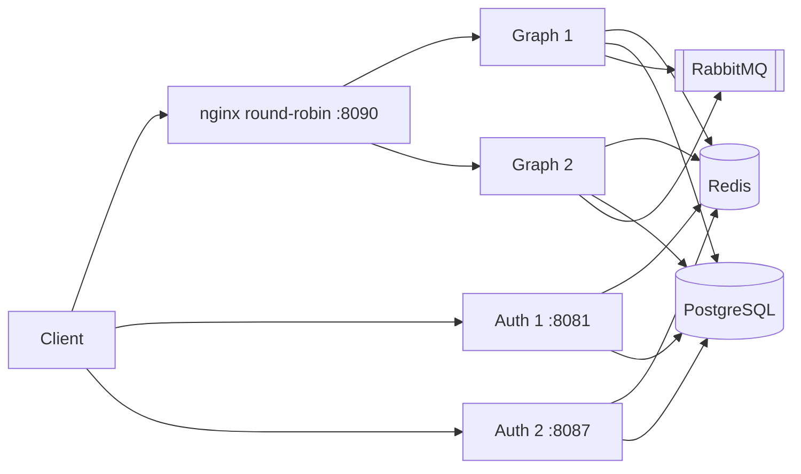
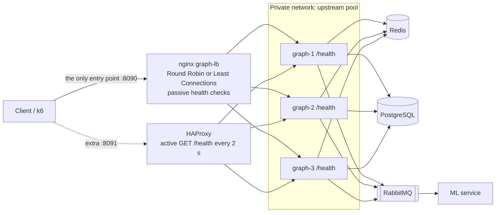
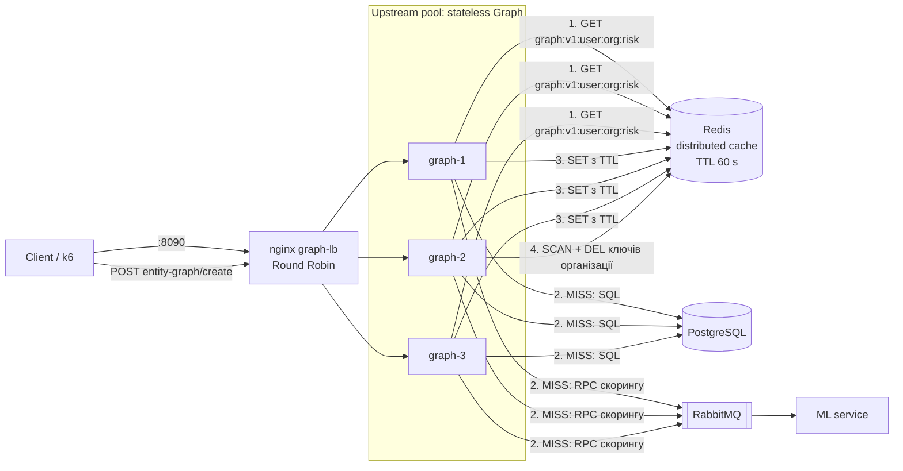
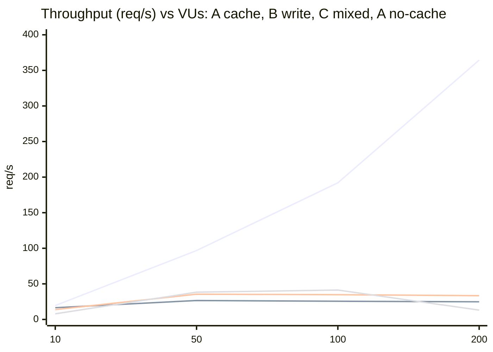
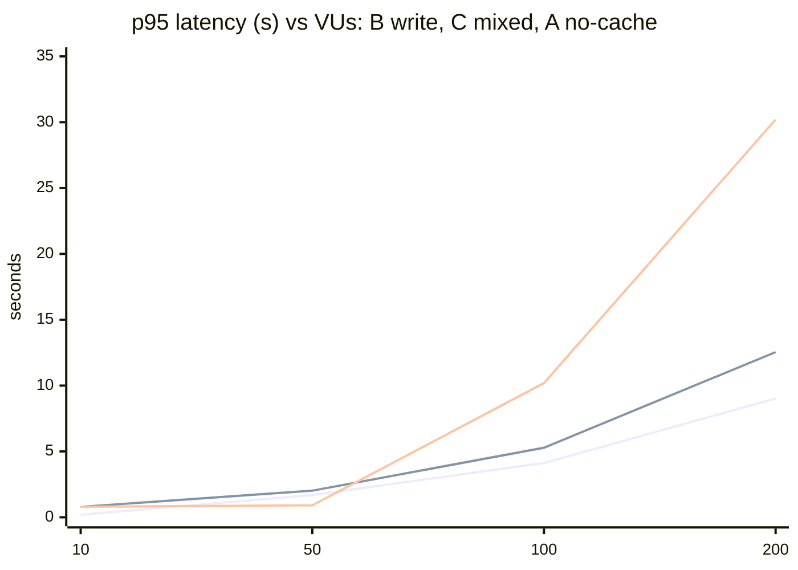

<!-- HERO BANNER — assets/branding/relativa_hero_banner_1920x480_radial.png -->
<p align="center">
  
</p>

<h1 align="center">Relativa</h1>

<p align="center">
  <strong>The CRM where you see every deal and every relationship on one graph — painted with real ML risk — for a fraction of the price of Salesforce.</strong>
</p>

<p align="center">
  <em>Turn relationships into revenue.</em>
</p>

<!-- =========================================================================
     TECH BADGES (Shields.io) — palette matched to brand blue (#2F5BEA)
     Backend: regenerate if versions change.
     ========================================================================= -->
<p align="center">
  
  
  
  
  
  
  
</p>

<p align="center">
  
  
  
</p>

---

## Table of Contents

- [What is Relativa?](#what-is-relativa)
- [Why Relativa? (What makes us different)](#why-relativa-what-makes-us-different)
- [Features](#features)
- [Screenshots & Demos](#screenshots--demos)
- [Tech Stack](#tech-stack)
- [Architecture](#architecture)
- [Quick Start](#quick-start)
- [Environment Configuration](#environment-configuration)
- [Database & Seed Data](#database--seed-data)
- [API Documentation](#api-documentation)
- [Service & Port Reference](#service--port-reference)
- [Documentation](#documentation)
- [Project Resources](#project-resources)
- [Roadmap](#roadmap)
- [Contributing](#contributing)
- [License](#license)

---

## What is Relativa?

**Relativa** is a self-hostable, multi-tenant **B2B CRM platform** for sales teams that need structured pipelines, granular access control, and predictive analytics — all in one place.

Instead of forcing managers to read through endless tables, Relativa renders the whole organization as an **interactive relationship graph**: clients, deals, contracts, contacts, and the people behind them, connected on a single canvas and color-coded by **machine-learning risk**. One glance shows you which deals are in trouble across the entire company.

Built for **small and mid-sized B2B companies** that manage a portfolio of clients across multiple teams, Relativa replaces hours of manual analysis with a visual, data-driven way of working.

> **Positioning:** _Salesforce-level features, Pipedrive-level price._

---

## Why Relativa? (What makes us different)

Every feature below is **already implemented in Relativa** but missing — or locked behind expensive enterprise tiers — in HubSpot, Pipedrive, and Salesforce.

| 🔵 Unique advantage | The real benefit |
|---|---|
| **Org-level relationship graph** | See *who is connected to whom* across the entire organization on one canvas — no clicking through records. Critical for complex B2B deals with many stakeholders. |
| **Combined ML closure + churn scoring** | Every deal gets a closure-probability **and** a churn-risk score from a real scikit-learn model — not rule-based guesswork. When a score can't be computed, Relativa tells you *exactly which data is missing*. |
| **Risk-colored graph nodes** | Deals on the graph light up by ML risk — red / amber / green. Spot problem deals across the whole org at a glance. A UX paradigm no competitor offers. |
| **Two-level RBAC (Organization → Workspace)** | One user, different roles in different workspaces. Perfect for companies with several sales teams that should each see only their own data. |
| **Flexible EAV data model** | Add new entity types, properties, and relationships by configuration — no schema migrations, no code. Adapt Relativa to any industry. |
| **Full transactional audit log** | Every state change is captured (with old / new values and author) via a transactional outbox → RabbitMQ → dedicated audit tables. GDPR-ready compliance out of the box. |
| **Self-hosted via Docker Compose** | The full stack comes up with a single `docker compose up`. Ideal for regulated industries and strict data-residency requirements where SaaS-only competitors simply can't go. |

💡 **Bottom line:** Relativa Growth-tier features cost **2–9× less** than competitor plans that offer a comparable RBAC + Audit + ML feature set.

---

## Features

### 🕸️ Relationship Graph
- Interactive, RBAC-filtered network of all users, workspaces, clients, deals, contracts, and their links.
- Click any node to **view, edit, or archive** the record directly from the canvas.
- Filter by **risk level, manager, workspace, or entity type**; a live counter shows visible vs. total nodes.
- Deal nodes are **colored by ML risk**, with a legend generated dynamically.

### 🤖 ML Risk Scoring
- Batch **closure-probability** and **churn-risk** scoring powered by scikit-learn models in a Python/Django microservice.
- Structured **"why is this score unavailable"** explanations so reps know what to fill in.
- Per-workspace, configurable risk thresholds.

### 🔐 Role-Based Access Control
- Separate, granular permissions at the **organization** and **workspace** levels.
- System roles (`org_owner`, `org_admin`, `org_member`, `ws_admin`, `ws_manager`, `ws_analyst`, `ws_member`) plus fully **custom roles**.
- Invitations, join-request flow, and member management.

### 🧩 Flexible Entities (EAV)
- Clients, deals, contracts, contacts, tasks, notes — all driven by a runtime-configurable schema.
- Custom properties, allowed-value validation, and typed relationships between entity types.

### 📒 Audit & Compliance
- Transactional **outbox pattern** guarantees every change is recorded in the same DB transaction.
- Four domain-specific audit logs (entity / workspace / organization / user) with a RBAC-filtered read API.

### 🏢 Multi-Tenant Workspaces
- Organizations contain isolated workspaces; data never leaks across team boundaries.

### ⚡ Real-Time Updates
- SignalR pushes live graph updates as data changes.

---

## Screenshots & Demos

A full product walkthrough — from first sign-up to a data-rich relationship graph, audit log, and settings.

### 🎬 Guided walkthrough

**1 · Onboarding**

<p align="center">
  
  <br><sub>Create an account</sub>
</p>
<p align="center">
  
  <br><sub>Sign in</sub>
</p>

**2 · Organization & members**

<p align="center">
  
  <br><sub>Create an organization and user</sub>
</p>
<p align="center">
  
  <br><sub>The graph with an added member</sub>
</p>
<p align="center">
  
  <br><sub>Invite a member</sub>
</p>

**3 · Workspaces**

<p align="center">
  
  <br><sub>Create a workspace</sub>
</p>
<p align="center">
  
  <br><sub>Add a member to the workspace</sub>
</p>

**4 · Entities (EAV)**

<p align="center">
  
  <br><sub>Create a client</sub>
</p>
<p align="center">
  
  <br><sub>Create a deal</sub>
</p>
<p align="center">
  
  <br><sub>Create a contact</sub>
</p>
<p align="center">
  
  <br><sub>Create a task</sub>
</p>

**5 · Graph, Audit & Settings**

<p align="center">
  
  <br><sub>The relationship graph filled with data</sub>
</p>
<p align="center">
  
  <br><sub>Audit log</sub>
</p>
<p align="center">
  
  <br><sub>Settings</sub>
</p>

<!-- =========================================================================
     🖼️ KEY SCREENS (desktop) — hidden until desktop screenshots are ready.
     Drop dashboard.png / entity-detail.png / audit-log.png into
     assets/screenshots/ and un-comment this block.
-->
<!--
### 🖼️ Key screens

| Dashboard | Entity detail + Scores | Audit log |
|:---:|:---:|:---:|
|  |  |  |
-->

### 📱 Mobile version

Relativa is fully responsive — here are the core screens on a phone.

| Login | Home | Home | Home |
|:---:|:---:|:---:|:---:|
|  |  |  |  |
| **Home** | **Organization** | **Members** | **Graph** |
|  |  |  |  |
| **Workspaces** | **Audit log** | **Settings** | |
|  |  |  | |

---

## Tech Stack

| Layer | Technology | Version |
|---|---|---|
| **Backend services** (Authentication, Core, Gateway, Graph, Audit, Migration) | .NET / ASP.NET Core | **10.0** |
| **API Gateway** | YARP reverse proxy | .NET 10 |
| **ML service** | Python · Django REST Framework · scikit-learn | Python **3.12** · Django **5.1** |
| **Frontend SPA** | Vue 3 + Vite | Node.js **22** |
| **Database** | PostgreSQL | **16** (Alpine) |
| **Message broker** | RabbitMQ | **3.13** (Management) |
| **Real-time** | SignalR | .NET 10 |
| **DB admin** | pgAdmin 4 | **8.x** |
| **Mail capture (dev)** | MailHog | latest |
| **Orchestration** | Docker Compose | Compose 2.x |

---

## Architecture

Relativa is a **microservice monorepo**. A YARP gateway is the single entry point; backend services communicate asynchronously over RabbitMQ, and all audit events flow through a transactional outbox.

```
                              ┌─────────────────┐
                              │   Vue 3 SPA      │  :3000
                              │   (Client)       │
                              └────────┬─────────┘
                                       │  HTTPS / JWT
                              ┌────────▼─────────┐
                              │  Gateway (YARP)  │  :8080
                              └───┬───┬───┬───┬──┘
              ┌───────────────────┘   │   │   └───────────────────┐
     ┌────────▼───────┐   ┌───────────▼┐ ┌▼───────────┐  ┌────────▼───────┐
     │ Authentication │   │    Core    │ │   Graph    │  │      ML        │
     │     :8081      │   │   :8082    │ │   :8083    │  │ (Django) :8084 │
     └────────┬───────┘   └─────┬──────┘ └─────┬──────┘  └────────┬───────┘
              │                 │              │ SignalR          │
              │           ┌─────▼──────────────▼──────┐           │
              │           │        RabbitMQ            │◀──────────┘
              │           │   (domain + audit events)  │
              │           └─────────────┬──────────────┘
              │                         │
        ┌─────▼─────┐            ┌───────▼────────┐
        │ Audit svc │            │   PostgreSQL   │  :5432
        │   :8086   │───────────▶│   (16-alpine)  │
        └───────────┘            └────────────────┘
```

**Key patterns**
- **EAV** core data model — runtime-configurable entity shapes (see [DATABASE.md](DATABASE.md)).
- **Two parallel RBAC hierarchies** — organization-scoped and workspace-scoped.
- **Soft deletes** everywhere (`is_archived`).
- **Transactional outbox** → RabbitMQ → four domain audit logs, with idempotency on both producer and consumer sides.

> 📚 Full design details live in [`AI-GUIDES-INDEX.md`](AI-GUIDES-INDEX.md) → `docs/ai-guides/ARCHITECTURE.md`.

---

## Quick Start

The entire stack runs in Docker — you **do not** need .NET, Python, Node, or PostgreSQL installed locally.

### Prerequisites

| Tool | Minimum version |
|---|---|
| **Docker Desktop** (Win/macOS) or **Docker Engine + Compose plugin** (Linux) | Docker 24.x · Compose 2.x |
| **Git** | 2.x |

> Recommended host resources: **8 GB+ free RAM**, **4 CPU cores**, **10 GB+ disk** (the stack runs 12 containers).
> On Windows, enable **"Use the WSL 2 based engine"** in Docker Desktop for noticeably faster startup.

### Run it

**PowerShell (Windows):**
```powershell
git clone <repository-url> relativa
cd relativa
Copy-Item .env.example .env
docker compose up --build -d
docker compose logs -f gateway
```

**Bash (Linux/macOS):**
```bash
git clone <repository-url> relativa
cd relativa
cp .env.example .env
docker compose up --build -d
docker compose logs -f gateway
```

Then open **http://localhost:3000** and register your first account. 🎉

| Command | What it does |
|---|---|
| `docker compose up -d` | Daily restart (no rebuild) |
| `docker compose down` | Stop everything (keeps data) |
| `docker compose down -v` | Stop **and wipe** the database |
| `docker compose logs -f <service>` | Tail one service's logs |

📖 Full setup walkthrough: [DOCKER-BUILD.md](DOCKER-BUILD.md) · [SETUP-GUIDE.md](SETUP-GUIDE.md)

---

## Environment Configuration

Configuration is driven by a single `.env` file at the repo root. Copy the template and adjust as needed:

```bash
cp .env.example .env
```

`.env` is personal and git-ignored; **`.env.example` is the committed template** with a comment on every value. Key variables:

| Variable | Purpose | Default |
|---|---|---|
| `DB_NAME` / `DB_USER` / `DB_PASS` | PostgreSQL credentials | `relativa` |
| `DB_PORT` | Postgres host port | `5432` |
| `PGADMIN_DEFAULT_EMAIL` / `_PASSWORD` | pgAdmin login | `admin@relativa.com` / `admin123` |
| `CLIENT_PORT` | Vue SPA host port | `3000` |
| `VITE_GATEWAY_URL` | Gateway URL the SPA calls | `http://localhost:8080` |
| `JWT_SECRET` | JWT signing key (HMAC-SHA256, ≥ 32 chars) | _change me_ |
| `JWT_ISSUER` / `JWT_AUDIENCE` | JWT claims (must match across auth & gateway) | `relativa-auth` / `relativa` |
| `CORS_ORIGIN_1` / `_2` | Allowed browser origins | `:5173` / `:3000` |
| `SMTP_HOST` | SMTP server (MailHog captures mail in dev) | `mailhog` |

> ⚠️ **Security:** `JWT_SECRET`, `JWT_ISSUER`, and `JWT_AUDIENCE` **must be identical** for the `auth` and `gateway` services — a mismatch returns `401` on every protected endpoint. Generate a unique `JWT_SECRET` per environment and never commit `.env`.

---

## Database & Seed Data

Migrations and demo data are applied **automatically** on the first `docker compose up`. A dedicated `migration` service waits for PostgreSQL to become healthy, runs all EF Core migrations, and exits — only then do the app services start.

After the first run the database is **not empty**; it comes pre-seeded with:

- **System roles** for organizations and workspaces (with priorities and permissions).
- **Permissions** catalog (org- and workspace-scoped).
- **Demo entities** — realistic clients, deals, contracts, and analysis rows — so you can explore the product immediately.

**Inspect the data** via pgAdmin at **http://localhost:5050** (log in with the `PGADMIN_*` values from `.env`, then register a server with host `postgres`).

**Reset to a clean state:**
```bash
docker compose down -v        # ⚠️ irreversibly deletes all Postgres data
docker compose up --build -d  # migrations + seed re-apply from scratch
```

📖 Full schema reference: [DATABASE.md](DATABASE.md)

---

## API Documentation

Every backend service ships interactive **Scalar** API docs and a raw OpenAPI spec:

| Service | Scalar UI | OpenAPI JSON |
|---|---|---|
| **Authentication** | http://localhost:8081/scalar/v1 | `:8081/openapi/v1.json` |
| **Core** | http://localhost:8082/scalar/v1 | `:8082/openapi/v1.json` |
| **Gateway** | http://localhost:8080/scalar/v1 | `:8080/openapi/v1.json` |

**Recommended flow:** open the Authentication Scalar → register → log in → copy the JWT → switch to the Core Scalar, click **Authorize**, paste the token, and exercise organization / workspace / RBAC endpoints.

📖 Step-by-step API guide: [SCALAR-GUIDE.md](SCALAR-GUIDE.md)

---

## Service & Port Reference

| Service | Port | Description |
|---|---|---|
| Client (Vue SPA) | `3000` | Main web app |
| Gateway (YARP) | `8080` | Single entry point / reverse proxy |
| Authentication | `8081` | Registration, login, JWT, profile |
| Core | `8082` | Organizations, workspaces, entities, RBAC |
| Graph | `8083` | Relationship graph data + SignalR |
| ML (Django) | `8084` | Closure & churn scoring |
| Audit | `8086` | Audit log consumer + read API |
| PostgreSQL | `5432` | Primary database |
| pgAdmin | `5050` | Database admin UI |
| RabbitMQ | `5672` / `15672` | AMQP / Management UI |
| MailHog | `1025` / `8025` | SMTP sink / web inbox (dev) |

> If a port is taken, change the matching variable in `.env` (e.g. `CLIENT_PORT`, `PGADMIN_PORT`, `DB_PORT`) and restart.

---

## Documentation

| Document | What it covers |
|---|---|
| [SETUP-GUIDE.md](SETUP-GUIDE.md) | Prerequisites, system requirements, database setup |
| [DOCKER-BUILD.md](DOCKER-BUILD.md) | Local Docker manual — start, stop, troubleshoot |
| [DATABASE.md](DATABASE.md) | Full schema, EAV model, RBAC, audit tables |
| [SCALAR-GUIDE.md](SCALAR-GUIDE.md) | Interactive API walkthrough |
| [docs/USER-GUIDE.md](docs/USER-GUIDE.md) | End-user scenarios for every feature |
| [AI-GUIDES-INDEX.md](AI-GUIDES-INDEX.md) | Deep technical guides (architecture, microservices, runbooks) |

---

## Project Resources

All project documentation and design mockups are available here:
- 📚 Project Resources (Project Documentation Links) – [Relativa — Project Resources](https://docs.google.com/document/d/1sQgllhQnAcj4JSiLMRa0BUW4Q3mr3orBaM-2HEgj2yE/edit?usp=sharing).

---

## Roadmap

Planned to close gaps with mainstream CRMs (currently on the roadmap):

- 🔴 **Data import/export**
- 🟡 **Custom dashboards**
- 🟢 **SSO / SAML**, **Webhooks**, **integration marketplace**
- 🟢 **Revenue forecasting** & **AI sales assistant**

---

## Contributing

Contributions are welcome! Please:

1. Fork the repo and create a feature branch.
2. Follow the maintenance obligations in [AI-GUIDES-INDEX.md](AI-GUIDES-INDEX.md) — update the relevant guide(s) when you change endpoints, services, schema, or UI.
3. Open a pull request against `main` with a clear description.

---

<p align="center">
  
</p>

<p align="center">
  <sub>Built with .NET 10, Vue 3, Django & a lot of graphs. · <em>Turn relationships into revenue.</em></sub>
</p>

---

## Розгортання в Kubernetes

Локальний кластер — minikube з драйвером Docker. У кластер потрапляють два компоненти: шлюз Gateway (образ з `Gateway/Dockerfile`, теги `1.0.0` і `1.1.0`) і PostgreSQL 16 з постійним томом. Решта мікросервісів CRM у цей кластер не входить. Усі об'єкти лежать у каталозі `k8s/`, по одному на файл, і створюються в namespace `relativa`.

Потрібні Docker, kubectl і minikube. Тег `latest` не використовується.

Зібрати обидві версії шлюзу і завантажити їх у minikube (кластер уже має бути запущений):

```powershell
docker build --build-arg APP_VERSION=1.0.0 -t relativa-gateway:1.0.0 -f Gateway/Dockerfile Gateway
docker build --build-arg APP_VERSION=1.1.0 -t relativa-gateway:1.1.0 -f Gateway/Dockerfile Gateway
minikube image load relativa-gateway:1.0.0
minikube image load relativa-gateway:1.1.0
```

Запустити кластер, увімкнути додатки і застосувати маніфести однією командою з каталогу:

```powershell
minikube start --driver=docker --cpus=2 --memory=4096
minikube addons enable metrics-server
minikube addons enable ingress
kubectl apply -f k8s/
```

Якщо Docker Desktop відмовляє 4096 МіБ (на цій машині доступно близько 3841 МіБ), кластер піднімається з `--memory=3072`.

Перевірка готовності:

```powershell
kubectl rollout status deploy/relativa-postgres -n relativa
kubectl rollout status deploy/relativa-gateway -n relativa
```

Відкрити шлюз з хоста:

```powershell
minikube service relativa-gateway -n relativa --url
```

До отриманої адреси додати шлях `/health`. Сервіс має тип NodePort (`30080`). Поруч описаний Ingress на хост `relativa.local`: додаток ingress увімкнений, а з Windows без підвищеного `minikube tunnel` надійний вхід — це NodePort.

Образ `postgres:16-alpine` kubelet завантажує сам. Образи шлюзу в registry не публікуються: їх забирає `minikube image load`, а в Deployment стоїть `imagePullPolicy: IfNotPresent`.

### ConfigMap `relativa-config`

| Ключ | Значення | Змінна оточення | Куди потрапляє |
|---|---|---|---|
| `APP_NAME` | `Relativa` | `Relativa__AppName` | контейнер `gateway`; відповідь `/health` у полі `appName` |
| `LOG_LEVEL` | `Information` | `Relativa__LogLevel` | контейнер `gateway` |
| `JWT_ISSUER` | `relativa-auth` | `Jwt__Issuer` | контейнер `gateway`; перевірка видавця JWT |
| `JWT_AUDIENCE` | `relativa` | `Jwt__Audience` | контейнер `gateway`; перевірка аудиторії JWT |
| `DB_NAME` | `relativa` | `POSTGRES_DB` | контейнер `postgres` |
| `DB_USER` | `relativa` | `POSTGRES_USER` | контейнер `postgres` |

### Secret `relativa-secret`

Значення синтетичні, це не паролі робочих систем. У відповідь `/health` вони не потрапляють. Усередині контейнера їх видно через `printenv`. Змінна оточення перекриває рядок із `appsettings.json`.

| Ключ | Змінна оточення | Куди потрапляє |
|---|---|---|
| `JWT_SECRET` | `Jwt__SecretKey` | контейнер `gateway`; ключ підпису JWT, не коротший за 32 символи |
| `POSTGRES_PASSWORD` | `POSTGRES_PASSWORD` | контейнер `postgres`; пароль користувача бази |

Ім'я пода шлюз отримує окремо, не з ConfigMap: downward API пише `metadata.name` у змінну `POD_NAME`. Версію образу задає `App__Version` під час `docker build`, у маніфесті цієї змінної немає, тож rolling update змінює саме образ.


---

## Stateless Architecture (Lab 2, High Load Systems)

Сервіси **Graph** і **Authentication** можна запускати у кількох екземплярах без sticky sessions: стан винесено з процесу в Redis (контейнер). Деталі й докази: `high-load-systems/defence/lab2.md`, `high-load-systems/evidence/lab2/`.

### Аудит стану

| Компонент | Що було в пам'яті | Клас | Рішення |
|---|---|---|---|
| Auth `MemoryEmailRateLimiter` | Лічильники rate limit | Shared | Redis (`RedisEmailRateLimiter`, Lua) |
| Graph `WorkspaceDashboardService` | `IMemoryCache`, cooldown ML-перерахунку | Shared | `IDistributedCache` (Redis) |
| Graph `GraphHub` (SignalR) | Групи й підключення | Shared | Redis backplane + клієнт без negotiate |
| Core `EntityTypeService` | `IMemoryCache`, довідник типів (10 хв) | Ephemeral | Без змін |
| Auth JWT, Gateway | — | Без стану | Без змін |
| PostgreSQL, RabbitMQ | Бізнес-дані, черги | Critical stateful | Без змін |

Прибрані in-memory залежності: `MemoryEmailRateLimiter` (лишився лише fallback без Redis), `IMemoryCache` у `WorkspaceDashboardService`, локальні групи SignalR, неявна affinity SignalR negotiate.

### Діаграма (Component)



### Запуск кількох екземплярів локально

```powershell
docker compose -f docker-compose.yaml -f docker-compose.lab2.yml up -d --build
```

nginx `:8090`, graph-1 `:8083`, graph-2 `:8085`, auth-1 `:8081`, auth-2 `:8087`. Кожна відповідь має заголовок `X-Instance-ID`.

```bash
# POST на екземпляр 1
TOKEN=$(curl -s -X POST http://localhost:8081/api/v1/auth/login -H "Content-Type: application/json" \
  -d '{"email":"admin@relativa.com","password":"Demo1234!"}' | jq -r .accessToken)
# GET і PATCH на екземпляр 2, потім GET на екземпляр 1
curl -si http://localhost:8087/api/v1/auth/me -H "Authorization: Bearer $TOKEN" | grep -i x-instance-id
# PATCH приймає поля firstName, lastName, phone, dateOfBirth: надсилайте всі чотири (поточні значення з GET, змінений lastName)
curl -si -X PATCH http://localhost:8087/api/v1/auth/me -H "Authorization: Bearer $TOKEN" \
  -H "Content-Type: application/json" \
  -d '{"firstName":"<current>","lastName":"Demo","phone":"<current>","dateOfBirth":"<current>"}'
curl -s http://localhost:8081/api/v1/auth/me -H "Authorization: Bearer $TOKEN"
# граф через балансувальник (бачимо graph-1 / graph-2 по черзі)
curl -si "http://localhost:8090/api/v1/graph?organizationId=1" -H "X-User-Id: 1" | grep -i x-instance-id
```

Автоматизовані сценарії (PowerShell): `high-load-systems/evidence/lab2/scripts/`.

---

## Horizontal Scaling and Load Balancing (Lab 3, High Load Systems)

Пул із **трьох екземплярів Graph** за єдиною точкою входу (nginx `graph-lb`, `:8090`). Екземпляри без стану (Lab 2), кожен повертає `X-Instance-ID`. Докази: `high-load-systems/evidence/lab3/`, план захисту: `high-load-systems/defence/lab3.md`, k6: `high-load-systems/evidence/lab3/k6/COMPARISON.md`.

### Архітектура



Порти graph-1/2/3 (`8083/8085/8086`) відкриті лише для налагодження стенду; клієнт працює тільки з `:8090` (у проді їх не публікують).

### Що додано

| Що | Де |
|---|---|
| `GET /health` (перевірка PostgreSQL через EF Core: 200 Healthy / 503 Unhealthy) | `Graph/src/Relativa.Graph/Program.cs` |
| `ARTIFICIAL_DELAY_MS` (штучна затримка на екземплярі для експерименту) | `Program.cs`, `docker-compose.lab3-slow.yml` |
| nginx: Round Robin і Least Connections (спільна зона, passive health check, retry) | `infra/nginx/graph-lb-lab3-rr.conf`, `infra/nginx/graph-lb-lab3-lc.conf` |
| graph-3 та перемикання алгоритму | `docker-compose.lab3.yml` |
| Додатково: HAProxy з active health check | `infra/haproxy/graph-lb.cfg`, `docker-compose.lab3-haproxy.yml` |

### Запуск і перемикання алгоритму

```powershell
docker compose -f docker-compose.yaml -f docker-compose.lab2.yml -f docker-compose.lab3.yml up -d --build
# live-перемикання Round Robin -> Least Connections
docker exec relativa-graph-lb sh -c "cp /etc/nginx/lab3/lc.conf /etc/nginx/conf.d/default.conf && nginx -s reload"
docker exec relativa-graph-lb sh -c "cp /etc/nginx/lab3/rr.conf /etc/nginx/conf.d/default.conf && nginx -s reload"
```

### Порівняння алгоритмів (один повільний вузол: graph-2, +500 мс; k6, 50 VU, 2 запуски на алгоритм)

| | Round Robin | Least Connections |
|---|---:|---:|
| Частка запитів на повільний вузол | 33.3% | 24.6% |
| Середній час відповіді (запуск 1 / 2) | 1020 / 967 мс | 956 / 927 мс |
| p99 (запуск 1 / 2) | 1547 / 1348 мс | 1472 / 1377 мс |

Least Connections стабільно зменшує частку повільного вузла і трохи знижує середній час, але p99 не покращується надійно (різниця менша за шум між запусками): хвіст визначає повільний вузол, поки він отримує хоч якийсь трафік.

### Відмова вузла

`docker kill` / `docker stop` одного екземпляра під навантаженням: 214 і 215 запитів, **0 відповідей не-200**, nginx повторює запит на живому вузлі, вузол повертається в пул сам (приблизно через 4 с після запуску). Зависання вузла (`docker pause`): nginx (passive) втратив 2 запити після 12 с, HAProxy (active `/health`) 0. Деталі: `high-load-systems/evidence/lab3/after/`.

### Scale-out (1, 2, 3 екземпляри, насичуюче навантаження, 1 CPU на екземпляр)

Пропускна здатність не зростає (≈23, 27, 15–25 req/s): наступні вузькі місця після масштабування Graph — ліміт підключень PostgreSQL (`too many clients already`, 1796 помилок) і спільний ML/RabbitMQ шлях; сам балансувальник не є обмеженням. Таблиці: `high-load-systems/evidence/lab3/k6/COMPARISON.md`.

---

## Distributed Caching (Lab 4, High Load Systems)

Розподілений кеш у Redis (контейнер `relativa-redis` з Lab 2, спільний для всіх екземплярів Graph) для найважчого читального запиту системи. Докази: `high-load-systems/evidence/lab4/`, план захисту: `high-load-systems/defence/lab4.md`, k6: `high-load-systems/evidence/lab4/k6/COMPARISON.md`.

### Обґрунтування вибору ендпоінта

Кешується `GET /api/v1/graph?organizationId=N` (Graph): найважчий читальний запит (7+ SQL-запитів до EAV-моделі, RPC до ML через RabbitMQ з бюджетом 200 мс на спробу, відповідь ≈ 68 КБ), його викликають часто, а змінюється граф рідко (створення сутностей). Допустима застарілість це секунди, тож кеш із TTL і явною інвалідацією підходить. Записи (Auth, `POST .../entity-graph/create`) не кешуються.

### Архітектура



### Схема ключів і TTL

| Елемент | Значення |
|---|---|
| Ключ | `relativa-graph:graph:v1:{userId}:{organizationId}:{riskLevel або all}` (`relativa-graph:` додає `IDistributedCache`, `v1` версія формату) |
| Чому `userId` у ключі | відповідь залежить від прав користувача; без нього був би витік даних між користувачами |
| Значення | JSON `GraphResponseDto` (≈ 67 КБ) |
| TTL | 60 с ±10% джиттера (`GraphCache:TtlSeconds`); джиттер проти Cache Avalanche |
| Інвалідація | після успішного `POST /api/v1/workspaces/{id}/entity-graph/create`: `SCAN relativa-graph:graph:v1:*:{orgId}:*` і `DEL` до відповіді клієнту; наступний GET це MISS зі свіжими даними. Зміни повз Graph (Core, Auth) діють після TTL |
| Метрики | заголовок `X-Cache: HIT / MISS / BYPASS` (BYPASS: Redis недоступний), лог `Graph cache invalidated ...` |
| Fallback | усі виклики Redis у `try/catch`, `FailFast` multiplexer з таймаутом 1 с: при падінні Redis запит іде в PostgreSQL, система працює (0 помилок), кеш повертається сам |

### Cold проти hot

Послідовні запити (вільна система, 8 пар): **cold (MISS) медіана 182 мс** (153..777), **hot (HIT) медіана 7 мс** (6..27), у ≈ 26 разів швидше. k6 (3 екземпляри, 30→50 VU, 2 запуски на сторону, запуск 2):

| | Без кешу | З кешем | Зміна |
|---|---:|---:|---:|
| Медіана | 810 мс | 4.5 мс | −99.4% |
| p95 | 906 мс | 19.1 мс | −97.9% |
| p99 | 987 мс | 39.1 мс | −96.0% |
| `X-Cache` | немає | HIT 9546 / MISS 84 (99.1%) | — |
| Повідомлень у черзі ML після запуску | 10 060 | 0 | — |

Застереження: сценарій має один ключ (найкращий випадок кешу), приріст пропускної здатності це властивість замкненого циклу, а не межа потужності, перші MISS після старту і після кожного закінчення TTL дають невеликий cache stampede (≈ 80 MISS за запуск). Повні таблиці й шум між запусками: `high-load-systems/evidence/lab4/k6/COMPARISON.md`.

### Запуск і демонстрація

```powershell
docker compose -f docker-compose.yaml -f docker-compose.lab2.yml -f docker-compose.lab3.yml up -d --build
powershell -File high-load-systems/evidence/lab4/scripts/cold-hot-demo.ps1 -SkipExpiry   # MISS -> HIT
powershell -File high-load-systems/evidence/lab4/scripts/invalidation-demo.ps1           # запис -> MISS зі свіжими даними
powershell -File high-load-systems/evidence/lab4/scripts/fallback-demo.ps1               # docker stop redis -> BYPASS, 0 помилок
```

---

## Load Performance Baseline (Lab 5, High Load Systems)

Базова лінія продуктивності системи після Lab 2-4: 3 екземпляри Graph за nginx Round Robin, Redis Cache-Aside, PostgreSQL, RabbitMQ, ML, Core. **Код застосунку не змінювався**, це вимірювання. Скрипти навантаження: [`load-tests/`](load-tests/README.md) (`load-tests/lab5/`), докази і повні таблиці: `high-load-systems/evidence/lab5/` (`k6/COMPARISON.md`), план захисту: `high-load-systems/defence/lab5.md`.

### Тестове середовище

| Компонент | Значення |
|---|---|
| Хост | Intel i5-8300H (4 ядра / 8 логічних), 7.9 ГБ RAM, Windows 10, Docker Desktop (WSL2) |
| VM Docker | 8 CPU, ~4 ГБ RAM для всіх контейнерів, **без лімітів на контейнер** |
| Graph | 3 екземпляри (.NET 10), кеш Redis TTL 60 с, пул Npgsql за замовчуванням (100 на екземпляр) |
| Балансувальник | nginx 1.27.5, Round Robin, `zone` в upstream |
| База даних | PostgreSQL 16, `max_connections=100`, `shared_buffers=128MB`, `work_mem=4MB` |
| Брокер, ML, Core | RabbitMQ 3.13.7; ML з одним споживачем; Core x1 (потрібен для запису) |
| Генератор навантаження | k6 v2.3.0 **у контейнері** в мережі compose (`http://relativa-graph-lb`), на тій самій VM |

Повний знімок: `high-load-systems/evidence/lab5/environment.txt`.

### Сценарії і методика

| Сценарій | Запит |
|---|---|
| **A Read-Intensive** | `GET /api/v1/graph?organizationId=1` (68 КБ), один кеш-ключ |
| **B Write-Intensive** | `POST /api/v1/workspaces/1/entity-graph/create` (реальний запис: Graph -> RabbitMQ RPC -> Core -> PostgreSQL) |
| **C Complex Workflow** | `GET graph` -> пауза 0.3 с -> `POST create` -> пауза 0.3 с (запис інвалідує кеш) |

Closed model (`ramping-vus`), think time 0.5 с, **warm-up** 5 VUs 15 с (результати відкидаються), ramp-up 15 с + **60 с вимірювання** на кожен рівень 10 / 50 / 100 / 200 VUs (окремий запуск на рівень), без thresholds. Перед кожним запуском скрипт видаляє тестові дані, очищає черги RabbitMQ, чекає простою сервісів і скидає кеш (запис залишає наслідки, які псують наступні запуски). Throughput = кількість запитів у вимірюванні / 60 с.

### Результати (окремі запуски на рівень)

| VUs | A (кеш): req/s / p50 / p95 / p99 / помилки | B (запис) | C (суміш) |
|---:|---|---|---|
| 10 | 19.5 / 4.5 / 16.8 / 41.5 мс / 0% | 16.5 / 89 / 191 / 276 мс / 0% | 13.8 / 264 / 792 / 824 мс / 0% |
| 50 | 96.8 / 6.2 / 19.4 / 36.0 мс / 0% | 26.6 / 1404 / 1687 / 1797 мс / 0% | 35.5 / 1120 / 2016 / 2478 мс / 0% |
| 100 | 192.0 / 6.1 / 24.5 / 152.5 мс / 0% | 25.6 / 3559 / 4117 / 4232 мс / 0% | 34.8 / 3753 / 5281 / 5491 мс / 0% |
| 200 | 364.4 / 8.1 / 51.4 / 692.8 мс / 0.08% | 24.8 / 8666 / 9022 / 9127 мс / 0% | 33.4 / 8306 / 12 536 / 12 895 мс / 0% |

Для A на 200 VUs другий запуск дав 306 req/s, p99 8.5 с, 0.24% помилок: біля коліна розкид між запусками до 16%, на плато (B: 25.6 і 25.7 req/s) менше 1%. Додатково для A: на 300 VUs два запуски розійшлися втричі (173 req/s і p95 2.7 с проти 548 req/s і p95 65 мс; причина колапсу невідома, не відтворився), 500 VUs зависили Docker Desktop (запуск відкинуто).

### Графіки

Пропускна здатність (req/s) за кількістю VUs: A з кешем, B, C, A без кешу (довідково):



p95 затримка (секунди) за кількістю VUs: B, C, A без кешу (A з кешем лишається нижче 0.06 с):



Для B і C плато пропускної здатності з 50 VUs і лінійне зростання затримки це сигнатура **Saturation Point**.

### Вплив масштабування і кешування

| Експеримент | Результат |
|---|---|
| 1 проти 3 екземплярів, A, 100 VUs | 189.6 / 193.0 проти 191.8 / 192.4 req/s: **різниці немає** (1 екземпляр не насичений) |
| 1 проти 3 екземплярів, A, 300 VUs | 499 проти 548 req/s (+10%), p99 2735 проти 578 мс, CPU Graph 200% проти 84% на екземпляр; ефективність 37% |
| 1 проти 3 екземплярів, A, 200 VUs | 368 / 338 проти 371 / 370 req/s; p99 164 / 2127 проти 170 / 207 мс: виграш у стабільності хвоста, не в пропускній здатності; CPU Graph 173% проти 63% на екземпляр |
| Кеш вимкнено проти увімкнено, A, 50 VUs | 38 проти 97 req/s, p50 812 проти 6.2 мс, p95 892 проти 19 мс, **-95% транзакцій PostgreSQL** (49 527 проти 2 387) |
| Без кешу, A, 100 / 200 VUs | p99 24 с і 1% помилок / 90% помилок: насичення на ~50 VUs |

### SYSTEM PERFORMANCE BASELINE

```
=== SYSTEM PERFORMANCE BASELINE ===
Environment Config: 1 VM Docker Desktop (8 логічних CPU, ~4 ГБ RAM, без лімітів); 3 x Graph (кеш Redis TTL 60 с)
                    за nginx RR; PostgreSQL 16 (max_connections=100); RabbitMQ 3.13; ML (1 споживач); Core x1;
                    k6 v2.3.0 в контейнері на тій самій VM, closed model, think 0.5 с
Stable Throughput:  читання (кеш) ~190 req/s на 100 VUs (p95 25-35 мс); запис ~25 req/s; суміш ~30-35 req/s;
                    читання без кешу ~38 req/s
Saturation Point:   запис і суміш ≈25 VUs (staged-прогін; окремі запуски: між 10 і 50); читання без кешу ~50 VUs; читання з кешем не досягнута (до 300 VUs 548 req/s, хвіст
                    нестабільний від 200 VUs; 500 VUs зависили Docker)
p95 / p99 Latency:  A (кеш) 100 VUs 24.5 / 153 мс; B 100 VUs 4117 / 4232 мс; C 100 VUs 5281 / 5491 мс
Error Rate:         A 0% до 100 VUs, 0.08-0.24% на 200 VUs; B і C 0% (черга, не відмови); A без кешу 1% на 100, 90% на 200
Critical Scenario:  запис (B) і комплексний сценарій (C)
Primary Bottleneck: запис: RPC Graph -> Core через RabbitMQ (нове з'єднання, канал і черга на кожен запит, CPU RabbitMQ
                    росте з навантаженням); читання без кешу: ML + RabbitMQ; читання з кешем: спільний CPU
                    і ліміт з'єднань PostgreSQL під час stampede
```

Застереження: closed model дає оптимістичні p95/p99 при насиченні (Coordinated Omission); сценарій A використовує один ключ кешу (найкращий випадок); вузьке місце запису не ізольоване експериментально (є кореляція CPU RabbitMQ і проба churn, немає експерименту "прибрати і перевимірити"); k6 і система на одній VM. Відкинуті та недійсні запуски збережені й описані в `COMPARISON.md` (розділ 9).

### Запуск

```powershell
# стек і Core (для запису)
docker compose -f docker-compose.yaml -f docker-compose.lab2.yml -f docker-compose.lab3.yml up -d --no-build
docker compose -f docker-compose.yaml -f docker-compose.lab2.yml -f docker-compose.lab3.yml up -d --no-build core

# один рівень: чистий стан + warm-up + k6 у контейнері (A|B|C, кількість VUs, тека результату, номер запуску)
powershell -File high-load-systems/evidence/lab5/scripts/run-k6.ps1 -Scenario B -Vus 50 -OutDir scenario-b/vus-50 -Run 1

# вся сітка, staged-прогін (10 -> 25 -> 50 -> 100 -> 200 VUs), таблиця з summary-файлів
powershell -File high-load-systems/evidence/lab5/scripts/run-matrix.ps1 -Part main -Scenarios A,B,C -Levels 10,50,100,200 -Run 1
powershell -File high-load-systems/evidence/lab5/scripts/run-staged.ps1 -Scenario C
& high-load-systems/evidence/lab5/k6/build-baseline-table.ps1 -Dir high-load-systems/evidence/lab5/k6/scenario-b -Run 1
```
