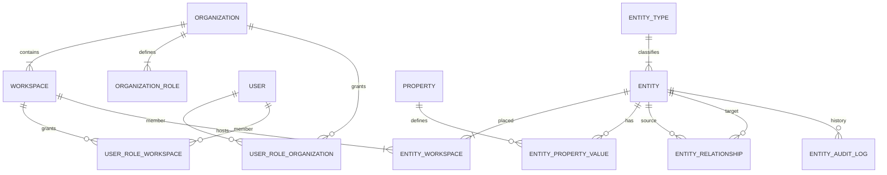

# Документ проєктування (SDD)

Relativa — мультиорендна CRM для B2B-команд продажів. Оператор бачить угоди, клієнтів і зв'язки на одному графі, а оцінки закриття та відтоку рахує окремий ML-сервіс. Цей документ описує контейнери, відповідальність і контракти між ними. Порядок запуску, змінні оточення і відновлення — у [isd.md](isd.md). Чому обрані база і шина — у [ADR 0001](adr/ADR-0001-shared-postgresql.md) і [ADR 0002](adr/ADR-0002-asynchronous-messaging.md).

Дата паспорта: 2026-11-22. Глибший розбір шарів .NET лишається в [docs/ai-guides/ARCHITECTURE.md](../ai-guides/ARCHITECTURE.md). Схема таблиць — у [DATABASE.md](https://github.com/BabayVolohatyu/Relativa/blob/testing/lab11/DATABASE.md).

## C4, рівень контейнерів

Браузер не ходить у бази і не викликає сервіси напряму. Єдиний HTTP-вхід — Gateway.

```mermaid
flowchart LR
  operator["Оператор продажів"]
  client["Client<br/>Vue 3, порт 3000"]
  gateway["Gateway<br/>YARP, порт 8080"]
  auth["Authentication<br/>.NET, порт 8081"]
  core["Core<br/>.NET, порт 8082"]
  graph["Graph<br/>.NET, порт 8083"]
  ml["ML<br/>Django, порт 8084"]
  audit["Audit<br/>.NET, порт 8086"]
  migration["Migration<br/>EF Core, разовий запуск"]
  pg[("PostgreSQL 16")]
  mq["RabbitMQ 3.13"]

  operator --> client --> gateway
  gateway -->|HTTP /auth| auth
  gateway -->|HTTP /core| core
  gateway -->|HTTP /graph| graph
  gateway -->|HTTP /ml| ml
  gateway -->|HTTP /audit| audit
  migration --> pg
  auth --> pg
  core --> pg
  graph --> pg
  ml --> pg
  audit --> pg
  auth -->|outbox| mq
  core -->|outbox| mq
  mq -->|audit.events| audit
  mq -->|relativa.domain| graph
  mq -->|relativa.domain| ml
  graph -->|RPC relativa.graph_ml| ml
  gateway -->|локальний маршрут| digest["Operator digest<br/>GET /api/v1/operator/digest"]
```

Синхронного HTTP між бекендами немає. Виняток за формою, не за транспортом: Graph просить оцінку в ML через чергу `relativa.graph_ml`, це RPC поверх AMQP, не HTTP.

## Компоненти

Кожен рядок посилається на сусідів, з якими компонент говорить, і на розділ розгортання в ISD.

| Компонент | Відповідальність | З ким говорить | Розгортання |
|---|---|---|---|
| [Client](#client) | Екрани реєстрації, організацій, робочих просторів, графа | Gateway | [ISD, Client](isd.md#client) |
| [Gateway](#gateway) | JWT, CORS, префікси маршрутів, заголовки особи | Client, Auth, Core, Graph, ML, Audit | [ISD, Gateway](isd.md#gateway) |
| [Operator digest](#operator-digest) | Анонімний зріз для оператора, який шлюз віддає сам | Gateway | [ISD, Gateway](isd.md#gateway) |
| [Authentication](#authentication) | Обліковий запис, пароль, JWT | Gateway, PostgreSQL, RabbitMQ | [ISD, Authentication](isd.md#authentication) |
| [Core](#core) | Організації, робочі простори, RBAC, сутності EAV | Gateway, PostgreSQL, RabbitMQ | [ISD, Core](isd.md#core) |
| [Graph](#graph) | Граф зв'язків, дашборд, SignalR, споживач подій | Gateway, PostgreSQL, RabbitMQ, ML | [ISD, Graph](isd.md#graph) |
| [ML](#ml) | Оцінки закриття та відтоку | Gateway, RabbitMQ, PostgreSQL | [ISD, ML](isd.md#ml) |
| [Audit](#audit) | Запис і читання журналу змін | Gateway, RabbitMQ, PostgreSQL | [ISD, Audit](isd.md#audit) |
| [Migration](#migration) | Застосування міграцій EF і стартових даних | PostgreSQL | [ISD, Migration](isd.md#migration) |
| [PostgreSQL](#postgresql) | Єдине сховище рядків | Усі .NET-сервіси, ML, Migration | [ISD, дані](isd.md#дані) |
| [RabbitMQ](#rabbitmq) | Доставка подій і RPC оцінок | Auth, Core, Graph, ML, Audit | [ISD, дані](isd.md#дані) |

Каталог `Graph/src/Relativa.Graph/DesignAudit/` і тип `DealCommercialOption` — фікстури лабораторних вимірів складності. У продуктовий шлях запиту вони не входять і на діаграмі їх немає.

### Client

Vue 3, Vite, Pinia, Vue Router. Усі виклики API йдуть на `VITE_GATEWAY_URL` (локально порт 8080). Стан сесії тримає браузер. Сервер сесій немає.

### Gateway

YARP знімає префікс `/auth`, `/core`, `/graph`, `/ml`, `/audit` і проксує на порти 8081, 8082, 8083, 8084, 8086. Після перевірки JWT у запит до сервісу додаються `X-User-Id` і `X-User-Email`. Маршрути реєстрації та логіну анонімні. Власні маршрути шлюзу, не проксі: `GET /health` повертає JSON `status` = `ok`, `service` = `relativa-gateway`; [operator digest](#operator-digest) описаний нижче.

### Operator digest

Окремий тип у процесі Gateway: `OperatorDigestEndpoints` у `Gateway/src/Relativa.Gateway/OperatorDigestEndpoints.cs`. Це не окремий контейнер і не виклик Core. `GET /api/v1/operator/digest` анонімний. Тіло: `kind` = `operator-digest`, `audience` = `sales-operator`, `includes` = `openDeals`, `highRiskDeals`, `pendingInvitations`. Числа угод цей маршрут не рахує: він називає поля зрізу, який оператор очікує побачити в продукті.

### Authentication

Видає JWT (HMAC). Пароль зберігається як bcrypt. Ролей у токені немає: Core і Graph читають членство з бази на кожен запит. Пише події в `audit_outbox` у тій самій транзакції, що й зміну користувача. Таблиця користувачів — єдина, яку цей сервіс змінює.

### Core

Власник організацій, запрошень, ролей, робочих просторів і записів EAV. Публікує outbox у два обміни: `audit.events` і `relativa.domain`. Не викликає Graph і ML по HTTP.

### Graph

`GET /api/v1/graph` збирає граф, видимий користувачу в організації. `GET /api/v1/dashboard/summary`, `/pipeline`, `/risk-distribution`, `/trends`, `/top-entities`, `/member-activity` і організаційні зрізи дашборда читають ті самі таблиці. Хаб SignalR: `/hubs/graph`. Споживач `relativa.domain` оновлює живі клієнти. Оцінку угоди просить в ML через `relativa.graph_ml`.

Graph стартує після PostgreSQL, RabbitMQ, успішного завершення Migration і старту контейнера ML (`condition: service_started`). Оцінка через `relativa.graph_ml` йде вже після цього порядку: процес Graph не піднімається, доки контейнер ML не стартував.

### ML

Django. HTTP: `GET /api/ml/health/`, `POST /api/ml/recalculate/`, `POST /api/ml/score/batch`. Окремо процес читає RPC `relativa.graph_ml` і події `relativa.domain`. Моделі scikit-learn рахують імовірність закриття угоди і ризик відтоку. Відповідь, яку Graph не зміг отримати, лишається поясненням «оцінки немає», а не вигаданим числом.

### Audit

Єдиний писар таблиць `*_audit_log`. Черга `audit.events.audit`, ключ `audit.#`, обмін `audit.events`. Повторна доставка гаситься записом у `audit_processed_event`. Читання: `GET /audit-log` і `GET /entities/{entityId}/audit-log` за JWT.

### Migration

Консольний процес. Після здорового PostgreSQL викликає `MigrateAsync` і завершується з кодом 0. Схема належить цій збірці (`Relativa.Migration`), не проєкту Core. Auth, Core, Graph, ML і Audit у Compose чекають `service_completed_successfully`, інакше піднімуться на порожній базі.

### PostgreSQL

Одна база на всі сервіси. Зрізи DbContext різні: Auth бачить користувача, Core і Migration — повну модель, Graph має окремий контекст ідемпотентності і окремий контекст читання графа. Це зафіксовано в [ADR 0001](adr/ADR-0001-shared-postgresql.md).

### RabbitMQ

Повідомлення не є другим джерелом істини. Істина — рядок у PostgreSQL, включно з рядком outbox. Брокер доставляє копію. Обміни та наслідки вибору — в [ADR 0002](adr/ADR-0002-asynchronous-messaging.md). Операційні команди черг — у [runbook](../runbooks/RABBITMQ-CHOREOGRAPHY.md).

## Модель даних

Фрагмент, не повний перелік колонок. Повний перелік таблиць — у [DATABASE.md](https://github.com/BabayVolohatyu/Relativa/blob/testing/lab11/DATABASE.md) і в `Persistence/src/Relativa.Persistence/Entities/`.

Організація — межа орендаря. Робочий простір належить одній організації. Користувач не має глобальної ролі: роль задає рядок членства в організації або в просторі. Бізнес-записи (клієнт, угода, контакт, контракт) — це рядки `entity` з типом `entity_type`. Значення полів лежать у `entity_property_value` (один із п'яти типізованих стовпців заповнений). Зв'язок «угода → клієнт» — рядок `entity_relationship`, не зовнішній ключ у таблиці угод.



Запис зміни не пишеться окремим з'єднанням після коміту. Той самий коміт бази кладе payload в `audit_outbox`. Диспетчер публікує його в RabbitMQ і позначає рядок опублікованим.

## Контракти між компонентами

| Звідки | Куди | Контракт | Що вважається збоєм |
|---|---|---|---|
| Gateway | Client | HTTP на шлюзі, без проксі: `GET /health`; `GET /api/v1/operator/digest` з тілом `kind` = `operator-digest` | Будь-який інший шлях `/api/v1/operator/*` не існує |
| Client | Gateway | HTTP на `VITE_GATEWAY_URL`. Захищені шляхи несуть `Authorization: Bearer`. Анонімний зріз оператора — рядок вище | 401, якщо секрет або issuer JWT на шлюзі і в Authentication розійшлися |
| Gateway | Authentication | Префікс `/auth` знято. Анонімно: `POST /api/v1/auth/login`, `POST /api/v1/auth/register` | 401 на `/api/v1/auth/me` без токена |
| Gateway | Core | Префікс `/core` знято. Анонімно: `GET /health`, `GET /api/v1/entity-types` | 403, якщо членство не дає права |
| Gateway | Graph | Префікс `/graph` знято. `GET /api/v1/graph?organizationId=`, `GET /api/v1/dashboard/*`, WebSocket `/hubs/graph` | Порожній граф, якщо користувача немає в організації. Це не 500 |
| Gateway | ML | Префікс `/ml` знято. `GET /api/ml/health/`, `POST /api/ml/recalculate/`, `POST /api/ml/score/batch` | 401 без JWT на шлюзі |
| Gateway | Audit | Префікс `/audit` знято. `GET /audit-log` | 401 без політики читача журналу |
| Authentication, Core | RabbitMQ | Рядок `audit_outbox` у тій самій транзакції, що й зміна. Обміни `audit.events` і `relativa.domain` | Подія лишається в outbox, доки диспетчер не опублікує |
| RabbitMQ | Audit | Черга `audit.events.audit`, ключ `audit.#` | Повтор не створює другий рядок журналу |
| RabbitMQ | Graph, ML | Обмін `relativa.domain` | Споживач ідемпотентний за ідентифікатором повідомлення |
| Graph | ML | RPC `relativa.graph_ml` | Немає відповіді — оцінка лишається порожньою, угода не падає |
| Усі писарі | PostgreSQL | Одна база, Npgsql / Django | Сервіс не стартує корисну роботу, доки Migration не завершився |

Повний перелік полів HTTP лежить у Scalar на портах 8080, 8081 і 8082 (`/scalar/v1`). Цей паспорт фіксує межі, а не кожне поле тіла.

## Покриття аудиторій

Питання новачка, розробника, QA, DevOps і бізнесу зібрані в [audience-matrix.md](../audience-matrix.md). Прогалин після паспорта немає: запуск і призначення закриває [README](https://github.com/BabayVolohatyu/Relativa/blob/testing/lab11/README.md), контракти — цей файл, розгортання і RTO/RPO — [isd.md](isd.md).
