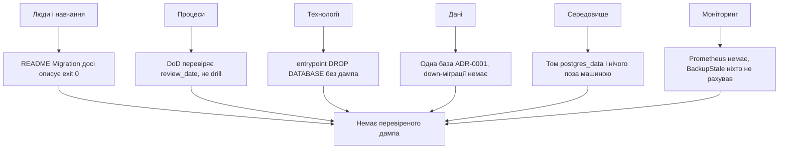

# Post-mortem INC-2026-11-22

Без звинувачень. Розбирається процес, який дозволив опублікувати RPO без дампа і лишити `DROP DATABASE` без перевірки. Імена людей у ланцюжку причин не стоять.

Інцидент: [INC-2026-11-22](incident-2026-11-22.md). Компонент: [Migration](legacy-migration.md).

## П'ять чому

1. Чому відновлення не відбулося? `pg_restore` не відкрив `/tmp/no-such-dump.dump`. Доказ: рядок логу `2026-11-22T21:12:03Z`.
2. Чому файлу не було? У Compose є лише том `postgres_data`. Завдання, яке пише `backups/`, у репозиторії на той коміт не було. Доказ: `Test-Path backups/relativa.dump` істинний для відсутності файлу; `docker-compose.yaml` монтує один том.
3. Чому ціль RPO 24 години жила без цього завдання? ISD у тому ж абзаці називає ціль і пише, що дампа немає. Збірка документації перевіряє посилання і `review_date`, не наявність файлу дампа. Доказ: таблиця RTO/RPO в `docs/architecture/isd.md` до коміту PASS і `lab11/check_review_dates.py`.
4. Чому такий текст пройшов як достатній? Регламент перегляду ЛР10 вимагає власника і дату, а не прогін restore. Доказ: `docs/maintenance.md`, цикл 90/180 днів, без кроку drill.
5. Чому процес це дозволив? До RFC-001 зміна «написати RPO» не вимагала зеленого drill, а `entrypoint.sh` міг виконати `DROP DATABASE` за одним прапором. Доказ: гілка truncate в `Migration/entrypoint.sh` на коміті FAIL, без змінної `RELATIVA_TRUNCATE_I_HAVE_A_DUMP`.

Корінь: процес дозволяв назвати ціль відновлення і знищити єдину базу, не вимагаючи жодного успішного розгортання дампа.

## Ісікава

Кожна гілка спирається на файл: README Migration, `docs/maintenance.md`, `entrypoint.sh`, ADR-0001, `docker-compose.yaml`, розділ моніторингу ISD.
