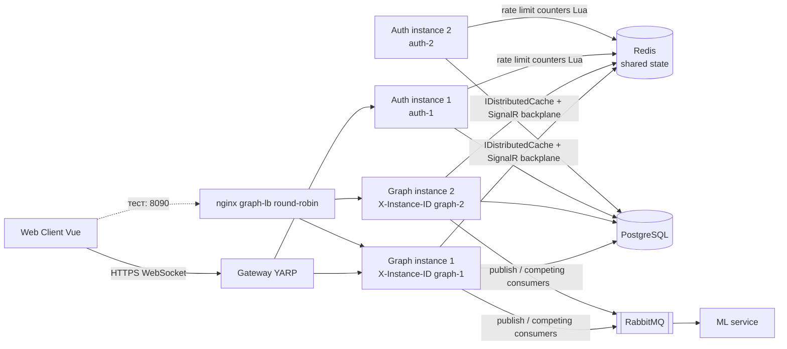

# Захист лабораторної роботи №2 (High Load Systems)

Тема: Stateless Architecture — винесення стану з процесу, горизонтальне масштабування без sticky sessions.

Проєкт: Relativa. Гілка `high-load-systems/lab2`. Опис завдання: `high-load-systems/description/Lab2 - Stateless Architecture.md`. Докази: `high-load-systems/evidence/lab2/`. Персональне пояснення «простими словами»: `evidence/lab2/FOR-ME-stateless-explained.md`.

## 1. Мета і вибір сервісів

Мета: щоб будь-який екземпляр сервісу міг обробити будь-який запит, а втрата екземпляра не губила дані й не ламала поведінку.

Сервіси обрані за очікуваним навантаженням:

- **Graph** — найважчий: збирає граф (сотні вузлів і ребер, 183 вузли / 291 ребро в сіді), дашборди, SignalR-хаб, споживачі RabbitMQ, RPC у ML. Масштабується першим.
- **Authentication** — кожен запит клієнта потребує JWT, є rate limiter; потрібен, щоб показати ланцюжок POST→1, GET→2, PUT→2, GET→1 (Graph лише читає, пише Auth).
- Gateway, Core, ML, Audit — аудит проведено, але не масштабувалися (див. таблицю). Gateway вже без стану.

## 2. Аудит стану (State Audit)

Класифікація: **Ephemeral** (втратили — відновимо, на коректність не впливає), **Shared** (має бути спільним для всіх екземплярів, інакше помилка), **Critical stateful** (втрата = втрата бізнес-даних).

| Де | Що зберігається | Клас до роботи | Проблема при ≥2 екземплярах | Що зроблено |
|---|---|---|---|---|
| Auth, `MemoryEmailRateLimiter` (`ConcurrentDictionary`) | Лічильники rate limit по IP / e-mail | **Shared** (було в пам'яті) | Ліміт 5/год/IP множиться на кількість екземплярів: прийнято 10 | Лічильник у Redis, атомарний Lua-скрипт (`RedisEmailRateLimiter`) |
| Graph, `WorkspaceDashboardService` (`IMemoryCache`) | Cooldown 5 хв «ML-перерахунок уже в черзі» | **Shared** | Одна задача ставиться в чергу двічі | `IDistributedCache` (Redis) |
| Graph, SignalR `GraphHub` | Підключення і групи `workspace-{id}` | **Shared** | Клієнт на екземплярі 1 отримує лише частину подій, опублікованих на екземплярі 2 (10 з 20) | Redis backplane (`AddStackExchangeRedis`) |
| Graph, SignalR negotiate | Стан підключення після HTTP `negotiate` | **Прихована affinity** | Upgrade на WebSocket потрапляє на інший екземпляр → 404 (8 з 10 підключень невдалі) | У клієнті `skipNegotiation: true` + WebSockets |
| Auth, JWT | Особистість користувача | Вже без стану | Ключ підпису спільний, сесій на сервері немає | Без змін; перевірено токеном з екз. 1 на екз. 2 |
| Auth, DataProtection keys | Ключі для cookies/антифоргері | **Ephemeral** (генеруються при старті) | Не використовуються для критичних шляхів | Без змін, у ризиках |
| Core, `EntityTypeService` (`IMemoryCache`) | Кеш довідника типів сутностей, 10 хв | **Ephemeral** | Лише тимчасова розбіжність до 10 хв, не помилка | Без змін (Core не масштабувався) |
| Gateway (YARP) | Лише конфігурація маршрутів | Без стану | — | Без змін |
| PostgreSQL | Усі бізнес-дані | **Critical stateful** | — | Єдине джерело правди, окремий контейнер з volume |
| RabbitMQ | Черги подій | **Critical stateful** (інфраструктура) | Споживачі — competing consumers на спільній черзі | Без змін |
| Redis (новий) | Rate limit, cooldown, backplane | **Shared** | — | Контейнер `redis:7-alpine`, без персистентності: усе, що там лежить, відновлюване за TTL |

### Список прибраних in-memory залежностей

1. `MemoryEmailRateLimiter` у Auth (лишився лише як локальний fallback, коли `Redis:ConnectionString` порожній).
2. `IMemoryCache` у `WorkspaceDashboardService` (Graph) → `IDistributedCache`.
3. Локальні групи SignalR у Graph → Redis backplane.
4. Неявна affinity SignalR (negotiate) у клієнті Vue.

### Stateless ≠ «немає даних»

Дані є: PostgreSQL, Redis, RabbitMQ. Stateless означає, що **процес сервісу не є власником стану між запитами**. Стан винесено у спільну інфраструктуру, а процес можна вбити й запустити заново без наслідків. Це відрізняється від системи без даних.

## 3. Що змінено в коді і навіщо

| Файл | Зміна |
|---|---|
| `Graph/src/Relativa.Graph/Program.cs` | Redis cache + SignalR backplane (якщо задано `Redis:ConnectionString`), fallback на `AddDistributedMemoryCache()` для локального запуску без Redis; middleware `X-Instance-ID` |
| `Graph/.../Dashboard/WorkspaceDashboardService.cs` | `IMemoryCache` → `IDistributedCache`, асинхронна логіка cooldown; великі методи розбиті на малі (цикломатична складність ≤ 10, див. 3.1) |
| `Authentication/.../Services/RedisEmailRateLimiter.cs` (новий) | Атомарний fixed-window лічильник через Lua (`INCR` + `PEXPIRE`), fail-closed |
| `Authentication/src/Relativa.Authentication/Program.cs` | Вибір Redis/Memory limiter; `X-Instance-ID` |
| `Client/src/api/graphHub.ts` | `skipNegotiation: true`, лише WebSockets |
| `docker-compose.lab2.yml` (новий) | Override до `docker-compose.yaml`: redis, graph-2, auth-2, nginx `graph-lb` |
| `infra/nginx/graph-lb.conf` (новий) | Round-robin без affinity, retry на іншому екземплярі |
| 5 тестових файлів Graph | `MemoryCache` → `MemoryDistributedCache` (під нову залежність) |

Версії NuGet зафіксовані: `StackExchange.Redis` 2.13.23 в Auth (3.x дає NU1605), пакети Redis для Graph 10.0.15.

Чому Lua, а не `INCR` + `EXPIRE` окремими командами: між двома командами процес може впасти, і ключ залишиться без TTL назавжди (ліміт «навічно»). У скрипті TTL виставляється, якщо ключ без TTL. Це атомарно.

### 3.1 Рефакторинг під pre-commit (цикломатична складність)

Хук `.githooks/pre-commit` запускає `lizard -C 10` на кожному зміненому `.cs` файлі і відхиляє коміт, якщо хоч один метод має складність > 10. Перший коміт цієї лаби було відхилено: `WorkspaceDashboardService.cs` потрапив у коміт (змінився cooldown), і хук перевірив **весь файл**, а п'ять методів у ньому вже мали складність понад 10 (`GetPropertyValuesAsync` 12, `GetPipelineAsync` 21, `GetRiskDistributionAsync` 28, `GetTrendsAsync` 13, `GetTopEntitiesAsync` 37).

Що зроблено: ці методи розбито на малі приватні методи без зміни поведінки (допоміжні `Prop`, `Money`, `DealValue`, `RawStatus`, `RequirePermissionAsync`; окремі `TallyPipeline`, `BuildRiskItems`, `EnqueueUnscoredDealsAsync`, `BuildTopDealsAsync`, `BuildTopClientsAsync`, `MonthTally` та інші). Порядок запитів до БД, ML і Redis збережено. Найбільша складність тепер 9.

Перевірка: `python -m lizard -C 10 -l csharp -w <змінені .cs>` не видає попереджень; інтеграційні тести Graph: 168 з 170 (2 падіння існували до змін), усі scripts «після» і k6 перезапущені на новому коді.

## 4. Специфікація потоку запиту

Приклад: `GET /api/v1/dashboard/workspace/3/risk-distribution`.

```
Client → nginx (8090, round-robin) → graph-1 або graph-2 (будь-який)
  1. Перевірка JWT: ключ підпису спільний, сесії в пам'яті немає.
  2. Читання угод із PostgreSQL (спільна БД).
  3. Є угоди без оцінки? Перевірка ключа cooldown у Redis (IDistributedCache).
       ключа немає → записати ключ у Redis (TTL 5 хв) → поставити задачу в RabbitMQ
       ключ є      → нічого не ставити
  4. Відповідь з заголовком X-Instance-ID (graph-1/graph-2).
Подія змін (RabbitMQ, competing consumers) → один з екземплярів →
  SignalR hub → Redis pub/sub → усі екземпляри → їхні локальні клієнти групи workspace-{id}
```

Стан між запитами: у PostgreSQL (дані), Redis (cooldown, rate limit, повідомлення backplane), RabbitMQ (черги). Процес Graph нічого не пам'ятає.

## 5. Діаграма C4 (Component, після змін)



У compose Gateway дивиться на один екземпляр Graph (`graph:8083`); для демонстрації з двома екземплярами трафік іде через nginx на `8090`. Підключити Gateway до балансувальника — окрема зміна конфігурації YARP, без змін коду.

## 6. Як запустити (локально, багато екземплярів)

Усі команди з кореня репозиторію. Redis — тільки в контейнері, локально не встановлюється.

```powershell
# "до" (оригінальний код не потрібен; базовий стенд)
docker compose up -d postgres rabbitmq migration graph ml

# "після": Redis + 2 Graph + 2 Auth + nginx
docker compose -f docker-compose.yaml -f docker-compose.lab2.yml up -d --build
```

Порти: nginx 8090; graph-1 8083; graph-2 8085; auth-1 8081; auth-2 8087.

Приклади cURL (одні й ті самі дані, різні екземпляри):

```bash
# логін на екземплярі 1
curl -s -X POST http://localhost:8081/api/v1/auth/login -H "Content-Type: application/json" \
     -d '{"email":"admin@relativa.com","password":"Demo1234!"}'

# читання профілю на екземплярі 2 тим самим токеном
curl -s http://localhost:8087/api/v1/auth/me -H "Authorization: Bearer <TOKEN>"

# граф через балансувальник: дивимося X-Instance-ID
curl -si "http://localhost:8090/api/v1/graph?organizationId=1" -H "X-User-Id: 1" | findstr /i "HTTP X-Instance"
```

## 7. Демонстрації (докази)

Скрипти: `evidence/lab2/scripts/*.ps1`. Запуск: `powershell -File high-load-systems/evidence/lab2/scripts/<script>.ps1`.

### 7.1 Було → стало (виміряно)

| Перевірка | До (код без змін, 2 екземпляри) | Після | Файли |
|---|---|---|---|
| Rate limit, ліміт 5 на IP, 10 запитів на 2 екземпляри | **10** прийнято | **5** прийнято, 5 відхилено (429) | `before/auth-ratelimit.txt`, `after/auth-ratelimit.txt` |
| ML-задачі в черзі на 2 виклики до різних екземплярів | **2** | **1** | `before/ml-cooldown.txt`, `after/ml-cooldown.txt` |
| SignalR: опубліковано 20, отримано клієнтом | **10 з 20** | **20 з 20** | `before/signalr-backplane.txt`, `after/signalr-backplane.txt` |
| SignalR через nginx зі старими налаштуваннями клієнта (negotiate) | — | лише **2 з 10** підключень, 8 невдалих (404 на upgrade; точне число залежить від стану round-robin, раніше було 0 з 10) | `after/signalr-negotiate-affinity-probe.txt` |
| SignalR через nginx з `skipNegotiation` | — | **20 з 20** | `after/signalr-via-lb-skipnegotiate.txt` |

Примітка: у `before/ml-cooldown.txt` заголовка `X-Instance-ID` ще немає (код до змін), а ML-контейнер у «до» не зупинявся; у скрипті «після» ML зупиняється на час проби, щоб угоди гарантовано були без оцінки. Метрика однакова: кількість повідомлень `ml.recalculate.enqueued` у RabbitMQ.

### 7.2 X-Instance-ID і узгодженість між екземплярами (`after/cross-instance.txt`)

- 10 читань графа через nginx: `graph-1` ×5, `graph-2` ×5, структура відповіді (id вузлів і ребер) ідентична: 183 вузли, 291 ребро.
- Ланцюжок вимоги: POST (login) → **auth-1**, GET `/auth/me` → **auth-2** (токен з екз. 1 прийнято), PATCH `/auth/me` → **auth-2**, GET → **auth-1** бачить запис, зроблений через екз. 2. Без sticky sessions.
- Що лежить у Redis: `relativa-auth:rate:*`, `relativa-graph:ml-enqueue-cooldown:*`, канали SignalR backplane.

Чому PATCH, а не PUT: у Auth ресурс профілю оновлюється через `PATCH /api/v1/auth/me`; семантика та сама (запис на іншому екземплярі, ніж перше читання).

### 7.3 Сценарій перезапуску / втрати екземпляра (`after/restart-scenario.txt`)

- Graph: `docker kill relativa-graph` під безперервним трафіком. 77 запитів, **0 не-200**, поки екземпляр мертвий — відповідає лише `graph-2` (27 з 27). Після `docker start` трафік знову ділиться.
- Auth: запис через екз. 1 → екз. 1 вбито → екз. 2 читає нове значення й приймає наступний запис → після перезапуску екз. 1 бачить усе. Втрат даних немає.

### 7.4 k6: статистика до і після (`evidence/lab2/k6/`)

Повна таблиця (вхідні параметри, всі метрики, % зміни та % покращення, шум між запусками): `evidence/lab2/k6/COMPARISON.md`.

Сценарій однаковий: `GET /api/v1/graph?organizationId=1`, 30→50 VU, 30 с наростання, 60 с утримання, 30 с спад, пауза 0.5 с між запитами, без порогів, це лише статистика. Кожна сторона запускалась двічі: «до» — на оригінальному коді (образ зібрано з git worktree початкового коміту), «після» — на фінальному коді.

Головний запуск (запуск 2):

| | До: 1 екземпляр (`:8083`) | Після: 2 екземпляри за nginx (`:8090`) | Покращення |
|---|---|---|---|
| Запитів | 3664 | 3770 | +2.9% |
| Пропускна здатність | 30.44 req/s | 31.40 req/s | +3.2% |
| Середній час | 859 мс | 821 мс | +4.5% |
| p95 | 941 мс | 910 мс | +3.4% |
| Помилки | 0 | 0 | — |
| Розподіл по екземплярах | — | 1884 / 1886 | — |

Запуск 1 (раніше) показав протилежне: після на ~5% повільніше (28.35 проти 29.85 req/s, p95 1.27 с проти 1.06 с).

**Шум між запусками (той самий стенд двічі):** до — до 11% (p95), після — до 29% (p95: 1.27 с → 0.91 с). Тобто шум більший за різницю до/після в обох запусках.

**Чесна інтерпретація:** різниці в швидкості чи пропускній здатності між 1 і 2 екземплярами в цьому тесті **немає** (запуск 1 — трохи гірше, запуск 2 — трохи краще, обидва в межах шуму). Не стверджувати покращення. Причина: тест замкнений (фіксована кількість VU), кожен запит має «підлогу» ≈ 765 мс навіть без конкуренції (мінімум 764–772 мс у всіх чотирьох запусках), тому один екземпляр не був насичений, і другому нічого перебирати; усі контейнери на одному ноутбуці, тож другий екземпляр не додає заліза. Redis у шляху `GET /api/v1/graph` не бере участі. Ціль лаби — **можливість масштабування й безпечна втрата екземпляра**, не швидкість. Де саме 765 мс (RPC у ML, БД, обробка) — не профілювалося; це тема профілювання/оптимізації в пізніших роботах.

## 8. Теоретичні питання (відповіді)

**Що таке stateless-сервіс?** Сервіс, у якого результат запиту не залежить від того, який екземпляр його обробив, бо між запитами екземпляр нічого не зберігає у власній пам'яті чи диску. Ідентичність — у токені, дані — у БД, тимчасовий спільний стан — у Redis.

**Чи означає stateless, що даних немає?** Ні. Дані є, але вони не належать процесу. Стан винесено в спільні сховища.

**Навіщо stateless у high-load?** Горизонтальне масштабування (додати екземпляри за балансувальником), відмовостійкість (втрата екземпляра = нуль втрат), прості rolling-оновлення й автоскейлінг.

**Які приховані ризики affinity (залежності від конкретного екземпляра)?**
1. Локальний кеш/лічильники (виявлені: rate limit, cooldown).
2. Групи й підключення WebSocket/SignalR: повідомлення на іншому екземплярі не доходить без backplane.
3. Протокол SignalR negotiate → WebSocket upgrade: два запити мають потрапити на той самий екземпляр. Виміряно: 8 з 10 підключень невдалі через round-robin зі старим клієнтом. Рішення: `skipNegotiation` + WebSockets або sticky sessions (ми обрали перше, бо в лабі sticky заборонені).
4. Локальні файли, тимчасові директорії, ключі DataProtection, генерація ID в пам'яті.
5. Фонові задачі: кілька екземплярів роблять одну й ту саму роботу (cron, outbox polling).
6. In-memory сесії, ліміти, one-time токени.

**Чому rate limiter у Redis, а не sticky sessions?** Sticky ламає рівномірний розподіл, не переживає падіння екземпляра (втрачається лічильник), а на IP-ліміт взагалі не впливає: той самий IP все одно може потрапити на різні екземпляри при перезапуску.

**Чому fail-closed для rate limiter?** Якщо Redis недоступний, надійніше відмовити (захист від спаму/перебору), ніж пропускати без ліміту. Рішення можна змінити на fail-open, якщо доступність важливіша за захист.

**Чому Redis без персистентності?** Там лише відновлюваний стан із TTL (лічильники, cooldown) і транзитні повідомлення. Критичні дані — у PostgreSQL.

**Що буде, якщо Redis недоступний?** Auth limiter відмовляє (fail-closed); `IDistributedCache` кидає виняток на запиті, який потребує cooldown; SignalR backplane втрачає міжекземплярну доставку, локальна працює. Redis — нова точка відмови; у проді потрібен Sentinel/Cluster (поза межами лаби).

**Чи стає сервіс швидшим?** Сам по собі ні (див. k6). Він стає масштабованим.

## 9. Залишкові ризики (чесно)

1. **Cooldown неатомарний**: `Get` потім `Set`, два запити в одну мілісекунду можуть обидва поставити задачу. Лікується `SET NX` (`StringSet(..., When.NotExists)`). Наслідок малий: ML-перерахунок ідемпотентний.
2. **Outbox dispatcher** у Auth (`AuditOutboxDispatcher`) читає непідтверджені записи без блокування (`FOR UPDATE SKIP LOCKED`), тому два екземпляри можуть опублікувати той самий запис двічі. Споживачі в Audit дедуплікують (at-least-once). Лікується `SKIP LOCKED` у транзакції. У лабі не змінювалося.
3. **Core** має свій SignalR-хаб (`CoreHub`) і `IMemoryCache`. Core не масштабувався, але при масштабуванні потрібен такий самий backplane.
4. **DataProtection keys** ефемерні: якщо з'являться cookie/антифоргері, ключі треба винести в спільне сховище.
5. **Gateway → Graph**: у compose один destination. nginx демонструє балансування; для продакшену YARP потрібно дати кілька destination (SignalR вже без affinity).
6. **Redis** — одна нода (SPOF у стенді).
7. **Інші тести Graph**: 168 з 170 інтеграційних тестів Graph проходять; 2 (`GraphDataServiceTests.BuildGraphAsync_MlClientThrows*`) падають, бо очікують, що `GraphDataService` ковтає помилку ML-клієнта. Це **не пов'язано з лабою**: ті самі 2 тести падають на оригінальному коміті (перевірено в git worktree початкового коду), а `GraphDataService` не змінювався (захист від відмови ML живе в декораторі клієнта з іншого курсу).

## 10. Відхилення від плану (чесно)

- Замість нового `docker-compose.yml` зроблено **override** `docker-compose.lab2.yml` до наявного `docker-compose.yaml`, бо базовий стенд мав залишитися робочим.
- Скрипти — `.ps1`, а не `.sh` (хост Windows, PowerShell).
- Додатково до Graph масштабовано **Auth** (`auth-2`), бо ланцюжок POST→GET→PUT→GET потребує записів, а Graph лише читає.
- Rate limiter — Lua-скрипт замість двох окремих команд (атомарність).
- Fallback без Redis — `AddDistributedMemoryCache()`, а не `AddMemoryCache()`, щоб DI не ламався після переходу на `IDistributedCache`.
- Змінено клієнт Vue (`graphHub.ts`) через виявлену прихований affinity.
- Оновлено 5 тестових файлів Graph під `IDistributedCache`.
- Docker Desktop довелося перезапускати (двигун і проброс портів зависали під одночасним тестуванням, збіркою та повним стеком); після перезапуску всі докази «після» перезбирались.
- Рефакторинг `WorkspaceDashboardService` під хук складності (див. 3.1): це не вимога лаби, але без нього коміт відхиляється.
- Для «до» у k6 запуску 2 образ Graph зібрано з git worktree початкового коміту, щоб порівнювати з реально оригінальним кодом.

## 11. Шпаргалка для усної відповіді

1. Перевірив, що саме тримає стан (аудит): три місця в пам'яті процесу + прихована affinity в протоколі SignalR.
2. Довів на оригінальному коді з 2 екземплярами: 10 замість 5, дубль задачі, 10 з 20 подій.
3. Виніс стан у Redis; JWT і PostgreSQL вже були без стану.
4. Довів після змін: 5 / 1 / 20 з 20; будь-який екземпляр віддає ті самі дані; убитий екземпляр = 0 помилок і 0 втрат.
5. k6: різниці в швидкості немає (два запуски на кожну сторону, різниця до/після менша за шум між запусками), і я не стверджую покращення; причина — тест замкнений і екземпляр не насичений, а не недолік stateless.
6. Знаю ризики: неатомарний cooldown, outbox-дублікати, Core SignalR, Redis як SPOF.
