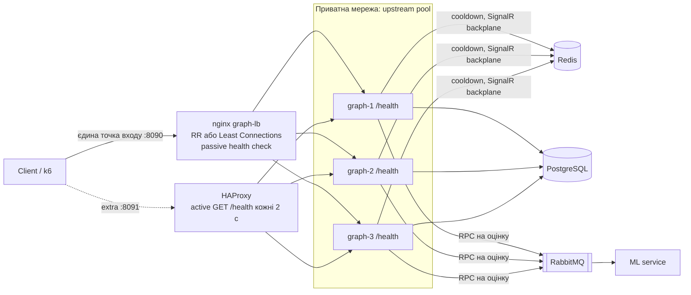

# Захист лабораторної роботи №3 (High Load Systems)

Тема: Горизонтальне масштабування (Horizontal Scaling) та балансування навантаження (Load Balancing).

Проєкт: Relativa. Гілка `high-load-systems/lab3`. Опис завдання: `high-load-systems/description/Lab3 - Horizontal Scaling.md`. Докази: `high-load-systems/evidence/lab3/`. Таблиці k6 (вхідні параметри, до/після, шум між запусками): `evidence/lab3/k6/COMPARISON.md`. Звіт і діаграма також додані в кінець кореневого `README.md` (розділ «Horizontal Scaling and Load Balancing»).

## 1. Мета і вибір сервісу

Мета: на основі stateless-архітектури (Lab 2) побудувати пул однакових екземплярів сервісу за єдиною точкою входу, порівняти алгоритми балансування, показати автоматичне виключення відмовивших вузлів і знайти наступне вузьке місце після масштабування обчислювального шару.

Масштабувався сервіс **Graph**: він найважчий (збирає граф із сотень вузлів, РПК в ML, SignalR, ~68 КБ відповіді), тому саме він упирається в навантаження першим. Він без стану після Lab 2 (Redis для cooldown і SignalR backplane), тож будь-який екземпляр може відповісти на будь-який запит. Auth, Core, ML не масштабувалися (див. ризики).

## 2. Покриття вимог лабораторної

| Вимога опису | Що зроблено | Де доказ |
|---|---|---|
| 2.1 Пул ≥ 2 реплік зі спільними сховищами, ізольований життєвий цикл, унікальний Instance-ID | 3 екземпляри Graph (`graph-1/2/3`), спільні PostgreSQL, Redis, RabbitMQ, заголовок `X-Instance-ID` | `docker-compose.lab3.yml`, `after/algorithm-distribution-equal-nodes.txt` |
| 2.2 Єдина точка входу, інкапсуляція | nginx `graph-lb` на `:8090`; клієнт (k6, curl) ходить лише туди; екземпляри в приватній мережі Docker (їхні порти `8083/8085/8086` відкриті тільки для налагодження стенду, у проді їх не публікують) | `infra/nginx/graph-lb-lab3-rr.conf` |
| 2.3.1 Round Robin + статистика розподілу | 30/30/30 із 90 | `after/algorithm-distribution-equal-nodes.txt`, k6 `post-lab/` (1230/1231/1230) |
| 2.3.2 Альтернативний алгоритм | **Least Connections** (`least_conn`) | `infra/nginx/graph-lb-lab3-lc.conf` |
| 2.3.3 Асиметричне навантаження (затримка на одному вузлі), порівняння RR і LC за p99 | graph-2 +500 мс; RR і LC по 2 запуски k6 | `k6/asymmetric/`, `COMPARISON.md` розділ 4 |
| 2.4.1 `GET /health` (перевірка БД) | EF Core `AddDbContextCheck<GraphDbContext>`: 200 `Healthy` / 503 `Unhealthy` | `after/health-check.txt` |
| 2.4.2 Автоматичне виключення вузлів | nginx: passive (`max_fails=2 fail_timeout=10s` + `proxy_next_upstream`); додатково HAProxy: **active** `GET /health` кожні 2 с | `after/active-vs-passive-health-check.txt` |
| 2.4.3 Зупинка контейнера без 5xx | `docker kill` і `docker stop`: 0 відповідей не-200 із 214 і 215 запитів | `after/fault-tolerance-kill.txt`, `after/fault-tolerance-stop.txt` |
| 2.5.1 Прогони 1, 2, 3 екземпляри | насичуюче навантаження, 1 CPU на екземпляр | `k6/scale-out/`, `COMPARISON.md` розділ 5 |
| 2.5.2 Аналіз наступного вузького місця | ліміт підключень PostgreSQL (доведено) і спільний ML/RabbitMQ шлях (спостерігається, не ізольовано) | розділ 7 нижче |
| Конфіги балансувальника | `infra/nginx/*.conf`, `infra/haproxy/graph-lb.cfg` | у репозиторії |
| Оновлена архітектурна схема | розділ 5 нижче і `README.md` | — |
| Звіт у README.md | розділ «Horizontal Scaling and Load Balancing» у `README.md` | — |

## 3. Що змінено в коді та конфігурації і навіщо

| Файл | Зміна | Навіщо |
|---|---|---|
| `Graph/src/Relativa.Graph/Program.cs` | `AddHealthChecks().AddDbContextCheck<GraphDbContext>("postgres")`, `MapHealthChecks("/health")`; middleware `ARTIFICIAL_DELAY_MS` | Готовність із перевіркою БД; штучне гальмо одного вузла для експерименту (за замовчуванням 0, ніякого ефекту) |
| `Graph/src/Relativa.Graph/Relativa.Graph.csproj` | пакет `Microsoft.Extensions.Diagnostics.HealthChecks.EntityFrameworkCore` 10.0.5 | Версія 10.0.15 тягне EF Core 10.0.15 і ламає тестовий проєкт (NU1605: тести прив'язані до EF Core 10.0.5); 10.0.5 сумісна |
| `infra/nginx/graph-lb-lab3-rr.conf` | 3 вузли, Round Robin, `zone`, passive HC, retry, лог із `upstream=` | Основна конфігурація |
| `infra/nginx/graph-lb-lab3-lc.conf` | те саме + `least_conn;` | Альтернативний алгоритм |
| `docker-compose.lab3.yml` | graph-3 (`:8086`), `graph-lb` монтує обидва конфіги в `/etc/nginx/lab3/` і копіює активний у `conf.d` при старті | Швидке live-перемикання алгоритму однією командою |
| `docker-compose.lab3-slow.yml` | graph-2: `ARTIFICIAL_DELAY_MS=500` | Асиметричний експеримент |
| `docker-compose.lab3-cpulimit.yml` | 1 CPU на кожен Graph | Щоб «ще один екземпляр» означав «ще одне ядро», а не ту саму машину (scale-out) |
| `docker-compose.lab3-poolcap.yml` | `Maximum Pool Size=30` у рядку підключення Graph | Перевірка гіпотези про ліміт підключень PostgreSQL |
| `infra/haproxy/graph-lb.cfg`, `docker-compose.lab3-haproxy.yml` | HAProxy `:8091` з active health check, stats `:8404` | Безкоштовного active HC в nginx community немає |
| `README.md` | розділ Lab 3 | Вимога опису |

Pre-commit: змінений лише один `.cs`-файл (`Program.cs`), перевірка складності (`python -m lizard -C 10 -L 99999 -a 99999 -l csharp -w Graph/src/Relativa.Graph/Program.cs`) без попереджень; gitleaks на нових файлах без знахідок. Інтеграційні тести Graph: 168 із 170 (2 відомі падіння `GraphDataServiceTests.BuildGraphAsync_MlClientThrows*` існували ще до Lab 2, не пов'язані із цією роботою), лог `evidence/lab3/graph-integration-tests.txt`.

### Знахідка по дорозі: nginx без `zone` розподіляє нерівномірно

Перший запуск пулу з трьох вузлів: 6 послідовних запитів підряд пішли на graph-1. Причина: nginx має кілька worker-процесів (тут 8), і без директиви `zone` у блоці `upstream` кожен worker веде свій власний лічильник Round Robin (і свої лічильники з'єднань для `least_conn`), тому кожен новий запит, що потрапив на «свіжий» worker, знову починає з першого сервера. Виміряно на конфігурації Lab 2 (без `zone`): 10 із 12 послідовних запитів на graph-1 (`before/lab2-nginx-sequential-distribution.txt`); після додавання `zone graph_backend 64k;` точно 10/10/10 із 30. Під великим паралельним навантаженням (k6 Lab 2) цього не було видно. Для `least_conn` `zone` ще важливіший: без нього «найменше з'єднань» обчислюється за неповними даними.

## 4. Як це працює (потік запиту)

```
Client → nginx graph-lb :8090 → (Round Robin | Least Connections) → graph-1 | graph-2 | graph-3
  - вузол обирається за алгоритмом, стан пулу (позиція, лічильники збоїв, кількість з'єднань) у спільній зоні пам'яті
  - вузол недоступний (connect error/timeout, 502/503/504) → fail лічильник++ ; 2 збої за 10 с → вузол виключено на 10 с;
    запит (GET) повторюється на іншому вузлі, клієнт не бачить помилки
  - через 10 с nginx пробує вузол знову (автоматичне відновлення)
Відповідь має X-Instance-ID (який вузол обслужив)
```

## 5. Діаграма (Component, після змін)



Gateway (YARP) у compose, як і раніше, дивиться на один Graph; підключити його до балансувальника це зміна конфігурації YARP (кілька destination) без коду.

## 6. Як запустити

Усі команди з кореня репозиторію (PowerShell). Усе інфраструктурне в контейнерах.

```powershell
# основний стенд: 3 Graph + Redis + 2 Auth + nginx (Round Robin, усі вузли однакові)
docker compose -f docker-compose.yaml -f docker-compose.lab2.yml -f docker-compose.lab3.yml up -d --build

# з повільним вузлом graph-2 (+500 мс)
$c = "-f docker-compose.yaml -f docker-compose.lab2.yml -f docker-compose.lab3.yml -f docker-compose.lab3-slow.yml".Split(' ')
docker compose @c up -d --force-recreate --no-deps graph-2 graph-lb
# повернути graph-2 у нормальний режим: ті самі команди без -f docker-compose.lab3-slow.yml

# HAProxy з active health check (:8091, статистика http://localhost:8404/stats)
docker compose -f docker-compose.yaml -f docker-compose.lab2.yml -f docker-compose.lab3.yml -f docker-compose.lab3-haproxy.yml up -d graph-lb-haproxy
```

Порти: nginx 8090; HAProxy 8091 / 8404; graph-1 8083, graph-2 8085, graph-3 8086 (налагодження); auth-1 8081, auth-2 8087. Після `docker desktop restart` контейнери самі не стартують: повторити `up -d`.

### Порядок захисту (шпаргалка команд для 4 кроків процедури)

**Крок 1. Демонстрація балансування (розподіл по Instance ID).**

```powershell
1..12 | ForEach-Object { curl.exe -s -o NUL -w "%header{x-instance-id} %{http_code} %{time_total}`n" "http://localhost:8090/api/v1/graph?organizationId=1" -H "X-User-Id: 1" }
```

Очікуване: graph-1, graph-2, graph-3 по черзі, усі 200. Для розподілу цифрами: `powershell -File high-load-systems/evidence/lab3/scripts/algorithm-demo.ps1`.

**Крок 2. Live-перемикання алгоритму.**

```powershell
# (опційно) зробити graph-2 повільним (команда вище), щоб різницю було видно
docker exec relativa-graph-lb sh -c "cp /etc/nginx/lab3/lc.conf /etc/nginx/conf.d/default.conf && nginx -s reload"   # Least Connections
docker exec relativa-graph-lb sh -c "cp /etc/nginx/lab3/rr.conf /etc/nginx/conf.d/default.conf && nginx -s reload"   # назад на Round Robin
```

Скрипт `algorithm-demo.ps1` сам перемикає RR → LC і друкує розподіл під паралельним навантаженням (з повільним вузлом: RR 33% / LC 22% на повільний вузол, див. `after/algorithm-distribution-slow-node.txt`). Пояснення: LC дивиться на кількість **активних** з'єднань; повільний вузол тримає з'єднання довше, тож накопичує їх і отримує менше нових запитів. При однакових вузлах і однакових запитах LC поводиться як RR (`after/algorithm-distribution-equal-nodes.txt`: 34/32/33%).

**Крок 3. Симуляція аварії.**

```powershell
powershell -File high-load-systems/evidence/lab3/scripts/fault-tolerance-demo.ps1 -Mode kill -Victim graph-2
# або вручну: у циклі запити через :8090, у другому вікні  docker stop relativa-graph-3
```

Очікуване: жодного не-200; у логу nginx видно повтори (`upstream=a, b`): `docker logs relativa-graph-lb --tail 20`. Вузол після `docker start` повертається сам.

**Крок 4. Архітектурна дискусія про SPOF балансувальника**: див. розділ 9.

## 7. Результати (виміряно)

### 7.1 Розподіл і відмова

| Перевірка | Результат | Файл |
|---|---|---|
| Round Robin, 3 рівні вузли, 30 послідовних / 90 паралельних | 10/10/10 і 30/30/30 | `after/algorithm-distribution-equal-nodes.txt` |
| Той самий тест на конфігурації Lab 2 (без `zone`, 2 вузли) | **10 із 12 на graph-1** | `before/lab2-nginx-sequential-distribution.txt` |
| Least Connections, рівні вузли | 31/29/30 (≈ RR) | `after/algorithm-distribution-equal-nodes.txt` |
| LC із повільним graph-2 | 36/20/34: повільний 22% (RR: 33%) | `after/algorithm-distribution-slow-node.txt` |
| `docker kill` graph-2 під навантаженням | 214 запитів, **0 не-200**, 3 повтори nginx, вузол повернувся через 3.6 с | `after/fault-tolerance-kill.txt` |
| `docker stop` graph-3 | 215 запитів, **0 не-200**, 1 запит добіг на вузлі, що зупинявся (graceful), повернувся через 3.9 с | `after/fault-tolerance-stop.txt` |
| `/health`, усе добре | 200 `Healthy` на всіх трьох | `after/health-check.txt` |
| `/health`, PostgreSQL зупинено | 503 `Unhealthy` на всіх; звичайний запит до API дає помилку 409 (глобальний обробник), nginx її не повторює; після `docker start` PostgreSQL все повертається у 200 без перезапуску Graph | `after/health-check.txt` |
| Завислий вузол (`docker pause` graph-3): nginx (passive) проти HAProxy (active) | nginx: 2 із 4 запитів у вікні зависання не-200 (таймаут клієнта 12 с); HAProxy: 0 із 21, вузол DOWN за `L7TOUT` менше ніж за 10 с, після розморожування знову UP | `after/active-vs-passive-health-check.txt` |

Важливо чесно сказати: коли вузол впав (нема з'єднання), passive-перевірка працює добре, але раз на `fail_timeout` (10 с) nginx знову пробує мертвий вузол, і один клієнт платить `proxy_connect_timeout` (2 с): у логу рядок `urt=2.000, 0.774`. Це ціна passive-перевірки.

### 7.2 k6: 1 екземпляр проти 3 (сценарій Lab 2, 50 VU, пауза 0.5 с, 2 запуски на сторону)

Повні таблиці: `evidence/lab3/k6/COMPARISON.md`.

| Метрика (запуск 2) | До (1 екземпляр) | Після (3 екземпляри за nginx) | Зміна |
|---|---:|---:|---:|
| Пропускна здатність | 30.22 req/s | 30.56 req/s | +1.1% (шум) |
| Середній час | 868 мс | 848 мс | −2.3% |
| p95 | 1012 мс | 948 мс | −6.3% |
| p99 | 1096 мс | 1049 мс | −4.3% |
| Помилки | 0 | 0 | — |
| Розподіл | 3637 / 0 / 0 | 1230 / 1231 / 1230 | — |

Запуск 1: 29.79 проти 29.99 req/s, p99 1210 проти 1309 мс (гірше). Шум між запусками на p99 до 20%, тож **вимірюваного виграшу немає, і його не треба стверджувати**. Причина: сценарій замкнений, кожен запит має «підлогу» ≈ 765 мс. У цій роботі вдалося її знайти: Graph викликає ML через RabbitMQ RPC із бюджетом 200 мс на спробу і 3 спробами; відповіді ML не встигають, тож кожен запит ≈ 3 × 200 мс + back-off (50 і 100 мс) чекає таймаутів (`ml_scoring_degraded attempts=3 reason=ML scoring attempt exceeded 200ms` у кожному запиті). Це очікування, а не CPU, тому нові екземпляри його не скорочують. Профілювання ML (чому відповідь довша за 200 мс) це тема Lab 9.

### 7.3 k6: асиметричне навантаження, RR проти LC (graph-2 +500 мс)

| Метрика | Round Robin | Least Connections | Зміна |
|---|---:|---:|---:|
| Частка запитів на повільний вузол | 33.3% (обидва запуски) | 24.6% (обидва запуски) | −8.7 в.п. |
| Середній час (запуск 1 / 2) | 1020 / 967 мс | 956 / 927 мс | −6.3% / −4.1% |
| Пропускна здатність (запуск 1 / 2) | 27.00 / 28.09 req/s | 28.26 / 28.99 req/s | +4.7% / +3.2% |
| p95 (запуск 1 / 2) | 1418 / 1316 мс | 1351 / 1315 мс | −4.7% / −0.1% |
| **p99 (запуск 1 / 2)** | 1547 / 1348 мс | 1472 / 1377 мс | **−4.8% / +2.2%** |

Висновок для захисту: LC механічно коректно зменшує частку повільного вузла і стабільно знижує середній час і підвищує пропускну здатність на 3–5%, але **системний p99 надійно не покращився** (різниця в межах шуму до 13%). Це очікувано: p95/p99 визначає найповільніший вузол, поки він отримує більше ≈ 1–5% трафіку; повільний вузол усе ще отримував чверть запитів по ≈ 1.3 с. Щоб прибрати хвіст, потрібно **виключити** вузол (health check, outlier ejection), а не лише розподіляти менше. Виміряно один рівень затримки (500 мс), одне навантаження (50 VU) і по 2 запуски; перший спробний прогін було відкинуто (Docker завис, пропускна здатність упала до 4.7 req/s) і повторено, обидва збережено (`k6/asymmetric/attempt1-invalid-docker-wedged/`).

### 7.4 k6: scale-out 1 / 2 / 3 екземпляри (насичуюче навантаження, 120 VU без пауз, 1 CPU на екземпляр)

| Екземплярів | Пропускна здатність | Помилки (таймаут 30 с та ін.) | Примітка |
|---|---:|---:|---|
| 1 | 23.15 req/s | 2.5% | Graph ≈ 100% свого ядра: упирається в CPU |
| 2 | 27.07 req/s | 19.6% | PostgreSQL `too many clients already` |
| 3 | 24.72 req/s | 17.6% | те саме |
| 1 / 2 / 3, пул підключень обмежено 30 | 21.83 / 27.65 / 14.91 req/s | 5.4% / 6.6% / 17.2% | помилок підключення більше немає, масштабування все одно немає |

**Пропускна здатність не зростає з кількістю екземплярів.** Один прогін на клітинку; це не повторюване вимірювання, але характер (відсутність масштабування і зростання помилок) значно більший за шум.

**Аналіз наступного вузького місця (2.5.2):**

1. **Один екземпляр з 1 ядром упирається в CPU** на ≈ 22 req/s (graph ≈ 97–104% ядра). Масштабування обчислювального шару логічне.
2. **Доведено: ліміт підключень PostgreSQL.** `max_connections = 100`, а кожен екземпляр Graph за замовчуванням тримає пул до 100 підключень (Npgsql). У логу Postgres 1796 рядків `sorry, too many clients already` під час прогонів без обмеження. Обмеження пулу 30 на екземпляр (3 × 30 = 90 < 100) прибрало ці помилки (лічильник не зріс) і зменшило помилки на 2 екземплярах з 19.6% до 6.6%. Це класичне «Database connection pool» з опису лаби: загальна кількість підключень = екземпляри × розмір пулу, і її треба бюджетувати (або ставити PgBouncer).
3. **Спостерігається, не ізольовано: спільний шлях ML + RabbitMQ.** На 2–3 екземплярах PostgreSQL 100–160% ядра, RabbitMQ 100–180%, ML 64–76% (один процес). Кожен запит Graph робить до 3 RPC-спроб через RabbitMQ, тож трафік до цього спільного шляху множиться. Після обмеження пулу масштабування все одно не з'явилося, і лишився хвіст 30 с. Який із ML, RabbitMQ чи CPU PostgreSQL є вирішальним, **не профілювалося** (Lab 9). Не слід стверджувати більше.
4. **Не є обмеженням:** сам балансувальник (nginx ≈ 2–5% CPU), Redis (≈ 1%), мережа.
5. Застереження: усі контейнери і k6 на одному ноутбуці (8 ядер), «окремі вузли» змодельовано лімітом 1 CPU; найслабша точка даних: 3 екземпляри з обмеженим пулом (немає `docker stats`, 1043 запити).

## 8. Вибір алгоритму під профіль навантаження

| Алгоритм | Коли | Коли ні |
|---|---|---|
| Round Robin | однакові вузли, запити однакової вартості, короткі | вузли різної потужності або дуже нерівні запити |
| Weighted Round Robin | гетерогенна інфраструктура (різна потужність вузлів): вага пропорційна потужності | вага статична: не реагує на тимчасову деградацію |
| Least Connections | запити різної тривалості, довгі з'єднання (WebSocket), вузол може тимчасово сповільнитися | вузли однакові і запити короткі: нуль виграшу; потребує спільного стану (`zone`) |
| IP Hash / hash | потрібна прив'язка клієнта до вузла (sticky на рівні L4/L7) | у цьому проєкті **свідомо не використовується**: Lab 2 вимагає, щоб будь-який екземпляр обслужив будь-який запит |

Для Graph: запити однакової вартості (один і той самий графовий збір), тож у нормі Round Robin достатньо; Least Connections вибираємо як захист від деградації окремого вузла (GC-паузи, шумний сусід), що ми і змоделювали.

## 9. Теоретичні питання (відповіді)

**Що таке Single Point of Failure стосовно самого балансувальника і як його усунути?** Усі клієнти ходять через один nginx: якщо він упаде, система недоступна навіть при здорових бекендах. Ми цього не усунули (залишковий ризик). Шляхи: (1) **Keepalived + VRRP**: два балансувальники, віртуальна IP-адреса (VIP); MASTER тримає VIP і розсилає VRRP-оголошення, при їх зникненні BACKUP за секунди перехоплює VIP (gratuitous ARP), клієнти бачать ту саму адресу; працює в одній L2-мережі. (2) **DNS Round Robin**: кілька A-записів на кілька балансувальників; просто, але клієнти кешують DNS (TTL), мертвий запис ще живе, немає health check; потрібен у парі з іншим механізмом. (3) Хмарний керований балансувальник, anycast/BGP, GSLB. На практиці: Keepalived/VRRP для одного ЦОД, DNS/GSLB між ЦОД. Також балансувальник без стану (як тут) можна просто дублювати.

**Passive проти active health check?** Passive: балансувальник вчиться на реальних запитах (збої, таймаути) і виключає вузол після `max_fails`; без зайвого трафіку, але першими страждають реальні клієнти (у нас: один запит платить 2 с кожні 10 с до мертвого вузла; завислий вузол: клієнт чекає до `proxy_read_timeout`). Active: балансувальник сам опитує `/health` (HAProxy `inter 2s fall 2 rise 2`), виключає вузол до того, як туди підуть клієнти, і повертає після `rise` успішних перевірок, але створює додаткове навантаження і може хибно виключити. Виміряно: завислий вузол: nginx 2 помилки (12 с), HAProxy 0.

**Чому nginx не викликає `/health`?** Community nginx не має директиви `health_check` (лише nginx Plus). `/health` у нас використовується HAProxy (active), контейнерною оркестрацією (Kubernetes readinessProbe) і ручною перевіркою.

**Чи `/health` має перевіряти БД?** Readiness (готовий приймати трафік) так, бо без БД вузол марний; liveness (процес живий) краще окремо і без залежностей, щоб оркестратор не перезапускав усі вузли через падіння спільної БД. Тут `/health` це readiness. Коли БД впала, усі три вузли стають Unhealthy одночасно, і виключення вузлів не допоможе (спільна залежність), тому потрібно прибирати спільні точки відмови, а не лише дублювати вузли.

**Чому `zone` у upstream?** Без нього кожен worker-процес nginx має власну копію стану пулу (позиція RR, лічильники збоїв, кількість з'єднань). Виміряно: 10 із 12 послідовних запитів на перший вузол. Зона в спільній пам'яті робить пул єдиним.

**Чому retry лише для GET?** `proxy_next_upstream` не повторює non-idempotent методи (POST, PUT) без прапорця `non_idempotent`: повтор міг би виконати запис двічі. У нашому API Graph лише читає; Auth пише, і ми його через цей балансувальник не пускали.

**Що відбувається при graceful stop?** Контейнер отримує SIGTERM і добігає активні запити: у `fault-tolerance-stop.txt` один запит завершився на вузлі, що зупинявся (жодної помилки). Це краще, ніж `kill`, де обірвані запити повторює nginx.

**Чому більше екземплярів не дало більше пропускної здатності?** Закон Амдала / спільні ресурси: масштабування клієнтського шару не збільшує потужність спільних залежностей (PostgreSQL, RabbitMQ, ML). Після того як CPU Graph перестав бути обмеженням, ним стали підключення PostgreSQL і спільний ML/RabbitMQ шлях. Наступні кроки: PgBouncer / бюджет пулів, кеш (Lab 4), реплікація читання (Lab 6), шардінг (Lab 7), профілювання (Lab 9).

**Чому в тесті Lab 2 і post-lab немає виграшу?** Сценарій latency-bound (50 VU, пауза 0.5 с, «підлога» ≈ 765 мс через таймаути ML); один екземпляр не насичений. Виграш видно лише в насичуючому сценарії, і то обмежено спільними залежностями.

## 10. Залишкові ризики (чесно)

1. **Балансувальник сам є SPOF** (один nginx). Рішення: Keepalived/VRRP, DNS RR (не реалізовано).
2. **Gateway → Graph**: у compose Gateway дивиться на один Graph (`graph:8083`), а не на nginx. Балансування демонструється на `:8090`. Підключення Gateway: кілька destination у YARP.
3. **Passive HC в nginx community**: не бачить деградації на рівні `/health`; завислий вузол шкодить клієнтам до таймауту (HAProxy як приклад active-перевірки, не замінює nginx у стеку).
4. **Спільні залежності**: PostgreSQL (один вузол, ліміт підключень), RabbitMQ, Redis, ML: усі одинарні (SPOF); пул підключень не обмежений за замовчуванням: `3 × 100 > max_connections`. У `docker-compose.lab3.yml` ліміт пулу не вмикається (лише в експерименті `lab3-poolcap.yml`).
5. **ML RPC**: майже кожен запит чекає ≈ 750 мс таймаутів; не виправлялося (не завдання лаби, тема профілювання).
6. **Auth, Core** не масштабувалися в Lab 3 (Core має SignalR-хаб і `IMemoryCache`, див. ризики Lab 2). Лише Graph у балансувальнику.
7. **Один прогін** на клітинку у scale-out; 3 екземпляри з обмеженим пулом найслабша точка (не було `docker stats`).
8. Усе на одній машині: контейнери й k6 конкурують за CPU (під час першої спроби асиметричного тесту Docker завис).
9. Порти graph-1/2/3 опубліковані на хост для налагодження: для повної інкапсуляції в проді їх прибирають і залишають лише порт балансувальника.
10. Active HC в HAProxy показано лише як додатковий експеримент, не інтегровано в основний стенд клієнта.

## 11. Відхилення від плану (чесно)

- **`.AllowAnonymous()` на `MapHealthChecks` не додано**: у Graph немає автентифікації, метод зайвий.
- **Версія пакета health checks 10.0.5, а не 10.0.15** (NU1605 у тестовому проєкті).
- **Додано `zone` в upstream** (знайдена нерівномірність RR між worker-процесами), чого не було в плані.
- **Перемикання алгоритму не через `docker cp`, а через `cp` усередині контейнера з двох змонтованих файлів**: `docker cp` у файл, змонтований як `:ro`, не спрацьовує, а так перемикання робить одна команда.
- **Додаткові файли**, яких не було в плані: `docker-compose.lab3-cpulimit.yml` і `docker-compose.lab3-poolcap.yml` (scale-out експеримент потребував 1 CPU на екземпляр; знайдено ліміт підключень), `infra/haproxy/graph-lb.cfg` і `docker-compose.lab3-haproxy.yml` (active health check).
- **Окремий saturating-сценарій** `k6/scale-out/graph-scale-test.js` (120 VU, без пауз), бо сценарій Lab 2 не насичує систему і не може показати scale-out.
- **Додано p99** в експорт k6 (`--summary-trend-stats`) і `compare-summaries.ps1` у `evidence/lab3/k6/` з довільними назвами колонок.
- **Перший прогін асиметричного експерименту відкинуто** (Docker завис), повторено заново, обидва збережено.
- **Scale-out скрипт змінює конфіг nginx** під N вузлів із того самого `rr.conf` (один джерело істини) і в кінці повертає 3 вузли.
- В `README.md` додано розділ Lab 3 (append; вміст студента не змінювався).

## 12. Шпаргалка для усної відповіді

1. Масштабував Graph до 3 екземплярів за nginx на `:8090`; будь-який екземпляр відповідає на будь-який запит, бо Lab 2 прибрала стан; `X-Instance-ID` показує, хто відповів.
2. Round Robin: 30/30/30. Знайшов і виправив особливість nginx: без `zone` кожен worker веде свій RR (10 із 12 на перший вузол), із `zone` рівно порівну.
3. Live-перемикання на Least Connections однією командою; при повільному вузлі (+500 мс) LC дає йому 24.6% замість 33.3%, середній час −4..6%, пропускна здатність +3..5%, але p99 не покращується надійно (шум більший за різницю): хвіст визначає повільний вузол, лікується виключенням вузла, а не розподілом.
4. `/health` перевіряє PostgreSQL (200/503). Вузол зупинено або вбито під навантаженням: 0 із 214 і 215 не-200, nginx повторює запит на іншому вузлі, вузол повертається сам.
5. Passive проти active: nginx community лише passive (клієнт платить 2 с, завислий вузол: 2 помилки по 12 с), HAProxy active `/health` кожні 2 с: 0 помилок. Це мій додатковий експеримент.
6. Scale-out: пропускна здатність не росте (≈23 → 27 → 25 req/s) і з'являються помилки. Наступне вузьке місце: ліміт підключень PostgreSQL (доведено: 1796 `too many clients`, обмеження пулу це прибирає), потім спільний ML/RabbitMQ шлях (спостерігається, не ізольовано). Балансувальник не обмежує.
7. SPOF: сам nginx; усувається Keepalived/VRRP (VIP, два балансувальники) або DNS RR/GSLB; не реалізовано.
8. Чесно: у сценарії Lab 2 1 проти 3 екземплярів немає вимірюваної різниці (шум більший), «підлога» 765 мс це таймаути ML, а не CPU.
