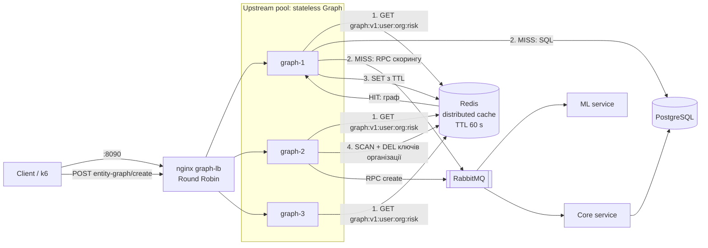

# Захист лабораторної роботи №4 (High Load Systems)

Тема: Розподілене кешування (Distributed Caching) та паттерни узгодженості даних.

Проєкт: Relativa. Гілка `high-load-systems/lab4`. Опис завдання: `high-load-systems/description/Lab4 - Distributed Caching.md`. Докази: `high-load-systems/evidence/lab4/`. Таблиці k6 (вхідні параметри, до/після, шум між запусками): `evidence/lab4/k6/COMPARISON.md`. Звіт і діаграма також додані в кінець кореневого `README.md` (розділ «Distributed Caching»).

## 1. Мета і вибір ендпоінта (завдання 2.1)

Мета: на базі масштабованої системи Lab 3 (3 екземпляри Graph за nginx) додати розподілений кеш у Redis, щоб розвантажити PostgreSQL і ML, зменшити затримку read-intensive запиту, і показати Cache-Aside, схему ключів, TTL, інвалідацію та відмовостійкість при падінні Redis.

**Що кешуємо: `GET /api/v1/graph?organizationId=N` у сервісі Graph.** Це найважчий читальний запит системи (Graph обрано як найнавантаженіший сервіс ще в Lab 2 і 3).

Декомпозиція за критеріями з опису:

| Критерій | Оцінка для `GET /api/v1/graph` |
|---|---|
| Частота читання | Висока: клієнт викликає його при відкритті і оновленні графа, у нашому тесті 30..50 користувачів безперервно. Той самий результат віддається багатьом викликам |
| Частота запису | Низька: граф змінюється лише коли створюють або змінюють сутності, зв'язки, ролі. Єдиний write-ендпоінт у самому Graph: `POST /api/v1/workspaces/{id}/entity-graph/create` |
| Допустима застарілість (stale) | Секунди: це візуалізація графа, а не фінансова операція. Вибрано TTL 60 с, а після власного запису інвалідація негайна |
| Вартість обчислення | Висока: 7+ SQL-запитів до EAV-моделі (користувач, дозволи, робочі простори, сутності, значення властивостей, зв'язки, учасники), складання графа в пам'яті, RPC до ML через RabbitMQ (до 3 спроб по 200 мс), відповідь ≈ 68 КБ (183 вузли, 291 ребро) |

Чому НЕ кешуємо інше: Auth (логін, рейт-ліміт, запис профілю) це записи, їх кешувати не можна; `POST .../entity-graph/create` це запис; дашборди (`/api/v1/dashboard/*`) теж кандидати, але одного добре обґрунтованого сценарію достатньо, щоб показати паттерн (див. ризики). Рівень застарілості і вартості різні для кожного ендпоінта, тому «кешувати все» було б помилкою.

## 2. Покриття вимог лабораторної

| Вимога опису | Що зроблено | Де доказ |
|---|---|---|
| 2.1 Аналіз і вибір об'єктів кешування | Розділ 1 цього файлу, розділ README | розділ 1 |
| 2.2 Redis як окремий контейнер, рівноправний доступ усіх instances | Той самий `relativa-redis` (`redis:7-alpine`, Lab 2), спільна мережа Docker; усі три екземпляри Graph використовують один Redis і один ключ (HIT від graph-2 і graph-3 на запис graph-2/1) | `after/cache-hit-miss-demo.txt`, `docker-compose.lab2.yml` |
| 2.3 Cache-Aside (lookup, HIT без БД, MISS: БД, запис у кеш з TTL, відповідь) | `GraphQueryEndpoints.GetGraphAsync` + `RedisGraphCacheService` | розділ 4 нижче, `after/cache-hit-miss-demo.txt` |
| 2.4 Схема ключів без колізій + політика TTL | `graph:v1:{userId}:{organizationId}:{riskLevel або all}`, TTL 60 с ±10% | розділ 4, `after/redis-key-inspection.txt` |
| 2.5 Інвалідація при POST/PUT/DELETE, наступне читання гарантовано свіже | `POST .../entity-graph/create` видаляє всі ключі організації до відповіді клієнту; наступний GET це MISS зі свіжими даними (184 вузли замість 183) | `after/invalidation-demo.txt` |
| 2.6.1 Метрики Hit / Miss / Invalidation | заголовок `X-Cache: HIT / MISS / BYPASS`; лог `Graph cache invalidated for org N: K key(s) removed.`; лічильники в k6 | `after/*.txt`, `COMPARISON.md` розділ 5 |
| 2.6.2 Холодний проти гарячого запиту | cold (MISS) медіана 182 мс проти hot (HIT) 7 мс, у 26 разів; під навантаженням 810 мс проти 4.5 мс | `after/cache-hit-miss-demo.txt`, `COMPARISON.md` |
| 2.6.3 Fallback при `docker stop redis` | 12 із 12 запитів 200 (`X-Cache: BYPASS`), `/health` 200, навіть запис (create) працює; після `docker start` кеш повертається сам (перша відповідь без BYPASS через ≈ 2 с, усі три екземпляри працюють із кешем на ≈ 3-й секунді) | `after/redis-fallback-demo.txt` |
| README: обґрунтування, ключі й TTL, cold vs hot, схема | розділ «Distributed Caching» у `README.md` | — |

## 3. Що змінено в коді та конфігурації і навіщо

| Файл | Зміна | Навіщо |
|---|---|---|
| `Graph/src/Relativa.Graph/Graph/IGraphCacheService.cs` (новий) | інтерфейс `GetAsync / SetAsync / InvalidateForOrgAsync` + `GraphCacheLookup(Value, Available)` | Відокремити логіку кешу від ендпоінта; `Available=false` відрізняє «ключа немає» (MISS) від «кеш недоступний» (BYPASS) |
| `Graph/src/Relativa.Graph/Graph/RedisGraphCacheService.cs` (новий) | Redis-реалізація: JSON у `IDistributedCache`, TTL із джиттером, інвалідація `SCAN`+`DEL`, усі виклики в `try/catch` | Cache-Aside, схема ключів, відмовостійкість (ніколи не кидає виняток) |
| `Graph/src/Relativa.Graph/Graph/NullGraphCacheService.cs` (новий) | порожня реалізація | Якщо Redis не налаштований (запуск без Docker, тести): поведінка як до Lab 4 |
| `Graph/src/Relativa.Graph/Graph/RedisMultiplexerFactory.cs` (новий) | одне спільне `ConnectionMultiplexer`, `BacklogPolicy.FailFast`, таймаут 1 с | Швидкий відхід на БД, коли Redis не відповідає (без цього команди стоять у черзі до таймауту) |
| `Graph/src/Relativa.Graph/Program.cs` | реєстрація спільного multiplexer-а для `AddStackExchangeRedisCache` (`ConnectionMultiplexerFactory`) і `IGraphCacheService` (Redis або Null) | Одне підключення і для `IDistributedCache` (cooldown ML), і для кешу графа |
| `Graph/src/Relativa.Graph/Graph/GraphQueryEndpoints.cs` | обробник винесено в `GetGraphAsync`, додано Cache-Aside і заголовок `X-Cache` | Сам паттерн |
| `Graph/src/Relativa.Graph/EntityGraphEndpoints.cs` | після успішного create: знайти `OrganizationId` робочого простору і видалити кеш організації (best effort) | Інвалідація при записі |
| `Graph/tests/.../GraphCacheTests.cs` (новий) | 6 тестів: MISS потім HIT, MISS після інвалідації, BYPASS, round trip Redis-сервісу, збій Redis не кидає виняток, формат ключа | Захист поведінки від регресій |
| `high-load-systems/evidence/lab4/...` | скрипти, логи, k6 | Докази |
| `README.md` | розділ Lab 4 (append) | Вимога опису |

Нових NuGet-пакетів немає (`StackExchange.Redis` уже приходить через пакети Lab 2). Нових контейнерів і нового `docker-compose.lab4.yml` немає: топологія не змінилася, Redis уже є. `ARTIFICIAL_DELAY_MS` з Lab 3 залишено як є (для цієї роботи не потрібний, `docker-compose.lab3-slow.yml` у вимірюваннях не використовувався).

Pre-commit: змінені `.cs`-файли пройшли `python -m lizard -C 10 -L 99999 -a 99999 -l csharp -w ...` без попереджень (максимальна складність нових методів 7). Інтеграційні тести Graph: 174 із 176 проходять; 2 відомі падіння `GraphDataServiceTests.BuildGraphAsync_MlClientThrows*` існували до Lab 2 і не пов'язані; ще один тест один раз впав через таймаут запуску контейнера PostgreSQL і пройшов при повторі (`evidence/lab4/graph-integration-tests-summary.txt`).

## 4. Як це працює

### 4.1 Cache-Aside (потік запиту)

```
GET /api/v1/graph?organizationId=1   (X-User-Id: 1)
  1. userId, перевірка riskLevel (як і раніше)
  2. ключ = graph:v1:1:1:all  → Redis GET
  3a. HIT   → повернути закешований граф. БД і ML не чіпаємо.      Заголовок X-Cache: HIT
  3b. MISS  → побудувати граф із PostgreSQL + ML, SET у Redis з TTL, повернути.   X-Cache: MISS
  3c. Redis недоступний (виняток/таймаут) → побудувати з PostgreSQL, у Redis НЕ писати.  X-Cache: BYPASS
```

### 4.2 Схема ключів (2.4)

```
Redis key:  relativa-graph:graph:v1:{userId}:{organizationId}:{riskLevel|all}
                  │             │   │       │        │            └ all | high | medium | low (як у запиті)
                  │             │   │       │        └ організація (інвалідація йде за нею)
                  │             │   │       └ користувач (дозволи різні: див. нижче)
                  │             │   └ версія формату: змінили DTO → v2, старі ключі просто ігноруються
                  │             └ домен і сутність
                  └ InstanceName IDistributedCache (додає бібліотека)
```

Чому в ключі є `userId`: граф залежить від прав користувача (org owner бачить усі робочі простори, інші лише свої), тож без `userId` один користувач отримав би граф іншого: це була б витік даних, а не колізія. `riskLevel` змінює відповідь (відфільтровує угоди), тому теж у ключі; значення не приводиться до нижнього регістру навмисно, бо `GraphDataService` трактує `HIGH` інакше, ніж `high` (фільтр порівнюється регістрозалежно). До кешу доходять тільки перевірені значення (`high|medium|low`), тож ін'єкції в ключ немає. У Redis значення зберігається як hash (`absexp`, `data`, `sldexp`), корисний вміст 67 389 байт, весь ключ ≈ 82 КБ пам'яті (`after/redis-key-inspection.txt`).

### 4.3 TTL (політика)

**60 секунд ±10% випадкового джиттера** (`GraphCache:TtlSeconds`, за замовчуванням 60). Обґрунтування: (1) допустима застарілість для візуалізації це секунди; (2) власні записи інвалідують кеш негайно, TTL потрібен лише як страховка для змін, які йдуть повз Graph (Core, Auth); (3) 60 с достатньо, щоб під навантаженням 99% запитів були HIT; (4) джиттер ±6 с, щоб ключі, записані одночасно, не вмирали одночасно (Cache Avalanche).

### 4.4 Інвалідація (2.5)

`POST /api/v1/workspaces/{workspaceId}/entity-graph/create` після успішної відповіді Core: шукається `OrganizationId` робочого простору, потім `SCAN relativa-graph:graph:v1:*:{orgId}:*` і `DEL` усіх знайдених ключів (усі користувачі й усі `riskLevel` цієї організації). Це відбувається ДО відповіді клієнту, тому його наступний GET гарантовано MISS зі свіжими даними. Чужі організації не зачіпаються (`after/invalidation-demo.txt`: ключ організації 2 вижив). Інвалідація «best effort»: якщо Redis недоступний, create усе одно повертає 200 (сутність уже створена), а старі записи вмирають за TTL. Шаблон `*:{orgId}:*` безпечний: `:1:` не збігається з `:10:` чи `:21:`, бо роздільники двокрапки входять у шаблон.

Чому саме `SCAN`+`DEL`, а не версія в ключі: нам потрібна була явна інвалідація, яку видно в Redis (ключі зникають). Альтернатива (лічильник версії організації в ключі, `INCR` при записі) O(1) і не сканує, але залишає сміття до TTL; обговорюється в ризиках.

### 4.5 Відмовостійкість (2.6.3)

Усі виклики до Redis в `RedisGraphCacheService` обгорнуті в `try/catch`: збій дає `GraphCacheLookup.Unavailable` (BYPASS), і запит іде в PostgreSQL. Multiplexer налаштований `BacklogPolicy.FailFast` і таймаутом 1 с: інакше при мертвому підключенні команди стоять у черзі до таймауту, і кожен запит чекав би секунди. Multiplexer перепідключається сам, тож після `docker start redis` кеш повертається без перезапуску Graph. Виміряно: 12 запитів при зупиненому Redis, 0 не-200, затримка 151..442 мс, медіана 177 мс (шлях БД; в іншому прогоні 149..789 мс), `/health` 200; `POST create` при зупиненому Redis 200 за 0.19 с; відновлення: перша відповідь без BYPASS через ≈ 2 с після `docker start`, далі всі HIT (кожен екземпляр перепідключається окремо, тому перші відповіді ще можуть бути BYPASS).

## 5. Діаграма (Component, після змін)



## 6. Як запустити і показати (процедура захисту)

Усі команди з кореня репозиторію (PowerShell). Стенд той самий, що в Lab 3 (нових контейнерів немає); Core має працювати (потрібен для `create`).

```powershell
docker compose -f docker-compose.yaml -f docker-compose.lab2.yml -f docker-compose.lab3.yml up -d --build
```

Після `--build` перезапустіть nginx, якщо вузли Graph отримали нові IP: `docker restart relativa-graph-lb`.

**Крок 1. Cache Hit / Miss.** Усе одним скриптом (MISS, потім HIT від різних екземплярів, ключ у Redis, 8 пар cold/hot, закінчення TTL):

```powershell
powershell -File high-load-systems/evidence/lab4/scripts/cold-hot-demo.ps1 -SkipExpiry
# вручну:
docker exec relativa-redis sh -c "redis-cli --scan --pattern 'relativa-graph:graph:v1:*' | xargs -r redis-cli del"
1..4 | % { curl.exe -s -D - -o NUL -H "X-User-Id: 1" "http://localhost:8090/api/v1/graph?organizationId=1" | Select-String "X-Cache|X-Instance" }
docker exec relativa-redis redis-cli --scan --pattern "relativa-graph:graph:v1:*"
```

Очікуване: перший `X-Cache: MISS`, далі `HIT` (з graph-1, graph-2 і graph-3 по черзі: кеш спільний), у Redis ключ `relativa-graph:graph:v1:1:1:all`.

**Крок 2. Інвалідація.**

```powershell
powershell -File high-load-systems/evidence/lab4/scripts/invalidation-demo.ps1
```

Очікуване: до запису ключі організації 1 (`all`, `high`, `low`) і організації 2; після `POST create` ключі організації 1 зникли, ключ організації 2 живий; наступний GET `MISS`, 184 вузли замість 183 (нова сутність у відповіді), далі `HIT`. Скрипт архівує створену демо-сутність.

**Крок 3. Fallback.**

```powershell
powershell -File high-load-systems/evidence/lab4/scripts/fallback-demo.ps1
# вручну:  docker stop relativa-redis ; (запити як вище: 200 і X-Cache: BYPASS) ; docker start relativa-redis
```

Очікуване: 0 не-200, `X-Cache: BYPASS`, затримка як у шляху без кешу, `/health` 200, `create` працює; після старту Redis кеш повертається сам.

**Крок 4. Теорія**: розділ 9.

Порти: nginx 8090, graph-1/2/3 8083/8085/8086 (налагодження), Core healthy (потрібен для `create`).

## 7. Результати (виміряно)

### 7.1 Cold проти hot (послідовні запити, система вільна)

`after/cache-hit-miss-demo.txt`: 8 пар (ключі видаляються перед кожним холодним запитом). Cold (MISS): мін. 153, медіана 182, макс. 777 мс. Hot (HIT): мін. 6, медіана 7, макс. 27 мс. Медіана швидша у ≈ 26 разів. Однаковий склад відповіді (183 вузли, 291 ребро, 67 607 байт) для MISS і HIT. Cold час «стрибає», бо RPC до ML інколи встигає у бюджет 200 мс, а інколи ні (777 мс); hot час від цього не залежить. Закінчення TTL (не інвалідація): ключ зник сам через 60 с, наступний запит MISS, потім HIT.

### 7.2 k6: до і після (3 екземпляри, 30→50 VU, 2 запуски на сторону)

Повні таблиці, вхідні параметри, шум і відкинутий запуск: `evidence/lab4/k6/COMPARISON.md`.

| Метрика (запуск 2) | До (без кешу) | Після (Redis cache) | Зміна |
|---|---:|---:|---:|
| Медіана | 810 мс | 4.5 мс | −99.4% |
| Середній час | 887 мс | 14.6 мс | −98.4% |
| p95 | 906 мс | 19.1 мс | −97.9% |
| p99 | 987 мс | 39.1 мс | −96.0% |
| Пропускна здатність | 29.8 req/s | 80.1 req/s | +169% (див. застереження) |
| Помилки | 8 | 0 | — |
| `X-Cache` | немає | HIT 9546, MISS 84 (99.1% HIT) | — |
| Повідомлень у черзі ML після запуску (до запуску черга очищена) | 10 060 | 0 | — |

Запуск 1: медіана 836 → 5.0 мс, p95 1029 → 21.0 мс, p99 1255 → 487 мс (9 помилок у запуску «після», див. нижче), пропускна здатність +144%. **Шум** між двома запусками однієї сторони приблизно 10% на медіані і p95, тобто різниця «до/після» (≈ 98%) на порядки більша за шум. Це на відміну від Lab 2 і Lab 3, де виграшу не було.

Чесні застереження (вони є в `COMPARISON.md`):
1. **Це найкращий випадок для кешу**: один користувач, одна організація, один ключ. З багатьма користувачами hit ratio буде нижчим.
2. **Зростання пропускної здатності це артефакт замкненого циклу** (коротша відповідь = більше ітерацій за той самий час), а не вимірювання межі потужності. Система не була насичена ні до, ні після.
3. **Помилки** (8 «до», 9 «після» в запуску 1) це `connection forcibly closed` на самому початку запуску, коли одночасно відкривається 30 з'єднань через Docker Desktop. Вони є на обох сторонах, тож не від кешу; першопричину не досліджували. Перший запуск «до» (51 помилка) відкинуто і збережено в `pre-lab/attempt1-discarded-51-failures/`.
4. **Cache stampede видно в цифрах**: ≈ 80 MISS за запуск це перший сплеск (30 VU одночасно не знаходять ключ і всі йдуть у БД) і сплеск на кожне закінчення TTL (приблизно двічі за запуск). Найповільніші MISS (до 5.2 с у запуску 1) це саме ці сплески.
5. **Підлога ≈ 765 мс з Lab 2 і Lab 3 пояснюється інакше, ніж думали.** У вільній системі нешвидкий запит триває 150..250 мс. Під навантаженням ML-сервіс (один споживач) не встигає: після кожного запуску «до» у черзі ML 9 000..10 000 запитів без відповіді, клієнт Graph чекає таймаути (3 × 200 мс + back-off) і відповідає без оцінок. Кеш прибирає це навантаження повністю (черга 0). Це виміряна кореляція; всередині ML не профілювали (Lab 9).

## 8. Вибір схеми і альтернативи

| Паттерн | Суть | Чому не він / коли він |
|---|---|---|
| **Cache-Aside (обрано)** | застосунок сам читає кеш, при MISS читає БД і заповнює кеш | Просто, кеш необов'язковий (відмова Redis не ламає читання), працює з будь-яким сховищем. Мінус: перший запит холодний, можливе вікно застарілості |
| Read-Through | кеш сам завантажує дані з БД при MISS | Потрібен кеш із вбудованим завантажувачем; логіка зникає із застосунку, але кеш стає критичним |
| Write-Through | запис іде в кеш і БД синхронно | Для нашого складного агрегованого графа немає простого «запису ключа»: граф складається із десятків таблиць |
| Write-Behind (Write-Back) | запис у кеш, у БД відкладено | Ризик втрати даних при падінні кешу; для бізнес-сутностей неприйнятний |
| Refresh-Ahead | оновлення до закінчення TTL | Ускладнення; вирішило б stampede, не реалізовано |

## 9. Теоретичні питання (відповіді)

**Cache Stampede / Thundering Herd: що це і як боротися?** Популярний ключ закінчується (або кеш холодний), і десятки одночасних запитів усі бачать MISS і одночасно йдуть у БД, перевантажуючи її саме в момент, коли кеш мав рятувати. У нас це виміряно: старт k6 з 30 VU дає 30 одночасних MISS, і MISS-запити тривають до 5 с замість 0.2..0.8 с; ≈ 80 MISS за запуск. Захист: (1) **single-flight / мьютекс на ключ** (у процесі `SemaphoreSlim` на ключ, у розподіленому вигляді `SET key NX PX` як блокування: один будує, інші чекають або віддають трохи застаріле); (2) **stale-while-revalidate**: віддавати застарілий запис, а оновлювати у фоні; (3) **ймовірнісне/раннє оновлення** (Refresh-Ahead); (4) **прогрів** кешу; (5) джиттер TTL. Ми реалізували лише джиттер, а блокування не робили (залишковий ризик, є дані).

**Cache Avalanche (лавина)?** Багато ключів закінчуються в один момент (або падає весь кеш), і шквал MISS падає на БД. Причини: однаковий TTL у ключів, записаних разом; перезапуск Redis без персистентності. Захист: випадковий джиттер до TTL (ми: ±10%), різні TTL, кластеризація/репліка Redis, прогрів після рестарту, circuit breaker і ліміти на БД. Наш Redis без персистентності, тож його перезапуск це холодний кеш і stampede на БД (див. ризики).

**Cache Penetration (проникнення)?** Запити до неіснуючих ключів завжди MISS і щоразу б'ють у БД. Захист: негативне кешування (кешувати «нічого немає» на короткий TTL), фільтр Блума. У нас ключ завжди має результат (мінімум вузол користувача), а `riskLevel` валідується, тож довільні ключі створити не можна.

**Eviction: LRU, LFU?** Політика, що викидає записи, коли пам'ять Redis (`maxmemory`) закінчилась. **LRU** (Least Recently Used) викидає той, до якого найдавніше зверталися (добре для «недавнє ще знадобиться»). **LFU** (Least Frequently Used) викидає той, до якого зверталися найрідше (захищає стабільно популярні ключі від разового сканування). У Redis: `allkeys-lru`, `allkeys-lfu`, `volatile-lru/lfu/ttl/random`, `allkeys-random`, `noeviction`. **У нашому стенді `maxmemory 0` (без ліміту) і політика `noeviction`** (`after/redis-key-inspection.txt`): викидання не відбувається, а ключі вмирають лише за TTL; один запис ≈ 82 КБ, тож для багатьох користувачів пам'ять росте і потрібно задати `maxmemory` і `allkeys-lru`/`volatile-lru`. Ми цього не міняли, бо в тому самому Redis лежать ключі rate-limit і cooldown (Lab 2), які не можна викидати за LRU; у проді розділяють інстанси або використовують `volatile-*`. Зазначте: eviction (за пам'яттю) і expiration (за часом) це різні речі.

**Різниця між Expiration та Invalidation?** **Expiration** це пасивне закінчення життя за TTL: час вийшов, запис зник сам, незалежно від того, змінилися дані чи ні (ми: 60 с). Він гарантує верхню межу застарілості, але не свіжість. **Invalidation** це активне видалення при зміні даних (ми: після `create` видаляємо ключі організації), дає свіжість одразу, але потребує, щоб кожен шлях запису знав про кеш. У нас обидва: invalidation для записів через Graph, TTL як страховка для всього іншого. Фраза з Філа Карлтона: «There are only two hard things in Computer Science: cache invalidation and naming things».

**Чому Redis, а не локальний кеш процесу (`IMemoryCache`)?** Екземплярів три і вони без стану (Lab 2). Локальний кеш: кожен екземпляр має свою копію (3 MISS замість 1), інвалідація на одному не торкається інших (користувач після запису міг би бачити старе від іншого екземпляра), пам'ять множиться. Спільний Redis: один запис, один ключ для всіх (ми показали MISS на graph-2 і HIT на graph-3), інвалідація одразу для всіх. Ціна: мережевий хоп (≈ 5..10 мс замість мікросекунд), ще одна залежність і SPOF.

**Чому в ключі `userId`?** Права доступу різні, відповідь залежить від користувача; спільний ключ на організацію віддавав би один граф усім (витік даних).

**Чому не кешувати записи / що буде при гонці?** Writes не кешуємо. Є гонка: запит A прочитав БД до запису, запис і інвалідація відбулися, A записав старий результат у кеш: він проживе до 60 с. Це вікно обмежене TTL; усувається версіонуванням ключа або блокуванням (не реалізовано).

**Чи можна втратити дані при падінні Redis?** Ні: це кеш, джерело правди PostgreSQL. Cache-Aside не потребує, щоб кеш був живий: ми показали 0 не-200 при зупиненому Redis. Але падіння означає більше навантаження на БД і ML (повертаємося до цифр «до»).

## 10. Залишкові ризики (чесно)

1. **Інвалідація лише для запису через Graph.** Зміни сутностей, зв'язків, ролей і складу організації (Core, Auth) не інвалідують кеш Graph: застарілість до TTL (≤ ≈ 66 с). Рішення: Graph уже слухає доменні події RabbitMQ (`DomainEventConsumerHostedService`), додати там інвалідацію за `OrganizationId`; не зроблено, бо воно торкається великого файлу з високою складністю.
2. **Гонка читання і інвалідації** (див. розділ 9): застарілий запис до TTL.
3. **Cache stampede не пом'якшено** (лише джиттер): виміряно ≈ 80 MISS і до 5 с на MISS за запуск. Потрібен single-flight або `SET NX`.
4. **Кешується і «деградована» відповідь**: якщо ML не встиг у бюджет 200 мс, відповідь без підсвічувань теж потрапляє в кеш на 60 с (так само це видно в тому, що розмір відповіді іноді 67 389 замість 67 607 байт). Зараз це не відрізняється; усувається відмовою кешувати відповідь із `ml_scoring_degraded`.
5. **`SCAN` для інвалідації** лінійний за кількістю ключів у Redis і не атомарний; для малого кешу нормально. У проді: лічильник версії організації в ключі (`INCR`) або тег-набір (Redis `SET` ключів організації).
6. **Один вузол Redis, без персистентності:** падіння це холодний кеш і stampede на БД і ML; SPOF для кешу, SignalR backplane, rate-limit і cooldown. Для проду: Sentinel/Cluster, репліка.
7. **Redis без `maxmemory`** (див. eviction): при великій кількості користувачів пам'ять росте.
8. **Лише один ендпоінт кешується**; дашборди (`/api/v1/dashboard/*`) мають схожу вартість і теж могли б, не зроблено.
9. **Залишилося з Lab 2:** `WorkspaceDashboardService` читає cooldown через `IDistributedCache` без `try/catch`: при мертвому Redis цей дашборд-ендпоінт падає (раніше чекав таймаут, тепер падає швидко через `FailFast`). Граф не залежить від цього шляху. Не змінювалося.
10. **Вимірювання на одній машині** (Docker Desktop, ≈ 4 ГБ): конкуренція за CPU, абсолютні числа не переносяться; порядок співвідношення так.
11. **k6 сценарій з одним ключем**: найкращий випадок, hit ratio 99% не слід переносити на реальне навантаження.

## 11. Відхилення від плану (чесно)

- **`IGraphCacheService.GetAsync` повертає `GraphCacheLookup`, а не `GraphResponseDto?`** (в плані було друге): потрібно було відрізнити MISS від «кеш недоступний», щоб віддавати `X-Cache: BYPASS` і не пробувати писати в мертвий Redis.
- **Додано `RedisMultiplexerFactory`** (`FailFast`, таймаут 1 с), чого не було в плані: без цього при зупиненому Redis запити чекали б у черзі до таймауту.
- **TTL із джиттером ±10% і конфігурований** (`GraphCache:TtlSeconds`), в плані було фіксоване 60 с.
- **Додано 6 автоматичних тестів `GraphCacheTests`** (не було в плані).
- **Протокол k6 уточнено по ходу:** перед кожним запуском очищається черга ML `ml.graph.score_request.v1` (після першого запуску там було 20 920 повідомлень) і ключі кешу; перший запуск «до» (51 помилка) відкинуто і збережено, виконано заново.
- **Core запущено** (`docker compose ... up -d core`): без нього `POST create` дає 504 (RPC без споживача). У попередніх лабах Core не потрібен.
- **Демо-запис**: сценарії інвалідації створюють по одній сутності «CacheDemo» і одразу архівують її (`is_archived = true`); сутність 1448 з ручної перевірки теж заархівована, лічильники в БД змінилися (ID 1448..1450 використані).
- Нового `docker-compose.lab4.yml` немає: топологія не змінилася. Для «до» використано `evidence/lab4/scripts/orig-image.override.yml` (оригінальний образ із git worktree).

## 12. Шпаргалка для усної відповіді

1. Кешував `GET /api/v1/graph`: найважчий читальний запит (7+ SQL, ML RPC, 68 КБ), читається часто, змінюється рідко, застарілість у секундах допустима.
2. Redis (уже був з Lab 2) спільний для трьох екземплярів Graph: MISS на одному, HIT на іншому.
3. Cache-Aside: GET ключа, HIT повертаємо, MISS: БД, SET з TTL 60 с (±10% джиттер), `X-Cache: HIT/MISS/BYPASS`.
4. Ключ `graph:v1:{userId}:{orgId}:{risk|all}`; `userId` обов'язковий, бо права різні; `v1` для зміни формату.
5. Інвалідація: після `POST create` видаляємо всі ключі організації (`SCAN`+`DEL`) до відповіді; наступний GET MISS і свіжий (184 вузли). TTL лише страховка для змін повз Graph.
6. Fallback: Redis зупинено → 12 із 12 запитів 200 з `X-Cache: BYPASS`, `/health` 200, create працює; після `docker start` кеш повертається сам (≈ 2..3 с).
7. Результат: медіана 810 → 4.5 мс, p95 906 → 19 мс (k6, запуск 2, 99.1% HIT), cold 182 мс проти hot 7 мс; черга ML 10 060 → 0. Шум між запусками ≈ 10%, тож ефект реальний.
8. Чесно: найкращий випадок (один ключ), пропускна здатність росте через замкнений цикл, stampede видно (≈ 80 MISS і до 5 с), інвалідація лише для записів через Graph, Redis один і без `maxmemory`.
9. Теорія: stampede (single-flight, SET NX, stale-while-revalidate), avalanche (джиттер TTL), eviction LRU/LFU (у нас `noeviction`, `maxmemory 0`), expiration (пасивно за часом) проти invalidation (активно при зміні).
