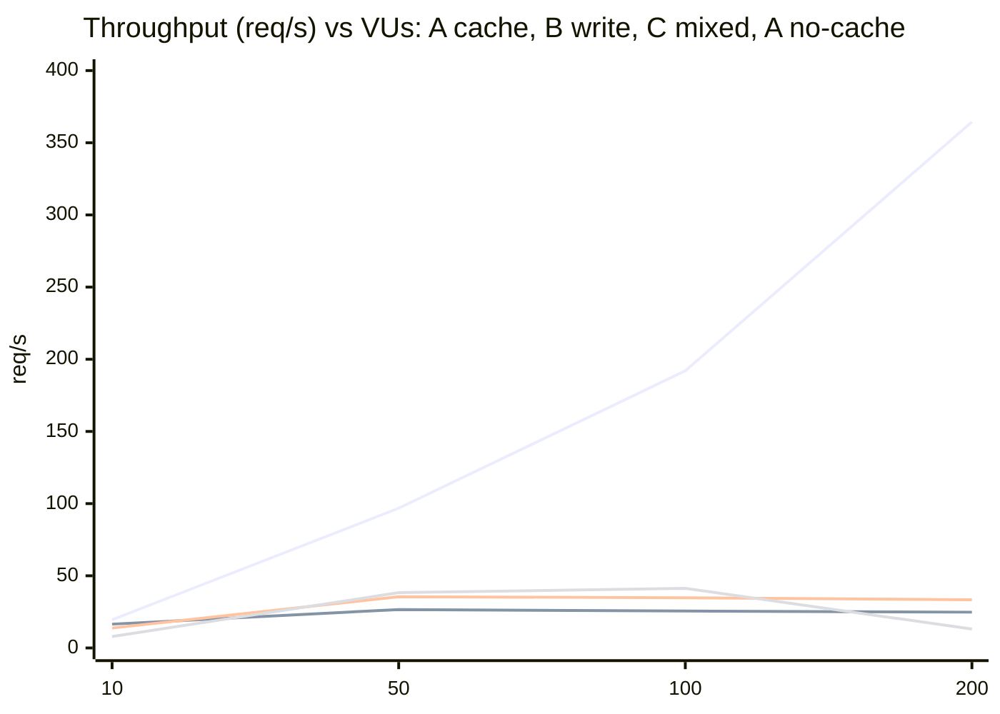
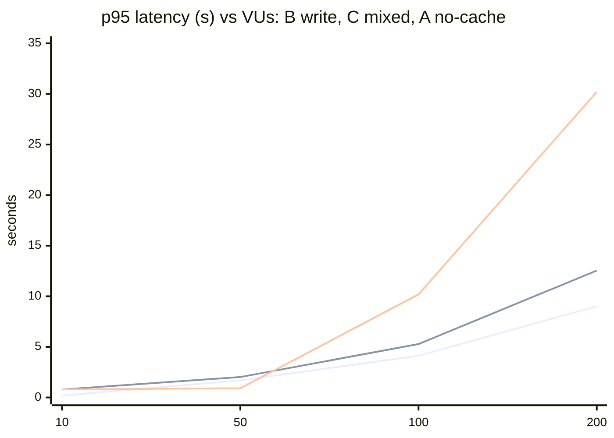

# Lab 5: Load Performance Baseline: план захисту

Гілка `high-load-systems/lab5`. Докази: `high-load-systems/evidence/lab5/`, таблиці та аналіз: `high-load-systems/evidence/lab5/k6/COMPARISON.md`, k6-скрипти в репозиторії: `load-tests/lab5/` (відстежуються git), документація: розділ "Load Performance Baseline" в кореневому `README.md`.

**Код застосунку не змінювався.** Лабораторна це вимірювання і аналіз: система після Lab 2-4 (3 екземпляри Graph за nginx Round Robin, Redis Cache-Aside, PostgreSQL, RabbitMQ, ML, Core) зафіксована як **baseline**, з якого порівнюватимуться Lab 6-10.

## 1. Що зроблено (коротко)

1. Три сценарії навантаження, декларативні k6-скрипти в `load-tests/lab5/`: **A Read-Intensive**, **B Write-Intensive**, **C Complex Workflow**.
2. Специфікація середовища (`evidence/lab5/environment.txt`): залізо, Docker, версії, налаштування PostgreSQL/Redis/nginx, відсутність лімітів.
3. Методика: warm-up, ramp-up, 60-секундне вимірювання (hold), окремий запуск на кожен рівень 10/50/100/200 VUs, staged-прогін 10 -> 25 -> 50 -> 100 -> 200.
4. Метрики по кожному рівню: Throughput, Avg, p50, p95, p99, Error %, плюс ефективність масштабування по VU.
5. Точка насичення (Saturation Point) і головне вузьке місце для кожного сценарію, з CPU по контейнерах (`docker stats`), лічильниками PostgreSQL і пробою RabbitMQ.
6. Вплив масштабування (1 проти 3 екземплярів Graph) і кешування (кеш вимкнено проти увімкнено, зокрема навантаження на СУБД).
7. Заповнена картка **System Performance Baseline** (розділ 7 цього файлу і розділ 10 `COMPARISON.md`).

## 2. Сценарії і чому саме вони

| Сценарій | Що робить | Чому |
|---|---|---|
| **A Read-Intensive** | `GET /api/v1/graph?organizationId=1` (68 КБ, найважчий читальний запит) | Основний читальний шлях, саме його кешували в Lab 4. **Кеш-ключ один**, тож це найкращий випадок кешу |
| **B Write-Intensive** | `POST /api/v1/workspaces/1/entity-graph/create`: Graph -> RabbitMQ RPC -> **Core** -> PostgreSQL, потім інвалідація кешу, доменні події, audit outbox | Єдиний реальний запис у системі. Core мусить працювати (без нього 504 після 30 с). Кожен запит створює сутність, їх видаляє скрипт після запуску |
| **C Complex Workflow** | на кожну ітерацію: `GET graph` -> пауза 300 мс -> `POST create` -> пауза 300 мс | Реалістична суміш. **Запис інвалідує кеш**, тому наступне читання це MISS (кеш майже не допомагає) |

Рішення, які ухвалив студент (форма запитань): реальний ендпоінт запису при запущеному Core; скрипти і в `load-tests/lab5/` (відстежуються), і копії/докази в `evidence/lab5/`; окремий k6-запуск на кожен рівень VUs.

## 3. Методика (і чому саме так)

| Крок | Що | Навіщо |
|---|---|---|
| Closed model, `ramping-vus` | кількість VUs фіксована, новий запит лише після відповіді | вимога лабораторної (ramp-up по VUs). Наслідок: Coordinated Omission (розділ 8) |
| Think time 0.5 с | пауза між ітераціями | імітація користувача; без неї 200 VUs це DoS |
| Warm-up | окремий запуск 5 VUs, 15 с, результати відкидаються | JIT, пули з'єднань, multiplexer Redis, DNS: інакше перші секунди псують p99 |
| Ramp 15 с + hold 60 с | вимірюються лише 60 с утримання (власні метрики `m_*` пишуться лише під час hold) | ramp-up не змішується зі сталим станом |
| **Чистий стан перед кожним запуском** | видалити тестові сутності та рядки `audit_outbox`, очистити черги RabbitMQ, дочекатися простою сервісів, скинути ключі кешу | **головний урок лабораторної** (розділ 9): запис залишає наслідки, які псують наступні запуски |
| k6 **у контейнері** в мережі compose | `grafana/k6`, `http://relativa-graph-lb` | k6 з хоста Windows втрачав 1-3% запитів через переадресацію портів Docker Desktop (розділ 9) |
| Без thresholds | лише статистика | правило курсу: чесні числа, не "добре/погано" |
| Throughput | `m_reqs / 60` | у сценарії C одна ітерація = 2 запити |

## 4. Baseline середовища

i5-8300H (4 ядра, 8 логічних), 7.9 ГБ RAM, Docker Desktop (WSL2) з 8 CPU і близько 4 ГБ RAM **без лімітів на контейнер**; 3 x Graph (Lab 4: Redis cache, TTL 60 с), nginx 1.27.5 Round Robin, Redis 7, PostgreSQL 16 (`max_connections=100`, `shared_buffers=128MB`), RabbitMQ 3.13.7, ML з **одним** споживачем, Core x1, Auth x2. **k6 працює на тій самій VM**, тому він конкурує з системою за CPU (5-55% одного ядра). Повний знімок: `evidence/lab5/environment.txt`.

## 5. Результати

Окремі k6-запуски на кожен рівень (60 с hold). Повні таблиці (Avg, p50, p95, p99, max, Error %, ефективність) і шум між запусками: `COMPARISON.md` розділи 3 і 8.

| Сценарій | 10 VUs | 50 VUs | 100 VUs | 200 VUs |
|---|---|---|---|---|
| **A (кеш)**: req/s, p95, p99 | 19.5, 17 мс, 42 мс | 96.8, 19 мс, 36 мс | 192, 25 мс, 153 мс | 364 (або 306), 51 мс (114), 693 мс (8484 мс); 0.08-0.24% помилок |
| **B (запис)** | 16.5, 191 мс, 276 мс | 26.6, 1687 мс, 1797 мс | 25.6, 4117 мс, 4232 мс | 24.8, 9022 мс, 9127 мс; 0% помилок |
| **C (суміш)** | 13.8, 792 мс, 824 мс | 35.5, 2016 мс, 2478 мс | 34.8, 5281 мс, 5491 мс | 33.4, 12 536 мс, 12 895 мс; 0% помилок |
| *довідково: A без кешу* | 7.9, 795 мс, 806 мс | 38.3, 908 мс, 982 мс | 41.3, 10 191 мс, 23 882 мс, 1% помилок | 13.1, 30 200 мс, 40 992 мс, **90% помилок** |

(Staged-прогін і трьохкратні запуски A на 100/200/300 VUs: `COMPARISON.md` розділи 3-4.)

**Графіки для демонстрації точки насичення** (Mermaid, рендеряться в GitHub і в Cursor; ті самі в кореневому `README.md`). Порядок ліній у першому графіку: A з кешем, B, C, A без кешу.



Порядок ліній у другому графіку: B, C, A без кешу (A з кешем лишається нижче 0.06 с).



Сигнатура Saturation Point на B і C: **плоска крива пропускної здатності з 50 VUs і лінійне зростання p95**. На A без кешу пропускна здатність спочатку плоска (38 -> 41), потім падає (13.1 на 200 VUs): колапс.

**Як це читати.**
- **A (кеш)**: майже ідеальна лінійність до 100 VUs (99% ефективності), далі "коліно": на 200 VUs хвіст розривається (p99 0.2-8.5 с, розкид між запусками 16%). На 300 VUs результати **розійшлися втричі**: один запуск (до перезапуску Docker, зі SonarQube) дав колапс 173 req/s і p95 2.7 с, а пізніший ідентичний запуск (`scaling-300`) дав 548 req/s і p95 65 мс. Колапс не відтворився, причина невідома (підозра: тиск на пам'ять 4-ГБ VM). Це не "система швидка", це "система не насичена, а k6 обмежений формулою `VUs / (think + latency)`".
- **B і C**: класичне насичення. Від 50 VUs пропускна здатність **пласка** (25-27 req/s для B, 30-35 req/s для C), а затримка росте лінійно з VUs (1.4 -> 3.6 -> 8.4 с). **Помилок немає**: система не падає, а ставить у чергу. Закон Літтла: `N = X x (R + Z)`, 200 / (8.4 + 0.5) = 22 req/s, виміряно 24.8.
- **A без кешу**: насичення на ~50 VUs (38 req/s), колапс на 100 і 200. Це те, від чого кеш захищає, і де видно справжню межу читального шляху.

## 6. Точка насичення і вузьке місце

| Шлях | Saturation Point | Головне вузьке місце | Докази |
|---|---|---|---|
| **Запис (B)** | ≈25 VUs (staged), плато ~25 req/s | **RPC Graph -> Core через RabbitMQ**: для кожного запиту нове з'єднання, канал, ексклюзивна reply-черга, опитування `BasicGet` кожні 25 мс | CPU RabbitMQ росте з навантаженням (45% -> 121% -> 177% -> 242%), а Core, Graph, PostgreSQL лишаються на 40-65% одного ядра, ML простоює. Проба: ~27 нових з'єднань/с = швидкості запису. Код: `EntityGraphEndpoints.cs` 111-154. **Не ізольовано**: контрольованого експерименту (прибрати churn і перевимірити) немає |
| **Суміш (C)** | те саме (~30-35 req/s) | запис (як вище) **плюс** читання, що завжди MISS (запис інвалідує ключ) і проходить через ML | ML 75-91% CPU, PostgreSQL 82-88%, у чергу ML лишається 2 100 повідомлень; частка MISS 65% на 50-100 VUs |
| **Читання без кешу** | ~50 VUs | **ML з одним споживачем + RabbitMQ**, далі ліміт з'єднань PostgreSQL | ML 75-82%, RabbitMQ 231%, черга ML росте на 1 000-7 300 повідомлень за запуск; Lab 3: `too many clients already` |
| **Читання з кешем** | **не досягнута**: до 300 VUs пропускна здатність обмежена `VUs/(think+latency)` (548 req/s, p95 65 мс), хвіст нестабільний від 200 VUs; 500 VUs зависили Docker | **спільний CPU хоста** (k6 + nginx + Graph на 8 логічних CPU) і **ліміт з'єднань PostgreSQL під час stampede на холодному кеші** (3 x 100 з'єднань Npgsql проти `max_connections=100`) | CPU: 1 екземпляр 173%, 3 екземпляри по 63%; помилки HTTP 409 на старті 0.03-0.4%; на 300 VUs 3 екземпляри тримають 95 з'єднань PostgreSQL із 100; на 500 VUs Docker зависає |

**Критичний сценарій: запис (B) і комплексний (C)**: насичуються найраніше, затримка під навантаженням складає секунди, кеш їм не допомагає.

## 7. System Performance Baseline (картка)

| Поле | Значення |
|---|---|
| **Environment Config** | 1 VM Docker Desktop (8 логічних CPU, ~4 ГБ RAM, без лімітів) на ноутбуці i5-8300H; 3 x Graph (.NET 10, Redis Cache-Aside TTL 60 с) за nginx 1.27 RR; Redis 7; PostgreSQL 16 (`max_connections=100`); RabbitMQ 3.13; ML (1 споживач); Core x1; Auth x2; k6 v2.3.0 у контейнері на тій самій VM, closed model, think 0.5 с, ramp 15 с + hold 60 с, warm-up 5 VUs 15 с, чистий стан перед кожним запуском |
| **Stable Throughput** | читання (A, кеш): **~190 req/s** на 100 VUs (p95 25-35 мс, 0% помилок, відтворюється в межах 1%); запис (B): **~25 req/s**; суміш (C): **~30-35 req/s**; читання без кешу: ~38 req/s |
| **Saturation Point** | запис і суміш: **≈25 VUs** (окремі запуски: між 10 і 50; staged-прогін: B 27.1 req/s і p95 0.61 с на 25 VUs, C 34.9 req/s і p95 0.82 с, далі плоско або падає); читання без кешу: **~50 VUs**; читання з кешем: **не досягнута** (до 300 VUs обмежено closed loop: 548 req/s; хвіст нестабільний від 200 VUs; 500 VUs зависили Docker) |
| **p95 / p99** | A: 100 VUs 24.5 / 153 мс, 200 VUs 51 / 693 мс; B: 100 VUs 4117 / 4232 мс; C: 100 VUs 5281 / 5491 мс (повна таблиця в `COMPARISON.md`) |
| **Error Rate** | A: 0% до 100 VUs, 0.08-0.24% на 200 VUs; **B і C: 0% на всіх рівнях**; A без кешу: 1% на 100, 90% на 200 |
| **Critical Scenario** | запис (B) і комплексний сценарій (C) |
| **Primary Bottleneck** | запис: RPC Graph -> Core через RabbitMQ (з'єднання на кожен запит); читання без кешу: ML + RabbitMQ; читання з кешем: спільний CPU і ліміт з'єднань PostgreSQL |

## 8. Вплив масштабування і кешування

### Масштабування (1 проти 3 екземплярів, сценарій A, кеш увімкнено)

| | 1 екземпляр | 3 екземпляри |
|---|---:|---:|
| 100 VUs, req/s (запуск 1 / 2) | 189.6 / 193.0 | 191.8 / 192.4 |
| 200 VUs, req/s (запуск 1 / 2) | 368.1 / 337.9 | 370.9 / 370.3 |
| 200 VUs, p99 (запуск 1 / 2) | 164 / 2127 мс | 170 / 207 мс |
| CPU Graph на 200 VUs | **173%** одного ядра | 63-69% на екземпляр |

На 100 VUs масштабування **нічого не дає** (1 екземпляр не насичений). На 200 VUs пропускна здатність така сама (обмежена `VUs/(think+latency)`), виграш лише у **стабільності хвоста** (p99 207 мс проти до 2127 мс). Ефективність масштабування (3-екземплярна пропускна здатність / (3 x одноекземплярна)) близько **33%**: система не насичена. Побічна ціна: 3 x 100 з'єднань Npgsql проти `max_connections=100` дають більше помилок на старті (88 і 74 проти 7 і 62). На 300 VUs (по одному запуску): 499 проти 548 req/s (+10%), p99 2735 проти 578 мс, помилок 19 проти 113, CPU Graph 200% проти 84% на екземпляр, 9 проти 95 з'єднань PostgreSQL; ефективність 548 / (3 x 499) = 37%. Це перший рівень, де масштабування дає помітний виграш. Таблиці: `COMPARISON.md` розділ 6.

### Кешування (A, 50 VUs, кеш вимкнено проти увімкнено)

| | Кеш вимкнено | Кеш увімкнено | Зміна |
|---|---:|---:|---:|
| Throughput | 37.6-38.7 req/s | 96.8-97.2 req/s | +153% |
| p50 | 800-828 мс | 4.5-6.2 мс | -99% |
| p95 | 868-962 мс | 17-19 мс | -98% |
| p99 | 935-1053 мс | 32-42 мс | -96% |
| Транзакцій PostgreSQL за запуск | 49 527 / 49 651 | 2 387 | **-95%** |
| Рядків, повернених запитами | 39.4 M | 2.59 M | -93% |
| Черга ML після запуску | 6 875-7 374 | 0 | -100% |

Кеш з 2.5-разовою кількістю відповідей робить у 20 разів менше транзакцій. Застереження: один користувач і один ключ (найкращий випадок).

## 9. Головні уроки і чесні застереження

1. **Побічні ефекти запису**: кожен запуск B/C залишає backlog подій (Graph і ML споживають хвилинами), створені сутності, 2 рядки `audit_outbox` на запис і чергу `domain.events.ml.workspace.v1` без споживача (дійшла до 37 697 повідомлень). Запуски після записів були повільнішими лише через це (100 VUs читання: 190 req/s чисто, 50-95 req/s одразу після запису). Рішення: `lab5-lib.ps1` перед **кожним** запуском видаляє дані, чистить черги і чекає простою. Забруднені запуски збережені в `evidence/lab5/k6/attempt2-contaminated-by-write-runs/`.
2. **k6 на хості втрачає запити**: 1-3% через переадресацію портів Docker Desktop (`wsarecv: forcibly closed`). k6 у контейнері в мережі compose це усуває. Докази: `attempt1-burst-start/`, `diagnosis-host-port-forward-resets/`, `diagnosis-container-same-params/`.
3. **A на 200 VUs, запуск 1, недійсний** (залишки роботи ML від попереднього запуску): 123 req/s, 1.93% помилок проти 364 req/s, 0.08% у чистому запуску 2. Показано в таблиці шуму з позначкою, ніде більше не використано.
4. **500 VUs зависили Docker Desktop**: це межа тестового стенда з одним хостом. Запуск відкинуто (`attempt3-docker-wedged-at-500-vus/`).
5. **Шум**: нижче насичення розкид пропускної здатності менше 1-2%; у зоні насичення (A на 200 VUs, C на 100) до 14-16%, а хвіст змінюється на порядок. Плато стабільне (B: 25.6 / 25.7).
6. **Не всі комірки мають однакову кількість запусків**: A по 2-3 запуски, B і C по 2 запуски на 10 і 100 VUs і по 1 на 50 і 200 (бюджет часу).
7. **Джерело вузького місця запису не ізольоване**: є кореляція (CPU RabbitMQ, churn), немає експерименту "прибрати churn і перевимірити".

## 10. Теорія для захисту (Q&A)

**Що таке Saturation Point?** Навантаження, після якого додаткові VUs більше не збільшують пропускну здатність (Throughput виходить на плато), а затримка починає рости (черга перед ресурсом, що насичився). У B це плато 25 req/s: на 50 VUs затримка 1.4 с, на 200 VUs 8.4 с, а пропускна здатність та сама. Ознаки: плоска крива Throughput, ріст p95/p99, інколи ріст помилок. Нижче точки насичення латентність майже константна (A до 100 VUs). **Коліно (knee)** це початок, **колапс** це коли пропускна здатність ще й падає (A без кешу на 200 VUs; A на 300 VUs в одному із двох запусків).

**Що таке Coordinated Omission і як це стосується нашого тесту?** У closed model VU чекає відповідь, перш ніж відправити наступний запит. Якщо система зависла на 5 с, генератор **не відправляє** запити, які мали б піти за цей час, і ці "пропущені" довгі очікування не потрапляють у статистику. Реальні користувачі, що приходять незалежно від стану системи, чекали б довше. Наслідок: наші p95/p99 при насиченні **оптимістичні**. Лікування: open model (`constant-arrival-rate` у k6, фіксована інтенсивність незалежно від відповідей) або корекція (HdrHistogram з `expected interval`). Тут використано closed model, бо цього вимагає лабораторна (ramp-up по VUs), і це застереження записане в `COMPARISON.md`.

**Як GC і JIT впливають на перцентилі?** Хвости (p99, max) лякають не повільною "типовою" роботою, а рідкісними паузами: JIT-компіляція перших викликів (холодний старт), збирання сміття (gen2 GC зупиняє потоки, особливо при великих відповідях по 68 КБ), ріст thread pool. Тому існує warm-up: без нього перші секунди дають max порядку секунди (у наших даних max ~1 с у перших запитах навіть при 0% помилок: це cold start кешу і JIT). Середнє це приховує, p99 і max ні. Ми не вимірювали GC окремо, це лише пояснення за аналогією з max, який лишається ~1 с при p95 ~20 мс.

**p50 проти p99: що показувати?** p50 це типовий користувач, p99 це 1 із 100 запитів. Для системи, де користувач робить багато запитів на сторінку, більшість користувачів зустрінуть p99 кілька разів, тому саме хвіст визначає якість. Середнє (avg) оманливе: у A на 200 VUs avg 47 мс при p99 693 мс і max 6.9 с. У B p50 і p99 близькі (1404 / 1797 мс), бо черга однорідна: усі чекають однаково, це ознака насичення, а не випадкових викидів.

**Закон Літтла.** `N = X x (R + Z)` (VUs = пропускна здатність x (час відповіді + think time)). У closed model це пояснює і лінійний ріст A (відповідь швидка, X ~ N/0.5), і плато B (X обмежена системою, тому R росте лінійно з N).

**Closed проти open model.** Closed: фіксоване число VUs, навантаження саморегулюється (система сповільнилась, VUs надсилають менше). Open: фіксована інтенсивність приходу, черга може рости необмежено. Реальні публічні сервіси ближчі до open. Closed бачить насичення як плато і зростання затримки, open як нескінченне зростання затримки і помилки.

**Чому окремі запуски на кожен рівень, а не один staged?** Кожен рівень стартує зі свого чистого стану і не успадковує розігрітий кеш та черги попереднього рівня; можна повторити окремий рівень. Staged-прогін (10 -> 25 -> 50 -> 100 -> 200) показано як демонстрацію форми кривої, але він успадковує стан, і результати ступенів нижче за 60-секундні окремі.

**Чому warm-up відкидається?** JIT, пули з'єднань Npgsql, multiplexer Redis, DNS і кеші ОС роблять перші секунди нетиповими. Warm-up окремим запуском 5 VUs 15 с із тим самим скриптом.

**Чому ефективність масштабування 33%, а не 100%?** Це не втрата, а ненасичення: 1 екземпляр уже тримає 370 req/s (при 200 VUs це обмежено `VUs/(think+latency)`), три екземпляри просто розподіляють ту саму роботу. Закон Амдала / USL: виграш від паралелізму обмежений частками, що не масштабуються (спільні PostgreSQL, RabbitMQ, Redis, один споживач ML). Вимірювати масштабування треба на рівні, де один екземпляр уже насичений (читання без кешу, запис), а не на кеші.

**Чому кеш у лабораторній дає такий великий ефект?** Один ключ, 99% HIT. Реальна суміш користувачів і організацій дала б нижчий hit ratio. Кеш зняв 95% транзакцій PostgreSQL і всю роботу ML для читання.

**Як визначити вузьке місце?** Дивитись, чий CPU росте разом з навантаженням, а чий ні: `docker stats` у сталому стані. У B росте RabbitMQ, інші на 40-65%. Потім підтвердити механізм (проба churn, код). Остаточне доведення це експеримент, що прибирає підозрюваного і перевимірює (не зроблено).

## 11. Ризики і обмеження

- k6 і система на одній VM: частина "насичення" це обмеження стенда (k6 до 55-70% ядра, nginx 45-60%).
- Closed model: оптимістичні перцентили при насиченні (Coordinated Omission).
- Один ключ кешу: найкращий випадок для A.
- Вузьке місце запису не ізольоване експериментально.
- Різна кількість запусків на комірку (розділ 9).
- Біля коліна відтворюваність гірша за 15%; плато стабільні.
- Docker Desktop нестабільний при >= 300-500 VUs; тест дорого відновлювати.
- Дані запису створюють сутності у бойовій базі (`Lab5WriteTest`), їх видаляє `Reset-TestData`; в кінці лабораторної БД повернуто до початкового стану (1394 сутності).
- Лічильники PostgreSQL взято за весь прогін разом з ramp-up (не лише hold): порівняння кеш/без кешу коректне (однаковий протокол), але абсолютні значення включають і ramp-up.

## 12. Відхилення від плану

1. Гілка `high-load-systems/lab5` не містила коду Lab 3 і 4; виконано fast-forward злиття гілки `high-load-systems/lab4` в lab5.
2. k6 запускався **в контейнері**, а не з хоста (хостовий k6 v2.2.0 лишився лише для перших, відкинутих запусків).
3. Забруднені, недійсні і відкинуті запуски збережено в окремих теках і описано (розділ 9).
4. Різна кількість повторів: A по 2-3, B і C по 2 на 10 і 100 VUs і по 1 на 50 і 200.
5. Додано (понад мінімум лабораторної): рівень 300 VUs для читання, ряд без кешу (`uncached/`), порівняння масштабування на 200 і 300 VUs, лічильники PostgreSQL, проба churn RabbitMQ.
6. Кеш-"enabled" сторона порівняння кешування це `scenario-a/vus-50` (не окрема тека `cache-enabled`); `caching/cache-disabled` це окрема тека.
7. Staged-прогін для A, C і B (кожен один раз).
8. Контейнер `relativa-sonarqube` (власний контейнер студента) зупинявся для другої половини вимірювань (дефіцит пам'яті Docker і перезапуск після зависання).
9. Docker Desktop перезапускався після зависання на 500 VUs.
10. Артефакт Lab 3 `ARTIFICIAL_DELAY_MS` залишено в коді і **не** використано (статус у `CONTEXT.md`).

## 13. Як запустити

```powershell
# стек (Lab 3/4) і Core
docker compose -f docker-compose.yaml -f docker-compose.lab2.yml -f docker-compose.lab3.yml up -d --no-build
docker compose -f docker-compose.yaml -f docker-compose.lab2.yml -f docker-compose.lab3.yml up -d --no-build core

# один рівень (чистий стан, warm-up, k6 у контейнері): сценарій A|B|C, VUs, тека результату, номер запуску
powershell -File high-load-systems/evidence/lab5/scripts/run-k6.ps1 -Scenario B -Vus 50 -OutDir scenario-b/vus-50 -Run 1

# вся сітка (списки через кому, одним рядком)
powershell -File high-load-systems/evidence/lab5/scripts/run-matrix.ps1 -Part main -Scenarios A,B,C -Levels 10,50,100,200 -Run 1

# staged-прогін 10 -> 25 -> 50 -> 100 -> 200
powershell -File high-load-systems/evidence/lab5/scripts/run-staged.ps1 -Scenario C

# таблиця рівнів з summary-файлів
& high-load-systems/evidence/lab5/k6/build-baseline-table.ps1 -Dir high-load-systems/evidence/lab5/k6/scenario-b -Run 1
```

Скрипти k6 (`load-tests/lab5/*.js`) можна запускати і напряму: `k6 run -e BASE_URL=http://localhost:8090 -e VUS=50 -e DURATION=60s load-tests/lab5/scenario-a-read.js` (з хоста можливі 1-3% втрат запитів, див. розділ 9).
