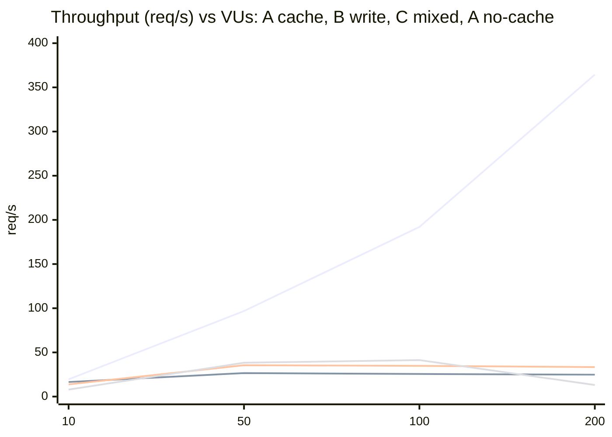
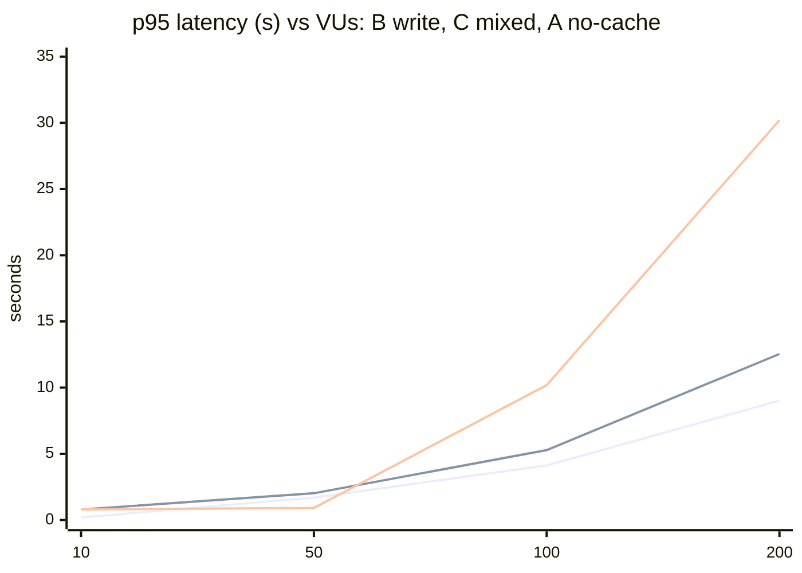

# Lab 5: Load Performance Baseline (k6)

Lab 5 has no "pre-lab / post-lab" pair: it measures the system **as it is after Labs 2-4** (3 Graph instances behind nginx Round Robin, Redis Cache-Aside, PostgreSQL, RabbitMQ, ML, Core) and records a baseline. No application code was changed. The comparisons that the lab asks for (scaling impact, caching impact) are done on the same stack by switching one thing.

All numbers come from `summary.runN.json` files in this folder. Tables were generated with `build-baseline-table.ps1` (ladders) and `compare-summaries.ps1` (A/B comparisons) and pasted in. Rates are `m_reqs / 60` (see "Test input").

## 1. Test input

| Item | Value |
|---|---|
| Tool | k6 v2.3.0 (`grafana/k6:latest` container). The host k6 (v2.2.0) was **not** used for any valid run, see section 9 |
| Where k6 runs | In a container on the compose network `relativa_relativa_net`, entry point `http://relativa-graph-lb` (nginx, port 80 inside the network). Same Docker VM as the system under test, so k6 competes with it for CPU (k6 used 5-55% of one core, section 5) |
| Executor | `ramping-vus` (closed model: a new request is sent only after the previous answer; VU count is fixed) |
| Profile of one run | 15 s ramp 0 -> N VUs (not measured) + **60 s hold at N VUs (measured)**. Custom metrics `m_reqs`, `m_failed`, `m_dur`, `m_dur_ok` are recorded only while the hold runs (`exec.scenario.startTime`) |
| Warm-up | Separate k6 run before every measured run: 5 VUs, 15 s, same script. Its numbers are discarded (JIT, connection pools, Redis multiplexer, DNS) |
| Load levels | 10 / 50 / 100 / 200 VUs, **one k6 run per level** (separate runs, lab decision); extra read runs at 300 VUs. Staged ramp 10 -> 25 -> 50 -> 100 -> 200 in one run (section 4) |
| Think time | 500 ms between iterations (Scenario C: 300 ms after the read and 300 ms after the write) |
| Thresholds | **None.** Stats only |
| Timeout | k6 default (60 s) |
| Throughput | `m_reqs / 60` (requests that finished inside the hold). In scenario C one iteration = 2 requests |
| Latency columns | avg / p50 (med) / p95 / p99 / max of `m_dur` (all requests, including failed ones). Error % = `m_failed / m_reqs` (status != 200) |

| Scenario | Requests (`load-tests/lab5/`) | Data set |
|---|---|---|
| **A Read-Intensive** (`scenario-a-read.js`) | `GET /api/v1/graph?organizationId=1`, header `X-User-Id: 1`; answer about 68 KB JSON; counts `X-Cache` HIT/MISS | one user, one organization = **one cache key** (best case of the cache); cold cache at the start of every run |
| **B Write-Intensive** (`scenario-b-write.js`) | `POST /api/v1/workspaces/1/entity-graph/create`, body `{"entityTypeId":1,"properties":[{"propertyId":1,"value":"Lab5WriteTest"},{"propertyId":3,"value":"Probe"}]}`. Real write: Graph -> RabbitMQ RPC -> **Core** -> PostgreSQL, then cache invalidation, domain events, audit outbox | every request creates one entity (about 1 100-1 900 per run), deleted after the run |
| **C Complex Workflow** (`scenario-c-mixed.js`) | per iteration: `GET graph` -> think 300 ms -> `POST create` -> think 300 ms | as A + B. **The write invalidates the cache key of the organization, so the next read is a MISS** (the cache mostly does not help here) |

Request mix and clean-state rules are in `load-tests/README.md`.

## 2. Environment (baseline specification)

Full capture: `../environment.txt`.

| Component | Value |
|---|---|
| Host | Intel Core i5-8300H, 4 cores / 8 logical, 7.9 GB RAM, Windows 10, Docker Desktop (WSL2) |
| Docker VM | 8 CPUs, about 4 GB RAM for all containers, **no CPU or memory limits per container** |
| Graph | 3 instances (`graph`, `graph-2`, `graph-3`), .NET 10, Lab 4 image (Redis cache, TTL 60 s +/-10%), Npgsql default pool (100 per instance) |
| Load balancer | nginx 1.27.5, Round Robin, `zone` in upstream, 8 workers |
| Cache | Redis 7, `maxmemory 0`, `noeviction`, no persistence |
| Database | PostgreSQL 16, `max_connections=100`, `shared_buffers=128MB`, `work_mem=4MB` |
| Broker | RabbitMQ 3.13.7 |
| ML | Django service, **one consumer** of `ml.graph.score_request.v1` |
| Core | 1 instance (needed for Scenario B/C writes) |
| Other | Auth x2, MailHog running. `relativa-sonarqube` (student's container) was stopped for the second half of the measurements (it was restarted by Docker after the engine restart, see section 9); its CPU was 4-11% and memory 1.2 GB |

## 3. Results per scenario (separate k6 run per level)

Efficiency = measured throughput / (previous level's throughput x VU ratio). 100% means linear growth. Throughput in a closed loop with think time is `VUs / (think + latency)`, so **linear growth only says "the system is not the limit yet"**; a flat curve with growing latency is the saturation signature.

### Scenario A: Read-Intensive (cache on), run 2 (the clean ladder)

| Load (VUs) | Throughput (RPS) | Avg latency | p50 latency | p95 latency | p99 latency | Max latency | Error rate (%) | Failed / total | Linear ideal (RPS) | Efficiency |
|---:|---:|---:|---:|---:|---:|---:|---:|---:|---:|---:|
| 10 | 19.5 | 13.6 ms | 4.5 ms | 16.8 ms | 41.5 ms | 942 ms | 0.00 | 0 / 1171 | - | - |
| 50 | 96.8 | 15.7 ms | 6.2 ms | 19.4 ms | 36.0 ms | 1031 ms | 0.00 | 0 / 5808 | 97.6 | 99% |
| 100 | 192.0 | 19.8 ms | 6.1 ms | 24.5 ms | 152.5 ms | 1623 ms | 0.00 | 0 / 11518 | 193.6 | 99% |
| 200 | 364.4 | 46.8 ms | 8.1 ms | 51.4 ms | 692.8 ms | 6894 ms | 0.08 | 18 / 21862 | 383.9 | 95% |

Run 3 (100 / 200 / 300 VUs, same protocol; the 500-VU run wedged Docker Desktop and was discarded, section 9):

| Load (VUs) | Throughput (RPS) | Avg latency | p50 latency | p95 latency | p99 latency | Max latency | Error rate (%) | Failed / total | Linear ideal (RPS) | Efficiency |
|---:|---:|---:|---:|---:|---:|---:|---:|---:|---:|---:|
| 100 | 190.7 | 22.9 ms | 6.9 ms | 28.2 ms | 97.1 ms | 2130 ms | 0.00 | 0 / 11443 | - | - |
| 200 | 306.4 | 228.1 ms | 11.2 ms | 113.6 ms | 8484.3 ms | 25672 ms | 0.24 | 45 / 18382 | 381.4 | 80% |
| 300 | 173.4 | 480.2 ms | 84.8 ms | 2681.3 ms | 3417.9 ms | 4921 ms | 0.00 | 0 / 10403 | 459.6 | 38% |

Reading: up to 100 VUs the curve is linear (99%), latency stays flat (p95 about 20-35 ms). At 200 VUs the average is still good but the **tail explodes** (p99 0.7-8.5 s, max 7-26 s, 0.1-0.2% failed) and the two runs differ by 16% (364 vs 306 req/s): this is the start of saturation. At 300 VUs this run (run 3) **collapsed** (173 req/s, p95 2.7 s), **but the collapse was not reproduced**: a later, otherwise identical 3-instance run at 300 VUs (`scaling-300/3-instances`, after the Docker restart and with `relativa-sonarqube` stopped, section 6) did **548 req/s, p95 65 ms, p99 578 ms, 0.34% failed**. Differences between the two: run 3 was made before the Docker Desktop restart and with sonarqube (1.2 GB of the 4 GB) running, and it had no CPU data. The cause of the 173 req/s is therefore **unknown** (memory pressure on the 4-GB VM and the PostgreSQL stampede are suspects); the 300-VU level is the border of what this bench can measure reliably, and 500 VUs wedged Docker. The failures at 200 VUs happen in the first seconds (cold cache, 200 VUs miss the same key at once, stampede) and are HTTP 409 from Graph when PostgreSQL answers `too many clients already` (reproduced and counted in `../diagnosis-container-same-params/`).

### Scenario B: Write-Intensive, run 1 and run 2

| Load (VUs) | Throughput (RPS) | Avg latency | p50 latency | p95 latency | p99 latency | Max latency | Error rate (%) | Failed / total | Linear ideal (RPS) | Efficiency |
|---:|---:|---:|---:|---:|---:|---:|---:|---:|---:|---:|
| 10 | 16.5 | 106.0 ms | 89.0 ms | 190.6 ms | 276.4 ms | 352 ms | 0.00 | 0 / 989 | - | - |
| 50 | 26.6 | 1417.0 ms | 1404.2 ms | 1687.0 ms | 1797.3 ms | 1843 ms | 0.00 | 0 / 1596 | 82.4 | 32% |
| 100 | 25.6 | 3604.9 ms | 3559.4 ms | 4117.0 ms | 4232.4 ms | 4274 ms | 0.00 | 0 / 1537 | 53.2 | 48% |
| 200 | 24.8 | 8434.0 ms | 8666.3 ms | 9021.8 ms | 9126.5 ms | 9176 ms | 0.00 | 0 / 1490 | 51.2 | 48% |

Run 2 (10 and 100 VUs only): 10 VUs 16.6 req/s, p95 165.8 ms, p99 209 ms; 100 VUs 25.7 req/s, p95 3937 ms, p99 4084 ms, 0 failures.

Reading: the textbook saturation curve. From 50 VUs on **throughput is flat at 25-27 req/s** while latency grows linearly with the VU count (1.4 s -> 3.6 s -> 8.4 s: every extra VU just waits in a queue; Little's Law: N = X x (R + think) gives 200 / (8.4 + 0.5) = 22 req/s, close to the measured 24.8). **There were no errors at all**: the system does not fail, it queues (the client-side wait is the symptom). The plateau is the same in both runs (25.6 and 25.7 req/s at 100 VUs).

### Scenario C: Complex Workflow (read + write), run 1 and run 2

| Load (VUs) | Throughput (RPS) | Avg latency | p50 latency | p95 latency | p99 latency | Max latency | Error rate (%) | Failed / total | Linear ideal (RPS) | Efficiency |
|---:|---:|---:|---:|---:|---:|---:|---:|---:|---:|---:|
| 10 | 13.8 | 434.0 ms | 264.0 ms | 791.9 ms | 823.8 ms | 1343 ms | 0.00 | 0 / 826 | - | - |
| 50 | 35.5 | 1143.2 ms | 1120.4 ms | 2016.3 ms | 2477.5 ms | 2622 ms | 0.00 | 0 / 2131 | 68.8 | 52% |
| 100 | 34.8 | 2758.7 ms | 3752.9 ms | 5280.7 ms | 5491.1 ms | 5773 ms | 0.00 | 0 / 2085 | 71.0 | 49% |
| 200 | 33.4 | 6438.2 ms | 8305.5 ms | 12536.4 ms | 12894.9 ms | 13178 ms | 0.00 | 0 / 2001 | 69.5 | 48% |

Run 2: 10 VUs 13.9 req/s (p95 791.5 ms); 100 VUs 30.1 req/s (p95 7011 ms, p99 8012 ms), 0 failures.

Reading: same shape, plateau at **30-35 req/s** (that is 15-17 workflow iterations per second, each iteration = 1 read + 1 write). Per request type (`duration_read` / `duration_write` and `cache_hit` / `cache_miss` in `k6-output.run1.txt`): at 10 VUs the **read** has p50 778 ms and 391 of 413 reads (95%) are `X-Cache: MISS`, while the **write** has p50 83 ms; at 50 VUs 689 of 1052 reads (65%) are MISS, read p50 801 ms, write avg 1.72 s; at 100 VUs 655 of 1003 reads (65%) are MISS, read p50 808 ms, write avg 4.8 s. So every write throws the cache key away and the next read of any VU is a MISS that goes through the slow ML path described in the Lab 4 log (ML queue 2 100-2 150 messages left after the 100/200-VU runs, ML at 75-91% CPU). Under load the **write** is what grows (83 ms -> 4.8 s), the read stays at about 0.8 s. That is why C is "mixed" in more than one way: it pays for the write bottleneck and for the uncached read together. The run-to-run difference at 100 VUs is 14% (34.8 vs 30.1 req/s).

### Reference: uncached read (cache disabled, original Graph image), run 1

Not one of the three required scenarios, measured because it shows where the read path really breaks (the cached path hides it). Same Scenario A script on the pre-Lab-4 image (`graph` x3, no Redis use).

| Load (VUs) | Throughput (RPS) | Avg latency | p50 latency | p95 latency | p99 latency | Max latency | Error rate (%) | Failed / total | Linear ideal (RPS) | Efficiency |
|---:|---:|---:|---:|---:|---:|---:|---:|---:|---:|---:|
| 10 | 7.9 | 777.6 ms | 775.4 ms | 795.2 ms | 806.3 ms | 825 ms | 0.00 | 0 / 474 | - | - |
| 50 | 38.3 | 823.9 ms | 810.8 ms | 908.0 ms | 981.7 ms | 1145 ms | 0.00 | 0 / 2295 | 39.5 | 97% |
| 100 | 41.3 | 2318.6 ms | 1042.9 ms | 10190.7 ms | 23881.6 ms | 41311 ms | 1.01 | 25 / 2476 | 76.5 | 54% |
| 200 | 13.1 | 18936.6 ms | 16296.6 ms | 30200.5 ms | 40991.8 ms | 44594 ms | 89.69 | 705 / 786 | 82.5 | 16% |

Reading: **saturation at about 50 VUs (about 38-41 req/s)**, **collapse at 100 and 200 VUs** (p99 24 s, then 90% failures). This is the original system, and it is what the cache protects from. ML (one consumer) was at 75-87% CPU, RabbitMQ at 195-230% and the queue `ml.graph.score_request.v1` grew by 1 000-7 300 messages per run.

### Charts

Throughput (req/s) vs VUs, lines in order: A cache on, B write, C mixed, A cache off (reference). The same charts are in the root `README.md`.

p95 latency (s) vs VUs, lines in order: B write, C mixed, A cache off (A cache on stays below 0.06 s).

## 4. Staged ramp (10 -> 25 -> 50 -> 100 -> 200 VUs in one run)

One `ramping-vus` run, 10 s ramp + 40 s hold per stage (`load-tests/lab5/staged-demo.js`, `scripts/run-staged.ps1`). Per-stage numbers are collected only in each stage's hold. The stages are shorter than the 60-s ladder and each stage inherits the state of the previous one (warm cache, queues), so they are a demonstration of the shape, not the baseline.

### Scenario A (cache on)

| Load (VUs) | Throughput (RPS) | Avg latency | p50 latency | p95 latency | p99 latency | Max latency | Error rate (%) | Errors / requests |
|---:|---:|---:|---:|---:|---:|---:|---:|---:|
| 10 | 19.7 | 6.9 ms | 6.1 ms | 13.8 ms | 15.6 ms | 21 ms | 0.00 | 0 / 590 |
| 25 | 49.3 | 6.2 ms | 4.4 ms | 15.4 ms | 20.0 ms | 24 ms | 0.00 | 0 / 1478 |
| 50 | 95.8 | 21.1 ms | 3.4 ms | 11.5 ms | 932.6 ms | 1334 ms | 0.00 | 0 / 2874 |
| 100 | 197.9 | 4.5 ms | 3.4 ms | 10.4 ms | 21.9 ms | 47 ms | 0.00 | 0 / 5938 |
| 200 | 197.8 | 318.7 ms | 21.2 ms | 860.9 ms | 5461.9 ms | 24100 ms | 0.89 | 53 / 5934 |

The 50-VU stage has a p99 of 933 ms only because the first stages ran with a cold cache for part of it (one stampede at the TTL expiry). At 200 VUs the throughput is flat (197.8 req/s) and p99 is 5.5 s with 0.89% failures: the stage shows the knee that the separate run at 200 VUs also shows.

### Scenario B (write), staged

| Load (VUs) | Throughput (RPS) | Avg latency | p50 latency | p95 latency | p99 latency | Max latency | Error rate (%) | Errors / requests |
|---:|---:|---:|---:|---:|---:|---:|---:|---:|
| 10 | 17.1 | 84.9 ms | 78.8 ms | 124.4 ms | 168.3 ms | 242 ms | 0.00 | 0 / 512 |
| 25 | 27.1 | 422.2 ms | 396.4 ms | 611.7 ms | 679.6 ms | 738 ms | 0.00 | 0 / 812 |
| 50 | 25.7 | 1438.4 ms | 1435.4 ms | 1650.2 ms | 1811.1 ms | 1830 ms | 0.00 | 0 / 771 |
| 100 | 24.1 | 3603.4 ms | 3557.9 ms | 3996.8 ms | 4024.8 ms | 4058 ms | 0.00 | 0 / 722 |
| 200 | 21.6 | 8398.5 ms | 8722.3 ms | 8934.4 ms | 8963.1 ms | 9010 ms | 0.00 | 0 / 649 |

### Scenario C (mixed), staged

| Load (VUs) | Throughput (RPS) | Avg latency | p50 latency | p95 latency | p99 latency | Max latency | Error rate (%) | Errors / requests |
|---:|---:|---:|---:|---:|---:|---:|---:|---:|
| 10 | 13.7 | 431.1 ms | 177.8 ms | 804.9 ms | 831.2 ms | 885 ms | 0.00 | 0 / 410 |
| 25 | 34.9 | 415.3 ms | 334.7 ms | 816.2 ms | 845.7 ms | 889 ms | 0.00 | 0 / 1047 |
| 50 | 32.2 | 1171.3 ms | 1016.7 ms | 2059.9 ms | 3057.5 ms | 3851 ms | 0.00 | 0 / 967 |
| 100 | 28.7 | 3131.8 ms | 1478.0 ms | 6617.0 ms | 6977.7 ms | 7119 ms | 0.00 | 0 / 862 |
| 200 | 25.5 | 7016.2 ms | 1227.2 ms | 15135.4 ms | 15639.3 ms | 15839 ms | 0.00 | 0 / 765 |

**The staged runs locate the knee of the write path: about 25 VUs.** B reaches its plateau at 25 VUs (27.1 req/s, p95 0.61 s); from there throughput is flat or slowly falling (25.7 -> 24.1 -> 21.6 req/s) while p95 grows 0.6 -> 1.7 -> 4.0 -> 8.9 s. C peaks at 25 VUs too (34.9 req/s, p95 0.82 s) and then declines (32.2 -> 28.7 -> 25.5) with p95 up to 15 s. The 10-VU stage of B (17.1 req/s, p95 124 ms) is the "healthy" region. The slow decline of throughput past the knee (and the 200-VU B stage at 21.6 against 24.8 in the separate run) is the typical cost of overload: queueing and connection churn eat capacity, and each stage inherits the queue of the previous one. In C the p50 is far below the average at 100-200 VUs (1.2-1.5 s vs 3.1-7.0 s) because reads (about 0.8 s) and writes (seconds) are two populations in one metric.

## 5. Where the time and CPU go (docker stats during the hold)

Average / maximum CPU % of one core inside the 60-s hold (100% = one core; the Docker VM has 8). Source: `resources.runN.txt` next to each run (made from the `docker stats` stream, `cpu-stream.runN.txt`). The first Scenario A and scaling-100 runs were made before this was in place and have no CPU data.

| Run | k6 | nginx | Graph (each of 3) | Core | ML | PostgreSQL | RabbitMQ | Redis |
|---|---:|---:|---:|---:|---:|---:|---:|---:|
| A, 50 VUs, cache on (`scenario-a/vus-50` run 3) | 22 / 34 | 15 / 26 | 25 / 48 | 1 / 5 | 26 / 77 | 10 / 64 | 18 / 132 | 4 / 8 |
| A, 50 VUs, cache OFF (`uncached/vus-50` run 2) | 10 / 14 | 5 / 15 | 59 / 74-90 | 1 / 8 | **75 / 82** | 80 / 132 | **231 / 290** | 2 / 9 |
| A, 200 VUs, 3 instances (`scaling-200/3-instances` run 2) | 53 / 65 | 45 / 62 | 63 / 81 (one graph shown) | - | - | 30 / 272 | 29 / 170 | 9 / 18 |
| A, 200 VUs, 1 instance (`scaling-200/1-instance` run 2) | 50 / 68 | 0 | **173 / 216** | - | - | 67 / 394 | 35 / 170 | 8 / 13 |
| B, 10 VUs (`scenario-b/vus-10` run 1) | 4 / 7 | - | 9 / 14 | 32 / 44 | 4 / 13 | 30 / 48 | 45 / 177 | - |
| B, 50 VUs (`scenario-b/vus-50` run 1) | 6 / 8 | - | 42 / 51 | 60 / 75 | 5 / 7 | 56 / 67 | **121 / 266** | - |
| B, 100 VUs (`scenario-b/vus-100` run 1) | 5 / 10 | 2 / 2 | 51 / 61 | 59 / 64 | 5 / 18 | 58 / 70 | **177 / 293** | 2 / 7 |
| B, 200 VUs (`scenario-b/vus-200` run 1) | 6 / 17 | - | 63 / 74 | 57 / 66 | 6 / 21 | 58 / 81 | **242 / 348** | - |
| C, 100 VUs (`scenario-c/vus-100` run 1) | 10 / 19 | 6 / 8 | 56 / 70 | 44 / 55 | **77 / 91** | 88 / 108 | **191 / 270** | 3 / 8 |
| C, 200 VUs (`scenario-c/vus-200` run 1) | 9 / 24 | - | 58 / 71 | 41 / 59 | **75 / 89** | 82 / 92 | **224 / 276** | - |
| A, 300 VUs, 3 instances (`scaling-300/3-instances` run 1) | 71 / 86 | 62 / 74 | 84 / 101 (one graph shown) | - | - | 25 / 298 | 27 / 157 | 12 / 19 |
| A, 300 VUs, 1 instance (`scaling-300/1-instance` run 1) | 64 / 92 | 0 | **200 / 258** | - | - | 51 / 360 | 38 / 193 | 9 / 15 |

What this table says:
- **Write path (B):** throughput is capped at 25 req/s while Core, Graph, PostgreSQL stay at 40-65% of one core and ML is idle. The only process whose CPU **grows with the load** is RabbitMQ (45% -> 121% -> 177% -> 242% for 10 -> 50 -> 100 -> 200 VUs). Nothing is at 100% of a core except the broker. The sum of all containers is about 4.7 of the 8 logical CPUs; the laptop has 4 physical cores with Hyper-Threading, so the host is also near its real capacity and **host-level contention cannot be excluded** by this data alone. The queue is not a CPU queue of Graph, Core or PostgreSQL individually. See section 11 for the cause.
- **Mixed path (C):** the same RabbitMQ pattern plus ML at 75-91% (the single ML consumer) and PostgreSQL at 82-88%: two bottlenecks stack.
- **Uncached read:** ML 75-82% and RabbitMQ 231% for only 38 req/s. Per request, the uncached path is by far the most expensive one.
- **Cached read, 200 VUs:** one Graph instance used 173% CPU on average (peak 216%) for 338-368 req/s, three instances about 63-69% each for 370 req/s: the total work is the same, the load is only spread. k6 itself used 50-55% of one core and nginx 45% (with 3 instances).

At 300 VUs with 3 instances the whole bench is busy: k6 about 0.7 core, nginx 0.6 core, three Graph about 2.5 cores, i.e. about 4-4.5 logical CPUs of 8 (about the real capacity of 4 hyper-threaded cores) and PostgreSQL sees 95 connections (limit 100) during the run: the next limits of the cached read are the host CPU and the PostgreSQL connection limit, not Graph.

## 6. Scaling impact (1 vs 3 Graph instances, Scenario A, cache on)

One instance = a separate nginx (`relativa-lab5-lb-1`, `nginx-1instance.conf`) with a single upstream (`graph`), same Graph image, same Redis, same protocol. Three instances = the normal stack. Two runs per side.

### 100 VUs (`scaling/`)

| Metric | Run | 1 instance | 3 instances | Change |
|---|---|---:|---:|---:|
| Throughput | 1 | 189.6 req/s | 191.8 req/s | +1.2% |
| Throughput | 2 | 193.0 req/s | 192.4 req/s | -0.3% |
| p95 | 1 / 2 | 59.3 / 21.9 ms | 25.0 / 24.4 ms | -58% / +11% |
| p99 | 1 / 2 | 333.4 / 46.4 ms | 44.0 / 51.7 ms | -87% / +11% |
| Error rate | 1 / 2 | 0.00 / 0.00% | 0.00 / 0.00% | same |

### 200 VUs (`scaling-200/`)

| Metric | Run | 1 instance | 3 instances | Change |
|---|---|---:|---:|---:|
| Throughput | 1 | 368.1 req/s | 370.9 req/s | +0.8% |
| Throughput | 2 | 337.9 req/s | 370.3 req/s | +9.6% |
| Latency avg | 1 / 2 | 42.6 / 90.7 ms | 37.9 / 38.1 ms | -11% / -58% |
| p50 | 1 / 2 | 9.9 / 12.5 ms | 9.9 / 7.9 ms | 0% / -37% |
| p95 | 1 / 2 | 42.3 / 57.1 ms | 44.6 / 32.2 ms | +5% / -44% |
| p99 | 1 / 2 | 163.9 / 2127.1 ms | 170.3 / 207.4 ms | +4% / -90% |
| Failed requests | 1 / 2 | 7 (0.03%) / 62 (0.31%) | 88 (0.40%) / 74 (0.33%) | worse / worse |

### 300 VUs (`scaling-300/`, one run per side)

| Metric | 1 instance | 3 instances | Change |
|---|---:|---:|---:|
| Throughput | 499.0 req/s | 548.2 req/s | +9.9% |
| Latency avg | 99.3 ms | 45.2 ms | -54.5% |
| p50 | 19.2 ms | 9.3 ms | -51.6% |
| p95 | 84.4 ms | 64.9 ms | -23.1% |
| p99 | 2735.1 ms | 577.5 ms | -78.9% |
| Max | 9500 ms | 6738 ms | -29.1% |
| Failed requests | 19 (0.06%) | 113 (0.34%) | worse |
| CPU of Graph | 200% (one instance) | 84% each |  |
| PostgreSQL connections (sampled) | 9 | 95 | |

Reading of all three levels: **at 100 VUs scaling gives nothing** (throughput equal within 1%), because a single instance is not saturated by the cached path. At 200 VUs the throughput is about the same (368 vs 371 in run 1, 338 vs 370 in run 2): the load is still bounded by `VUs / (think + latency)` = 200 / (0.5 + 0.04) = 370 req/s, which the 3-instance stack reaches and one instance reaches only in one of two runs. What 3 instances buy at 200 VUs is **tail stability** (p99 164-207 ms vs 164-2127 ms, avg 38 vs 43-91 ms), not throughput. Scale-out efficiency (3-instance throughput / 3 x single-instance throughput) is therefore about **33%**: three instances serve the same traffic with a third of the CPU each, which is what a non-saturated system looks like. The 3-instance side had *more* start-up failures (88 and 74 vs 7 and 62): three instances open 3 x 100 connections to PostgreSQL (`max_connections=100`) during the cold-cache stampede (the sampler saw 60-76 connections with 3 instances vs 7-39 with one). That cost of scaling is the same finding as in Lab 3. At 300 VUs three instances give +10% throughput (548 vs 499 req/s), a p99 of 0.58 s against 2.7 s and 113 vs 19 start-up failures (95 PostgreSQL connections against the limit of 100); the single instance used 200% CPU (about two cores, still not at a hard limit because Graph has no CPU limit here), so scale-out efficiency is 548 / (3 x 499) = **37%**. First sign of a real scaling benefit, and the first level where the PostgreSQL connection limit is almost reached by the 3-instance side. Only one run per side exists at 300 VUs.

## 7. Caching impact (Scenario A, 50 VUs, cache on vs cache off)

Cache off = original Graph image (`relativa-graph-orig`, same as Lab 4 "pre-lab"); cache on = Lab 4 image. Same k6 script, same protocol, cold start, three Graph instances behind nginx. Cache-on side is `scenario-a/vus-50` (runs 1, 2, 3), cache-off side is `caching/cache-disabled` (runs 1, 2) and `uncached/vus-50` (runs 2, 3).

| Metric | Cache OFF (run 1 / 2) | Cache ON (run 1 / 2) | Change (run 2) |
|---|---:|---:|---:|
| Throughput | 37.6 / 38.3 req/s | 96.8 / 96.8 req/s | +153% |
| Latency avg | 846 / 822 ms | 15.2 / 15.7 ms | -98.1% |
| p50 | 828 / 812 ms | 4.8 / 6.2 ms | -99.2% |
| p95 | 962 / 892 ms | 18.9 / 19.4 ms | -97.8% |
| p99 | 1053 / 949 ms | 42.4 / 36.0 ms | -96.2% |
| Error rate | 0.00 / 0.00% | 0.00 / 0.00% | same |
| ML queue after the run | 6 875 / 7 374 messages | 0 | -100% |

Database load (`db-load.runN.txt`, `pg_stat_database` delta over the whole k6 run including the 15-s ramp, counters of database `relativa`):

| Counter | Cache OFF (`uncached/vus-50` run 2 / run 3) | Cache ON (`scenario-a/vus-50` run 3) | Change |
|---|---:|---:|---:|
| Transactions | 49 527 / 49 651 | 2 387 | **-95%** |
| Rows returned by queries (`tup_returned`) | 39.4 M / 39.5 M | 2.59 M | **-93%** |
| Rows fetched (`tup_fetched`) | 4.87 M / 4.88 M | 0.44 M | -91% |
| Blocks read + hit | 943 k / 929 k | 160 k | -83% |
| Requests served in the same run (hold) | about 2 300 | about 5 800 | cache ON served **2.5x more requests** with 20x fewer transactions |
| PostgreSQL CPU avg / max in the hold | 80% / 132% | 10% / 64% | |
| Connections to the lab DB (sampled) | 28 | 15 | |
| Graph CPU avg per instance | 59% | 25% | |

Reading: the cache removes about 95% of the database transactions and moves the whole read path from "limited by ML + RabbitMQ" (ML 75%, RabbitMQ 231% CPU) to "limited by the client" (VUs / think time). Cache-ON numbers are for one user and one key (best case, 99% HIT); a realistic mix of users/organizations would give a lower hit ratio. The ladder of the uncached path is in section 3; at 100 VUs without cache the system already fails (1% failures, p99 24 s).

## 8. Run-to-run noise

Same setup, same protocol, different run (clean-state runs only). "run 1 (pre-settle)" means the first run of A made before the clean-state helpers existed (section 9).

| Scenario / VUs | Run 1 | Run 2 | Run 3 | Spread of throughput |
|---|---|---|---|---|
| A, 10 | 19.5 req/s, p95 12.9 ms | 19.5 req/s, p95 16.8 ms | - | 0% |
| A, 50 | 96.8, p95 18.9 ms | 96.8, p95 19.4 ms | 97.2, p95 17.0 ms | 0.4% |
| A, 100 | 190.6, p95 35.8 ms | 192.0, p95 24.5 ms | 190.7, p95 28.2 ms | 0.7% |
| A, 200 | **122.8, p95 14 273 ms, 1.93% errors (invalid, pre-settle, see section 9)** | 364.4, p95 51.4 ms, 0.08% | 306.4, p95 113.6 ms, 0.24% | **16%** (runs 2-3) |
| A, 300 | - | - | 173.4, p95 2681 ms, 0% (main ladder, before the Docker restart, sonarqube running) | **3x** against `scaling-300/3-instances`: 548.2, p95 64.9 ms, 0.34% (after the restart, sonarqube stopped). Not reproduced, cause unknown |
| B, 10 | 16.5, p95 190.6 ms | 16.6, p95 165.8 ms | - | 0.6% |
| B, 100 | 25.6, p95 4117 ms | 25.7, p95 3937 ms | - | 0.4% |
| C, 10 | 13.8, p95 791.9 ms | 13.9, p95 791.5 ms | - | 0.7% |
| C, 100 | 34.8, p95 5281 ms | 30.1, p95 7011 ms | - | **14%** |
| Scaling 100, 1 instance | 189.6 | 193.0 | - | 1.8% |
| Scaling 200, 1 instance | 368.1 | 337.9 | - | 8% |
| Scaling 200, 3 instances | 370.9 | 370.3 | - | 0.2% |
| Cache OFF, 50 | 37.6 | 38.3 (run 3 of the DB-load pair: 38.7) | - | 2% |

Below saturation the noise is under 1-2% of throughput. In the saturation zone (A at 200 VUs, C at 100 VUs) it rises to 14-16% and the **tail** moves by an order of magnitude (p99 0.7 s vs 8.5 s). That is itself a result: the numbers at the knee are not reproducible to better than about 15%, and the plateau values are (B: 25.6 vs 25.7).

## 9. Discarded and invalid data (kept for transparency)

| Folder / run | What happened | Why not used |
|---|---|---|
| `attempt1-burst-start/` | First runs of A/B/C with **k6 on the Windows host** | 1-3% of requests were lost to Docker Desktop port forwarding ("wsarecv: forcibly closed", 30-s hangs). Reproduced in `diagnosis-host-port-forward-resets/` and compared with the container run in `diagnosis-container-same-params/` (A, 200 VUs, same parameters: 251 host resets vs 110 real HTTP 409 from PostgreSQL). Decision: all valid runs use k6 in a container on the compose network |
| `attempt2-contaminated-by-write-runs/` | A run 2, B, C, scaling, staged, made right after each other | A write run leaves a backlog (domain events consumed by Graph and ML for minutes), the created entities, 2 `audit_outbox` rows per create and a queue (`domain.events.ml.workspace.v1`) that has no consumer and grew to 37 697 messages. Later runs were slower for that reason alone (100-VU read: 190 req/s clean, 50-95 req/s after a write run). Fix: `lab5-lib.ps1` deletes the test data, purges the queues and waits until the services are idle before **every** run. Every number in sections 3-8 was made with it |
| `scenario-a/vus-*/` run 1 | Made with the first version of the protocol (cache cleared, ML queue purged, but no wait for idle) | A at 10/50/100 agrees with the clean runs (table in section 8) and is kept; **A at 200 VUs run 1 is invalid** (leftover ML work from the previous run: 123 req/s, 1.93% errors, p95 14 s vs 364 req/s, 0.08%, 51 ms in the clean run 2). It is shown in the noise table with that label and excluded everywhere else |
| `attempt3-docker-wedged-at-500-vus/` | A at 500 VUs (extra level beyond the lab's 200) | The Docker engine stopped answering (HTTP 500 on `containers/json`) during/after the run; the k6 output stayed empty. Docker Desktop was restarted (`docker desktop stop` / `start`, containers started again with `docker start`). **500 VUs on this machine kills the test environment**, which is a finding about the limits of a single-host test bench |
| `run-plan.ps1` write block, `run-plan-extra.ps1` step "A run 3 at 100-500" | Failed in 1 second | `powershell -File ... -Scenarios B, C` passes the list as ONE string; fixed in `run-matrix.ps1` (comma-separated strings). No data produced |
| `cpu-stream` / `resources` of early runs | The first sampler (`docker stats --no-stream`, 4 samples) took over a minute per sample under saturation and sampled after the run; the second version deleted its own output file | A, run 1-2 and scaling-100 runs have no CPU data. For B/C the summary was rebuilt from the kept raw stream (`regen-resources.ps1`) |

## 10. System Performance Baseline (card)

| Field | Value |
|---|---|
| **Environment Config** | 1 Docker Desktop VM (8 logical CPUs, about 4 GB RAM, no per-container limits) on an i5-8300H laptop. 3 x Graph (.NET 10, Redis Cache-Aside, TTL 60 s) behind nginx 1.27 Round Robin; Redis 7; PostgreSQL 16 (`max_connections=100`); RabbitMQ 3.13; ML (1 consumer); Core x1; Auth x2. k6 v2.3.0 in a container on the same VM, closed model, think time 0.5 s, 15-s ramp + 60-s hold per level, warm-up 5 VUs / 15 s, clean state before every run |
| **Stable Throughput** | **Read (A, cache on): about 190 req/s at 100 VUs** (p95 25-35 ms, 0% errors, 99% scaling efficiency, reproducible within 1%). Reaches 306-371 req/s at 200 VUs and 548 req/s at 300 VUs (p95 65 ms) but the tail is not stable there (and one 300-VU run gave 173 req/s). **Write (B): about 25 req/s** (24.8-26.6 from 50 VUs, reproducible: 25.6 / 25.7). **Mixed (C): about 30-35 req/s** (= 15-17 iterations/s). Uncached read: about 38 req/s |
| **Saturation Point** | **Write and mixed: about 25 VUs** (separate runs: at 10 VUs B does 16.5 req/s with p95 191 ms, at 50 VUs the plateau of 26 req/s is already reached with latency 1.4 s, so the knee is between 10 and 50; the staged run places it at 25 VUs: B 27.1 req/s / p95 0.61 s, C 34.9 req/s / p95 0.82 s, flat or falling afterwards, section 4). **Uncached read: about 50 VUs** (38 req/s; collapses at 100). **Cached read: not reached.** Throughput stays closed-loop bound (about VUs / 0.54 s) up to 300 VUs in the cleanest run (548 req/s, p95 65 ms, 3 instances); from 200 VUs on the tail is unstable (p99 0.2-8.5 s, run-to-run spread 16%) and one earlier 300-VU run collapsed to 173 req/s (not reproduced, cause unknown); 500 VUs wedged the Docker engine. The limit of the cached read is hidden behind the limit of this test bench (host CPU shared by k6 + nginx + Graph, PostgreSQL connection limit during the cold-start stampede) |
| **p95 / p99 Latency** (separate runs, run 1) | A (cache on): 100 VUs 24.5 / 152 ms; 200 VUs 51 / 693 ms (run 2) or 114 / 8484 ms (run 3). B: 10 VUs 191 / 276 ms; 50 VUs 1687 / 1797 ms; 100 VUs 4117 / 4232 ms; 200 VUs 9022 / 9127 ms. C: 10 VUs 792 / 824 ms; 50 VUs 2016 / 2478 ms; 100 VUs 5281 / 5491 ms; 200 VUs 12 536 / 12 895 ms. Uncached read: 50 VUs 908 / 982 ms; 100 VUs 10 191 / 23 882 ms |
| **Error Rate** | A (cache on): 0.00% up to 100 VUs, 0.03-0.40% at 200 VUs and 0.06-0.34% at 300 VUs (HTTP 409 `too many clients` in the cold-start stampede; 0.00% in the collapsed 300-VU run). B and C: **0.00% at every level** (they queue, they do not fail). Uncached read: 0% at 50, 1% at 100, 90% at 200 |
| **Critical Scenario** | **Write path (B) and the mixed workflow (C)**: they saturate earliest (about 25 req/s, 10-50 VUs), the latency under load is seconds, and they do not benefit from the cache (a write invalidates it, C reads right after) |
| **Primary Bottleneck** | **Write path: the Graph -> Core RPC over RabbitMQ.** RabbitMQ is the only container whose CPU rises with the load (45% -> 121% -> 177% -> 242% for 10 -> 50 -> 100 -> 200 VUs) while Core, Graph and PostgreSQL stay at 40-65% of one core and ML is idle; the plateau is flat at 25 req/s. Likely cause: the RPC client opens a new connection, a new channel and an exclusive reply queue for every create and polls `BasicGet` every 25 ms (code reading + churn probe, section 11); the exact split (connection setup vs Core consumer concurrency) is **not isolated**. **Read path without cache: ML (one consumer) + RabbitMQ**; **read path with cache: shared host CPU (k6 + nginx + Graph) and the PostgreSQL connection limit during the cold-start stampede** |

## 11. Bottleneck evidence for the write path

**Code** (`Graph/src/Relativa.Graph/EntityGraphEndpoints.cs` lines 111-154, and the same pattern in `ML/RabbitMqMlScoringClient.cs` lines 47-92): for **every** request the handler does `factory.CreateConnectionAsync` (a new TCP + AMQP connection), `CreateChannelAsync`, `QueueDeclareAsync` (a new exclusive reply queue), publishes the RPC request and then loops `BasicGetAsync(replyQueue)` with `Task.Delay(25)` until the reply arrives. Nothing is pooled or reused.

**Probe** (`../diagnosis-rabbit-churn/`: Scenario B, 50 VUs, 40-s hold, RabbitMQ management API `/api/overview` sampled every 5 s, `rabbit-overview.txt`):

| Sample window | connections created/s | channels created/s | queues declared/s | publishes/s | successful `BasicGet`/s |
|---|---:|---:|---:|---:|---:|
| 6 of 8 samples inside the hold (the other two: one 57/s spike, one 0 after k6 ended) | 27-31 (28.6 median) | 27-31 | 26-30 | 96-144 (about 120) | 25-27 |

This run: 1 099 creates in the 40-s hold = 27.5 req/s, RabbitMQ 125% CPU (max 275%), Core 58%. The creation rate of connections, channels and queues equals the write rate: **one new connection, one channel and one exclusive queue per POST create**, and each create causes about 4.5 publishes (RPC request, domain events, audit). RabbitMQ is at 120% CPU for 27 creates per second, i.e. about 4.5 ms of broker CPU per create (and about 8 ms per create at 200 VUs, where it is at 242%), which is far more than the work of moving a few small messages. This fits the observation that the plateau (25 req/s) does not move with the VU count and that RabbitMQ is the only container with rising CPU.

**What is proven and what is not.** Proven: (1) the write plateau is about 25 req/s, reproducible (25.6 / 25.7 at 100 VUs); (2) RabbitMQ CPU rises with the load while Core, Graph and PostgreSQL stay at 40-65% of one core; (3) every create costs one connection + channel + queue. **Not proven** (no controlled experiment, time budget): that removing the churn (a long-lived RPC connection with a shared reply queue / `BasicConsume`) would lift the plateau, and how much of the limit is the single Core consumer or the host CPU. The next lab on this topic should change the RPC client and re-measure Scenario B.

## 12. How to read this

- **It is a closed-loop test with think time.** Throughput is `VUs / (think + latency)`, so a "high" number only shows that the system answered fast enough, not its capacity. The plateau (B, C, uncached A) is the capacity; the linear part (cached A up to 200 VUs) is not. Coordinated Omission: in a closed loop a slow answer delays the next request of that VU, so the load generator under-reports the latency a real, open-arrival user population would see. The p95/p99 here are therefore **optimistic** at and beyond saturation; an open model (`constant-arrival-rate`) would be the next step.
- **Cached read is the best case:** one user, one key, 99% HIT, so cached A measures nginx + Graph + Redis, not the database or ML. The honest baseline of the system is the pair (cached A, B/C).
- **The k6 container and the system share one 8-logical-CPU VM.** At 200-300 VUs k6 itself used 50-70% of a core and nginx 45-60%; the saturation point of the cached read is partly a property of this bench.
- Latency percentiles include failed requests (`m_dur`). `m_dur_ok` (200 only) is also in the summaries; they differ only where there are failures.
- The three scenarios were not run with the same number of runs: A has 3 runs at most levels, B and C 2 runs at 10 and 100 VUs and 1 run at 50 and 200 VUs (time budget). Plateaus are stable between runs, values at the knee are not (section 8).
- What was not profiled: ML internals, the Core consumer concurrency, PostgreSQL query plans, the .NET GC/JIT (they are reflected in the max / p99 of the first seconds after a cold start, not measured separately).
