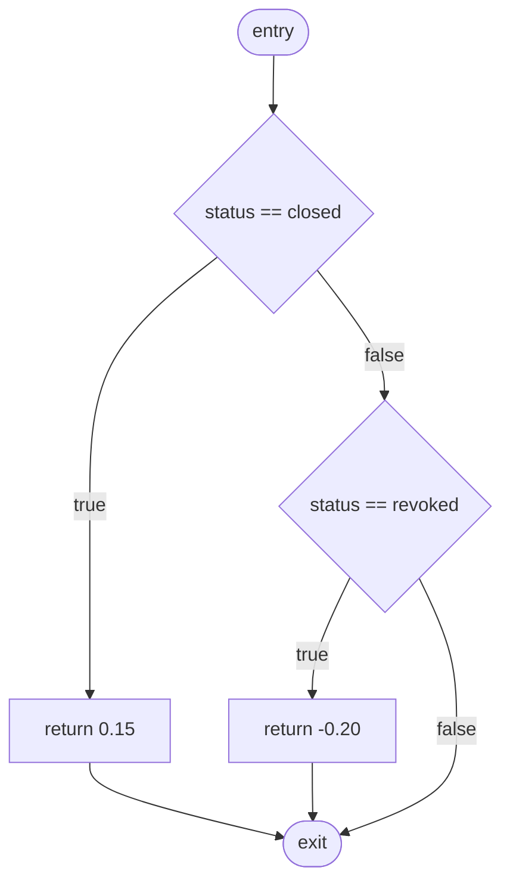
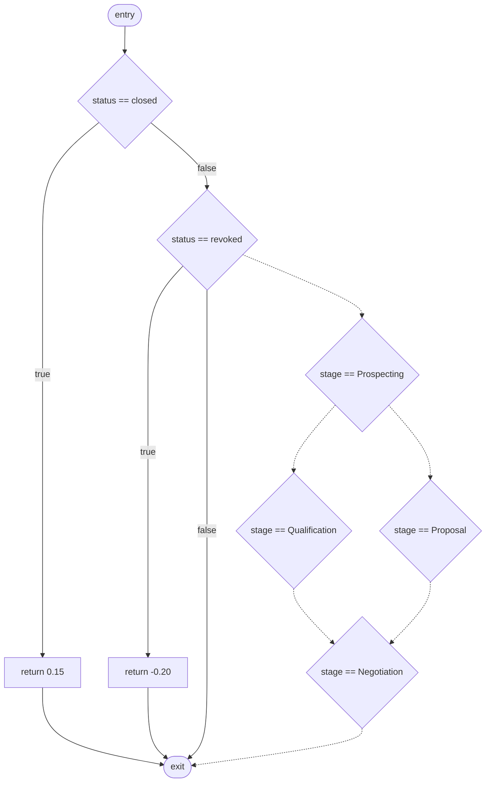

# Лабораторна робота №6

Топологічний та аналітичний аудит внутрішньої складності алгоритмів (метрики Холстеда та Мак-Кейба)

Проєкт: Relativa. Лексичний аудит знято з бойових `src/**/*.cs` на коміті `d7dea04`, до появи експериментального методу. Топологічний експеримент — [DealCommercialOption.cs](../Graph/src/Relativa.Graph/Dashboard/DealCommercialOption.cs) у модулі дашборда Graph. Сирі журнали лежать у [lab6/evidence](evidence).

`GetSummaryAsync` у `WorkspaceDashboardService` і `DashboardService` не змінювався: ЛР3 вже знизила складність першого, а підміна всього методу довідником зламала б перевірену поведінку зведення.

## Декларація інструментального стеку

`Microsoft.CodeAnalysis.Metrics` для цього стеку віддає індекс підтримуваності, цикломатичну складність, зв'язність, глибину успадкування і рядки. Чотири первинні міри Холстеда (η₁, η₂, N₁, N₂) він не друкує. Тому Холстед рахує multimetric, а цикломатичну складність методу — Lizard. Обидва вже використовувались як безкоштовні CLI; Lizard 1.24.3 у ЛР5 збігся з Sonar S1541 на дашборді.

Окремого конфігураційного файлу немає: ні multimetric, ні Lizard не читають аналог `.eslintrc`. Поріг задається прапорцями команди.

| Інструмент | Версія | Команда |
|---|---|---|
| Python | 3.12.10 | `winget install --id Python.Python.3.12 -e --accept-package-agreements --accept-source-agreements` |
| multimetric | 2.4.5 | `python -m pip install -r lab6/requirements.txt` |
| lizard | 1.24.3 | той самий `requirements.txt` |

Журнал `pip show` — [versions.txt](evidence/versions.txt). Інтерпретатор стоїть у `%LOCALAPPDATA%\Programs\Python\Python312\python.exe`.

Холстед для всього дерева знімає [scan-halstead.py](scan-halstead.py): він кличе `multimetric.__main__.run`, ту саму функцію, що й CLI, і передає список файлів у процесі. На Windows `python -m multimetric` падає в `multiprocessing`: дочірній процес не знаходить `file_process` у `__main__`. Тому транскрипт трьох файлів — [halstead-three.txt](evidence/halstead-three.txt) — це JSON того самого `run()`, з тим самим округленням до трьох знаків.

Цикломатична складність методу:

```text
python -m lizard -C 15 -L 99999 -a 99999 -l csharp <file>
```

`-C` лише вмикає код виходу. Число береться з колонки CCN. `-L` і `-a` підняті, щоб довгий метод або довгий список параметрів не маскувались під порушення Мак-Кейба.

## Глобальна базова лінія Холстеда

Межа скану: 401 файл `**/src/**/*.cs`. Відкинуто `bin/`, `obj/`, `Migrations/` і `*.Designer.cs`, бо згенеровані ідентифікатори роздули б словник операндів і не є кодом, який підтримує розробник. SHA знімка — `d7dea04` ([head-sha.txt](evidence/head-sha.txt)). `DealCommercialOption.cs` у цей знімок не входить.

`overall` у multimetric будується в `get_results_global`: списки токенів файлів зчіплюються, унікальність — це `set`, тобто об'єднання, не сума η₁. Перевірка на двох файлах з однаковим `if`/`return`: 6 + 6 = 12, а `overall.operators_uniq` = 7 ([halstead-union-check.json](evidence/halstead-union-check.json)).

Повний журнал — [halstead-global.txt](evidence/halstead-global.txt), пофайлово — [halstead-global.json](evidence/halstead-global.json).

| Міра | Значення |
|---|---:|
| Унікальні оператори η₁ | 639 |
| Унікальні операнди η₂ | 4491 |
| Усі оператори N₁ | 58917 |
| Усі операнди N₂ | 39353 |
| Словник η = η₁ + η₂ | 5130 |
| Довжина N = N₁ + N₂ | 98270 |
| Об'єм V = N · log₂(η) | 1 211 152.505 |
| Складність D = (η₁ / 2) · (N₂ / η₂) | 2 799.662 |
| Зусилля E = V · D | 3 390 818 038.964 |
| Індекс дефектності B = V / 3000 | 403.718 |

Похідні перераховані з чотирьох первинних мір. Вони збігаються з полями CLI `halstead_volume`, `halstead_difficulty`, `halstead_effort` і `halstead_bugprop`. B — це спосіб multimetric за замовчуванням (`--bugpredict new`). Старіший прогноз Холстеда B = E^(2/3) / 3000 тут не використовується. D — складність проєктування (наскільки важко читати код), B — очікувана кількість дефектів з об'єму.

Оператор у класифікації multimetric — токен Pygments на кшталт `Token.Operator`, `Token.Punctuation`, `Token.Keyword` у групі операторів (ключові слова, знаки, роздільники). Операнд — імена, літерали, рядки (`Token.Name`, `Token.Literal`, `Token.Number`). η₁ і η₂ — розміри цих двох множин, N₁ і N₂ — скільки разів елементи зустрілись у тексті.

## Матриця трьох архітектурних файлів

Словник валідатора η = 41, це вище порога 15 унікальних токенів, тож контрольна група лишилась `CreateEntityRequestValidator`.

| | Core Domain | Infrastructure | Utility |
|---|---:|---:|---:|
| Файл | `DashboardService.cs` | `ResilientMlScoringClient.cs` | `CreateEntityRequestValidator.cs` |
| LOC | 638 | 73 | 30 |
| η₁ | 45 | 29 | 14 |
| η₂ | 353 | 75 | 27 |
| N₁ | 2690 | 224 | 110 |
| N₂ | 1877 | 153 | 64 |
| η | 398 | 104 | 41 |
| N | 4567 | 377 | 174 |
| V | 39 443.465 | 2 526.066 | 932.214 |
| D | 119.639 | 29.580 | 16.593 |
| B | 13.148 | 0.842 | 0.311 |
| E | 4 718 969.180 | 74 721.026 | 15 467.848 |

Ранжування за зусиллям: дашборд, потім клієнт ML, потім валідатор.

Дашборд тримає словник угод, стадій, ризику і доступів і багато разів повторює ті самі імена у запитах і гілках, тому й N, і D великі. Клієнт стійкості — інтеграція із зовнішнім скорингом: таймаут, повтор, скасування. Унікальних імен мало (η₂ = 75), текст короткий, тож абсолютне E на два порядки менше, хоча D = 29.6 уже не «порожній» файл. Валідатор — контрольна група: ланцюжок `RuleFor` без предметної арифметики, найменший словник і найменше зусилля.

Серед цих трьох E і LOC ранжуються однаково. Пастка LOC видна на іншій парі з того самого скану, нижче.

E на рядок: дашборд 7396.5, клієнт 1023.6, валідатор 515.6. Навіть там, де абсолютне E росте разом із довжиною, щільність зусилля різна: рядок бізнес-модуля «важчий» за рядок валідатора.

## Гарячі точки і чому LOC ховає складність

Перші файли за E:

| E | LOC | Файл |
|---:|---:|---|
| 5 740 555.087 | 596 | `Graph/.../WorkspaceDashboardService.cs` |
| 5 610 126.006 | 762 | `Core/.../EntityService.cs` |
| 4 718 969.180 | 638 | `Graph/.../DashboardService.cs` |
| 3 152 306.101 | 504 | `Audit/.../AuditLogReadRepository.cs` |
| 2 065 492.430 | 273 | `Core/.../EntityRepository.cs` |
| 1 278 798.663 | 362 | `Core/.../OrganizationService.cs` |
| 1 207 253.354 | 378 | `Graph/.../GraphDataService.cs` |
| 1 194 958.402 | 391 | `Authentication/.../PrivacyWorkflow.cs` |
| 1 068 787.205 | 652 | `Gateway/.../AggregatedOpenApiEndpoint.cs` |
| 961 543.205 | 275 | `Core/.../OrgInvitationService.cs` |

Пара, де коротший файл вимагає більшого зусилля:

| | `EntityRepository.cs` | `AggregatedOpenApiEndpoint.cs` |
|---|---:|---:|
| LOC | 273 | 652 |
| η₁ | 30 | 32 |
| η₂ | 191 | 396 |
| N₂ | 1210 | 1102 |
| N₂ / η₂ | 6.335 | 2.783 |
| V | 21 736.036 | 24 004.068 |
| D | 95.026 | 44.525 |
| E | 2 065 492.430 | 1 068 787.205 |

Репозиторій у 2.4 раза коротший і майже вдвічі важчий за E. Об'єм у нього навіть трохи менший: довгий OpenAPI-файл вводить більше різних імен (η₂ = 396), тому log₂(η) не рятує репозиторій. Різницю дає D. Множник η₁/2 майже однаковий (15 проти 16). Множник N₂/η₂ — ні: репозиторій 1210 разів уживає лише 191 операнд, шлюз 1102 рази уживає 396 операндів. Повтор однієї робочої множини імен піднімає складність проєктування, а E = V · D переносить це в зусилля. У формулі немає LOC. Підрахунок рядків поставив би шлюз вище і сховав би репозиторій.

Той самий зсув є на вершині списку: `WorkspaceDashboardService` (596 рядків, E 5.74·10⁶) випереджає довший `EntityService` (762 рядки, E 5.61·10⁶).

## Базова топологія

Метод — `DealCommercialOption.Adjustment` у коміті `535c237` (`chore(audit): baseline commercial-option control flow`). Дві гілки — ті самі статуси угоди, що дашборд рахує як won і lost: `closed` → 0.15, `revoked` → −0.20, інакше 0. Тести: `closed`, `revoked`, `open`.



Вузли V = 6: entry, два предикати, два then-вузли, exit. Ребра E = 7. Цикломатична складність Мак-Кейба:

CC = E − V + 2 = 7 − 6 + 2 = 3.

Те саме дає число предикатів: 2 + 1 = 3. Lizard друкує CCN 3 для `Adjustment` ([lizard-baseline.txt](evidence/lizard-baseline.txt)). `else` окремого предиката не додає: це ребро false.

## Паперове розширення

До графа додано 4 предикатні вузли стадій (`Prospecting`, `Qualification`, `Proposal`, `Negotiation`) і 6 ребер. На схемі вони пунктирні.



Нові вузли: 4. Нові ребра: 6. Прогноз:

CC = (7 + 6) − (6 + 4) + 2 = 5.

ΔCC = ΔE − ΔV = 6 − 4 = +2. П'ять шляхів індустріальну межу 15 не перетинають. Цей ескіз ще не повний керуючий граф: у чотирьох нових предикатів немає пари виходів true/false. Він відповідає на питання методички «що стане з CC, якщо домальовати рівно 4 предикати і 6 ребер», і навмисно лишається нижче 15. Моноліт нижче вже є повним графом.

## FAIL: моноліт і збіг зі сканером

Коміт `fe15df3`, повідомлення `feat(audit): simulate topological CC failure, FAIL`. Метод замінено на `Evaluate(status, stage, riskBand, accessLevel, closingThisMonth, clientActive)`. Словник той самий, що в `DashboardService`: три статуси, чотири стадії, три смуги ризику (`high` / `medium` / `low`), три рівні доступу (`basic` / `full` / `full_org`).

Тіло: 13 простих `if`, один `if (closingThisMonth && clientActive)` і один `if (status == "closed" || stage == "Negotiation")`, далі `return Math.Round(option, 2)`. Немає `switch`, циклів, тернарного оператора і `else if`.

Lizard CCN = 18 ([lizard-fail.txt](evidence/lizard-fail.txt)), код виходу 1 на порозі `-C 15`. Розклад сканера: база 1, кожен `if` дає +1 (їх 15), `&&` дає +1, `||` дає +1. Разом 1 + 15 + 1 + 1 = 18. Попередній паперовий рахунок «1 + 13 + 1 + 1 = 16» не додавав самі ключові слова двох складених `if`. Його виправлено за виводом Lizard, не навпаки.

Чому `&&` і `||` збільшують CC понад `if`. Коротке замикання — окрема точка рішення. `if (A && B)` має шлях, де B не обчислюється. Lizard ставить на цей оператор ще один предикат. Якби ручний граф лишив одну ромбову вершину на весь `if`, вийшло б 16, і збігу зі сканером не було б. У графі нижче складена умова розщеплена на два предикати.

Повний граф. Предикатів P = 17 (13 простих `if` + 2 предикати кон'юнкції + 2 предикати диз'юнкції). Then-вузлів 15 (по одному на кожен `if`). Плюс entry і exit.

V = 1 + 17 + 15 + 1 = 34.

Вихідні степені: entry 1, кожен предикат 2 (разом 34), кожен then-вузол 1 (разом 15), exit 0.

E = 1 + 34 + 15 = 50.

CC = E − V + 2 = 50 − 34 + 2 = 18.

Це дорівнює і P + 1 = 18, і колонці CCN. Чотири стадійні предикати з паперового ескізу стоять у цьому графі як звичайні `if` (пунктир там був лише приростом +4/+6, не кресленням моноліта).

```mermaid
flowchart TD
  entry([entry]) --> pClosed{closed}
  pClosed -->|T| tClosed["+0.15"]
  tClosed --> pRevoked
  pClosed -->|F| pRevoked{revoked}
  pRevoked -->|T| tRevoked["-0.20"]
  tRevoked --> pOpen
  pRevoked -->|F| pOpen{open}
  pOpen -->|T| tOpen["+0.00"]
  tOpen --> pProspect
  pOpen -->|F| pProspect{Prospecting}
  pProspect -->|T| tProspect["+0.02"]
  tProspect --> pQual
  pProspect -->|F| pQual{Qualification}
  pQual -->|T| tQual["+0.05"]
  tQual --> pProposal
  pQual -->|F| pProposal{Proposal}
  pProposal -->|T| tProposal["+0.08"]
  tProposal --> pNeg
  pProposal -->|F| pNeg{Negotiation}
  pNeg -->|T| tNeg["+0.12"]
  tNeg --> pHigh
  pNeg -->|F| pHigh{high}
  pHigh -->|T| tHigh["-0.10"]
  tHigh --> pMedium
  pHigh -->|F| pMedium{medium}
  pMedium -->|T| tMedium["-0.04"]
  tMedium --> pLow
  pMedium -->|F| pLow{low}
  pLow -->|T| tLow["+0.03"]
  tLow --> pBasic
  pLow -->|F| pBasic{basic}
  pBasic -->|T| tBasic["-0.05"]
  tBasic --> pFull
  pBasic -->|F| pFull{full}
  pFull -->|T| tFull["+0.01"]
  tFull --> pOrg
  pFull -->|F| pOrg{full_org}
  pOrg -->|T| tOrg["+0.02"]
  tOrg --> pClose
  pOrg -->|F| pClose{closingThisMonth}
  pClose -->|T| pActive{clientActive}
  pClose -->|F| pOrStatus
  pActive -->|T| tPair["+0.07"]
  pActive -->|F| pOrStatus
  tPair --> pOrStatus{status closed}
  pOrStatus -->|T| tOr["+0.04"]
  pOrStatus -->|F| pOrStage{stage Negotiation}
  pOrStage -->|T| tOr
  pOrStage -->|F| exitNode([Round exit])
  tOr --> exitNode
```



П'ять тестів `DealCommercialOption` проходять і на моноліті, і на довіднику нижче: очікувані суми не змінювались. Команда:

```text
dotnet test Graph/tests/Relativa.Graph.Integration.Tests/Relativa.Graph.Integration.Tests.csproj --filter FullyQualifiedName~DealCommercialOption
```

## PASS: довідник замість гілок

Коміт `e67872a`, повідомлення `refactor(audit): eliminate conditional branches using lookup table, PASS`. Той самий підпис `Evaluate` і ті самі числа. Гілок у методі немає: шість `GetValueOrDefault` і `Math.Round`.

- словники статусу, стадії, ризику і доступу;
- пара `(true, true) → 0.07` замість `&&`;
- шість пар `(status, stage) → 0.04` замість `closed || Negotiation` на трьох статусах і чотирьох стадіях, які дашборд уже пише.

Lizard: `Evaluate` має CCN 1 ([lizard-pass.txt](evidence/lizard-pass.txt)). Ініціалізатори словників теж CCN 1: це літерали, не розгалуження. Diff коміта — [lookup-diff.txt](evidence/lookup-diff.txt).

Після рефакторингу ті самі 5 тестів зелені. Невідомий статус на стадії `Prospecting` дає 0.00 і в моноліті, і в таблиці. Пара «невідомий статус + Negotiation» у шість ключів не входить: таблиця покриває словник дашборда, не довільний рядок.

## Лінійність Git

```text
* a4af9d2 refactor(audit): linearize legacy tier probe, PASS
* e67872a refactor(audit): eliminate conditional branches using lookup table, PASS
* fe15df3 feat(audit): simulate topological CC failure, FAIL
* 535c237 chore(audit): baseline commercial-option control flow
```

Три стани аудиту йдуть підряд: baseline → FAIL → lookup PASS. Коміт `a4af9d2` стоїть після них: це вже воротар якості. Повідомлення `feat: add messy code` у `git log` немає. Журнал — [git-graph.txt](evidence/git-graph.txt).

## Pre-commit

Хук ЛР3 уже стоїть через `core.hooksPath=.githooks` ([lab3/install-hooks.ps1](../lab3/install-hooks.ps1)). Файл `.git/hooks/pre-commit` за цієї настройки не виконується, тому бар'єр дописано в [.githooks/pre-commit](../.githooks/pre-commit). Спочатку лишився `gitleaks protect --staged`. Якщо секретів немає, хук бере staged `*.cs` (лише A/C/M), пропускає `Migrations/`, `*.Designer.cs`, `bin/` і `obj/`, і кличе:

```text
python -m lizard -C 10 -L 99999 -a 99999 -l csharp <staged files>
```

Lizard завершується ненульовим кодом, коли CCN > 10. Хук тоді друкує червоний рядок і виходить з кодом 1. CCN = 10 коміт не блокує. Якщо Python або модуль lizard відсутні, хук теж виходить з 1 і коміт не створює. Шлях до `python.exe` шукається так само, як gitleaks: спочатку каталог інсталяції Python 3.12, потім `PATH`. На Windows `chmod +x` не потрібен: Git запускає `#!/bin/sh`.

Повний текст хука:

```sh
#!/bin/sh
# Block staged secrets, then block staged C# whose cyclomatic complexity exceeds 10.
if ! command -v gitleaks >/dev/null 2>&1; then
  if [ -n "$LOCALAPPDATA" ] && [ -x "$LOCALAPPDATA/Microsoft/WinGet/Links/gitleaks.exe" ]; then
    PATH="$LOCALAPPDATA/Microsoft/WinGet/Links:$PATH"
    export PATH
  fi
fi

if command -v gitleaks >/dev/null 2>&1; then
  GITLEAKS=gitleaks
elif [ -x "$LOCALAPPDATA/Microsoft/WinGet/Links/gitleaks.exe" ]; then
  GITLEAKS="$LOCALAPPDATA/Microsoft/WinGet/Links/gitleaks.exe"
else
  echo "gitleaks is not installed; refusing to commit." >&2
  exit 1
fi

cd "$(git rev-parse --show-toplevel)" || exit 1
"$GITLEAKS" protect --staged --redact --no-banner --verbose --config .gitleaks.toml
gitleaks_code=$?
if [ "$gitleaks_code" -ne 0 ]; then
  exit "$gitleaks_code"
fi

if [ -n "$LOCALAPPDATA" ] && [ -x "$LOCALAPPDATA/Programs/Python/Python312/python.exe" ]; then
  PYTHON="$LOCALAPPDATA/Programs/Python/Python312/python.exe"
elif command -v python >/dev/null 2>&1; then
  PYTHON=python
elif command -v py >/dev/null 2>&1; then
  PYTHON=py
else
  echo "python is not installed; refusing to commit." >&2
  exit 1
fi

if ! "$PYTHON" -c "import lizard" >/dev/null 2>&1; then
  echo "lizard is not installed; refusing to commit." >&2
  exit 1
fi

set --
while IFS= read -r file; do
  case "$file" in
    ''|*/Migrations/*|*.Designer.cs|*/bin/*|*/obj/*) continue ;;
  esac
  set -- "$@" "$file"
done <<EOF
$(git diff --cached --name-only --diff-filter=ACM -- '*.cs')
EOF

if [ "$#" -eq 0 ]; then
  exit 0
fi

echo "lizard cyclomatic gate (CC>10 blocks the commit)"
"$PYTHON" -m lizard -C 10 -L 99999 -a 99999 -l csharp "$@"
lizard_code=$?
if [ "$lizard_code" -ne 0 ]; then
  printf '\033[31mcomplexity gate: a staged method has cyclomatic complexity above 10. Commit rejected.\033[0m\n' >&2
  exit 1
fi

exit 0
```

Хук дивиться на кожен метод файла, не лише на щойно дописаний. Тому в індекс не можна класти `DashboardService.cs` чи `WorkspaceDashboardService.cs`: у ЛР5 `GetTopEntitiesAsync` мав CCN 37, і воротар відхилив би коміт незалежно від дрібної правки. Це наслідок пофайлового ліміту, не дірка в хуку. Стрес-тест ішов лише по `DealCommercialOption.cs`, де решта методів уже були CCN 1.

### Блокування

У файл додано `ScoreLegacyTier` з одинадцятьма простими `if`. Lizard: CCN 12. Далі `git add` цього файла і `git commit -m "feat: add messy code"`.

gitleaks секретів не знайшов. Lizard назвав `DealCommercialOption::ScoreLegacyTier` з CCN 12 і попередженням `cyclomatic_complexity > 10`. Хук надрукував відмову і вийшов з кодом 1. `git log -1` лишився `e67872a`. Журнал — [hook-fail.txt](evidence/hook-fail.txt).

### Пропуск

`ScoreLegacyTier` замінено на словник `0..10` і один `GetValueOrDefault`. Lizard: CCN 1. Той самий `git add` і коміт `refactor(audit): linearize legacy tier probe, PASS` створили `a4af9d2`. Журнал — [hook-pass.txt](evidence/hook-pass.txt). Разом із тестами котирування пройшли 7 тестів `DealCommercialOption`.

## Захист, близько п'яти хвилин

1. Оператор і операнд. Оператор — дія і роздільник: `if`, `return`, `+`, `==`, дужки. Операнд — те, над чим дія: ім'я, літерал, рядок. η₁ і η₂ — скільки різних, N₁ і N₂ — скільки входжень. Об'єм V = N · log₂(η) росте від довжини програми в токенах і від розміру словника. Складність D = (η₁ / 2) · (N₂ / η₂) росте від різноманіття операторів і від того, як часто повторюються одні й ті самі операнди. Зусилля E = V · D. У формулі немає рядків коду: `EntityRepository.cs` коротший за `AggregatedOpenApiEndpoint.cs` (273 проти 652) і має менше V, але N₂/η₂ = 6.34 проти 2.78, тому D і E більші.
2. Цикломатична і когнітивна складність. Цикломатична (Мак-Кейб, Lizard, у ЛР3 ще Sonar S1541) — число незалежних шляхів: CC = E − V + 2, або число предикатів плюс один. Когнітивна (Sonar S3776 у ЛР3) — та сама структура плюс штраф за вкладеність. Після ЛР3 `GetSummaryAsync` мав цикломатичну 9 і когнітивну 7: винесення циклів зрізало когнітивну сильніше, бо прибрало вкладеність, а не лише кількість гілок. Плоский моноліт цієї роботи має CC 18 без глибокої вкладеності; когнітивна карала б його слабше, ніж глибоко вкладений метод з меншим CC. `&&` і `||` для Мак-Кейба — додаткові предикати через коротке замикання. Lizard дав 18, а не 16, саме через ці два оператори.
3. Воротар. Показати [hook-fail.txt](evidence/hook-fail.txt): команда коміту, CCN 12, код 1, `git log` без цього повідомлення. Потім [hook-pass.txt](evidence/hook-pass.txt): CCN 1 і створений коміт. Граф: baseline → FAIL → lookup PASS.
