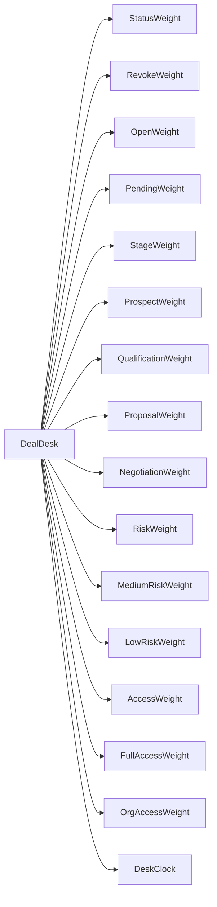
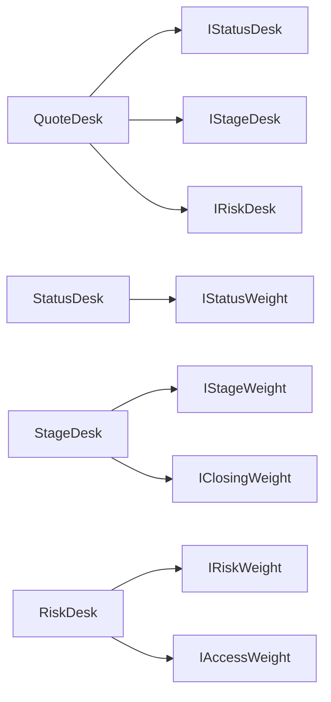

# Лабораторна робота №8

Об'єктно-орієнтований аудит системного дизайну (CK і MOOD)

Проєкт: Relativa. Три файли з ЛР6 лишились порівняльною групою. Експеримент з класом-мутантом і з ієрархією живе в `Relativa.Graph.DesignAudit` і в тести не тягне базу. `EntityService`, `DashboardService`, `WorkspaceDashboardService` і EF-ієрархія `AuditLog` не змінювались. Сирі журнали лежать у [lab8/evidence](evidence). Сканер — [lab8/metrics](metrics).

`EntityAuditLog : AuditLog` має глибину 2 і нуль перевизначень. У продуктовому коді немає класу, де одночасно CBO > 15 і LCOM прямує до 1. Тому завдання 2 і 3 зроблені штучною агрегацією, як це дозволяє умова, коли мутанта в репозиторії немає.

## Декларація API-запитів

Сервер: SonarQube 26.10 на `http://localhost:9000`, ключ проєкту `Relativa`. Токен читається з `$env:SONAR_TOKEN` і в ці файли не потрапляє. Повний список викликів — [api-requests.txt](evidence/api-requests.txt). Скрипти: [pull-measures.ps1](pull-measures.ps1) і [sonar-scan.ps1](sonar-scan.ps1). Другий збирає і `Graph/Relativa.Graph.sln`, і `Relativa.slnx`, бо кореневий solution Graph не містить, а попередній зріз від 2026-10-17 файлів дашборда не мав.

Приклад для доменного файлу:

```text
GET http://localhost:9000/api/measures/component?component=Relativa%3AGraph%2Fsrc%2FRelativa.Graph%2FDashboard%2FDashboardService.cs&metricKeys=class_complexity,coupling_between_objects,lcom4,dit,rfc,cohesion_in_methods,complexity,cognitive_complexity
```

Тіло відповіді, [api-domain.json](evidence/api-domain.json):

```json
{"errors":[{"msg":"The following metric keys are not found: coupling_between_objects, cohesion_in_methods, dit, rfc, class_complexity, lcom4"}]}
```

Те саме для інфраструктури, валідатора і кореня проєкту: [api-infra.json](evidence/api-infra.json), [api-utility.json](evidence/api-utility.json), [api-project.json](evidence/api-project.json). Community Edition 26.10 ці ключі дизайну не публікує. MOOD (MHF, AHF, COF) у сервері теж немає. Окремий запит лише з тими метриками, які сервер знає, дає числа. Для дашборда, [api-domain-supported.json](evidence/api-domain-supported.json):

```json
{"component":{"key":"Relativa:Graph/src/Relativa.Graph/Dashboard/DashboardService.cs","measures":[{"metric":"complexity","value":"186"},{"metric":"functions","value":"15"},{"metric":"cognitive_complexity","value":"138"},{"metric":"classes","value":"1"},{"metric":"ncloc","value":"579"}]}}
```

| Файл | complexity | cognitive | ncloc |
|---|---:|---:|---:|
| `DashboardService.cs` | 186 | 138 | 579 |
| `ResilientMlScoringClient.cs` | 10 | 13 | 73 |
| `CreateEntityRequestValidator.cs` | 2 | 1 | 30 |

Корінь проєкту після цього зрізу: complexity 5069, cognitive_complexity 2541, classes 322, functions 2289, ncloc 29981 ([api-project-supported.json](evidence/api-project-supported.json)).

Сторінки Coupling Matrix у цій редакції немає. Матриця нижче зібрана сканером.

## Як рахується CK і MOOD

Сканер обходить `**/src/**/*.cs`, без `bin`, `obj`, `Migrations`, `*.Designer.cs` і `tests`. WMC — сума Lizard CCN по методах типу, разом із конструктором. CBO — різні користувацькі типи в позиції типу (база, поле, параметр, повернення, `new`, приведення). Ім'я члена, яке збіглось із типом, не рахується. LCOM — Хендерсон-Селлерс, `(M - середнє використання полів) / (M - 1)`. Діапазон 0..1. Нуль означає спільні поля, одиниця означає, що методи полів не ділять. Це не Sonar LCOM4, де одиниця була ознакою згуртованості. Якщо методів менше двох або полів немає, LCOM = 0. DIT = 1, коли клас не розширює інший клас. Кожна знайдена класова база додає 1. Нерозв'язана зовнішня база дає 2. Інтерфейси глибину не додають. PIM — число різних публічних методів типу і його знайдених баз. Overridden — методи з `override` на цьому типі.

MOOD по всьому `src`: MHF = 100 × приватні методи / усі методи, AHF = 100 × приватні поля / усі поля, COF = спрямовані посилання на користувацькі типи / (TC × (TC − 1)).

## Зведена таблиця CK і MOOD

Знімок [ck-mood-baseline.json](evidence/ck-mood-baseline.json), коміт `8afcbb8`.

| | Core Domain | Infrastructure | Utility |
|---|---:|---:|---:|
| Файл | `DashboardService.cs` | `ResilientMlScoringClient.cs` | `CreateEntityRequestValidator.cs` |
| WMC | 174 | 13 | 2 |
| CBO | 15 | 4 | 1 |
| LCOM | 0.782 | 0 | 0 |
| DIT | 1 | 1 | 2 |
| PIM | 6 | 1 | 0 |

Проєкт на цьому зрізі: TC 481, MHF 18.943%, AHF 90.051%, COF 0.005613. Приховано 147 методів із 776 і 878 полів із 975. Полів багато приватних, методів мало: типові сервіси віддають публічний контракт і ховають стан. COF малий, бо 1296 ребер на 481 × 480 можливих пар. Це розріджений граф, не повний клубок.

Перший розбір дашборда давав CBO 20, бо імена членів `Entity`, `EntityType`, `Permission`, `Property`, `Workspace` збігались із типами. У таблиці CBO 15: лише позиції типу. Решта рядка дашборда від цього не змінилась.

Вердикт. Дашборд зачеплений на межі порога (CBO 15, не вище) і має LCOM 0.782: методи ще ділять контекст запиту, це не розрізнений мутант. Клієнт ML — один публічний метод, тож LCOM за формулою 0, CBO 4. Валідатор розширює `AbstractValidator`, тому DIT 2, а правил у тілі методів немає: вони в конструкторі, PIM 0, WMC 2. Ознак спагеті на цих трьох файлах немає. Клас із CBO > 15 і LCOM = 1 у продуктовому коді не знайдений.

## Завдання 2. God Object

Базовий `DealDesk` сам робить `new` для 16 сусідів. 14 методів читають своє поле, два (`StageBonus` і `StagePair`) читають лише `StageWeight`. Поле `DeskClock` читається в конструкторі, не в методах, тому сума використань полів дорівнює числу полів і LCOM = 1. WMC 17, CBO 16, PIM 16. Повний список ребер — [coupling-matrix.json](evidence/coupling-matrix.json).



FAIL, коміт `107c73d`. Сигнатура сусіда стала `Weight(string stage, int month)`. Обидва виклики в `DealDesk` лишились з одним аргументом. Збірка Graph падає двічі, [fail-god-build.txt](evidence/fail-god-build.txt):

```text
DealDesk.cs(53,55): error CS7036: There is no argument given that corresponds to the required parameter 'month' of 'StageWeight.Weight(string, int)'
DealDesk.cs(55,54): error CS7036: There is no argument given that corresponds to the required parameter 'month' of 'StageWeight.Weight(string, int)'
```

Одна зміна в чужому класі б'є по двох методах мутанта, бо він приварений до конкретного типу.

PASS, коміт `1a676a6`. `DealDesk` видалений. Чотири столи беруть залежності конструктором і не називають конкретні класи.



`StageWeight` лишає розширений `Weight(string, int)` і закриває `IStageWeight.Weight(string)` викликом із місяцем 0. Столи бачать лише інтерфейс.

| Тип | WMC | CBO | LCOM | DIT |
|---|---:|---:|---:|---:|
| `DealDesk` до | 17 | 16 | 1 | 1 |
| `StatusDesk` | 5 | 2 | 0 | 1 |
| `StageDesk` | 7 | 3 | 0 | 1 |
| `RiskDesk` | 7 | 3 | 0 | 1 |
| `QuoteDesk` | 2 | 3 | 0 | 1 |

Кожен новий клас має CBO ≤ 8 і LCOM ≤ 0.2. Очікувані десяткові ті самі: `StatusBonus` 0.15, `StageBonus("Negotiation")` 0.12, `RiskBonus("high")` −0.10, `AccessBonus("basic")` −0.05. Журнал тестів — [pass-god-test.txt](evidence/pass-god-test.txt). Метрики — [ck-god-pass.json](evidence/ck-god-pass.json).

## Завдання 3. Успадкування і композиція

База, коміт `ee2c1dd`. `QuoteRule` оголошує 21 публічний віртуальний метод. `StageQuoteRule` перевизначає перші 11, включно зі `Status`. `DeskQuoteRule` перевизначає `Status` ще раз і методи 12–21. Теж 11 перевизначень.

| Тип | DIT | PIM | Overridden |
|---|---:|---:|---:|
| `QuoteRule` | 1 | 21 | 0 |
| `StageQuoteRule` | 2 | 21 | 11 |
| `DeskQuoteRule` | 3 | 21 | 11 |

PIM 21 > 20, глибина 3, на кожному рівні переписано близько половини батьківської поверхні. Листове `Status` повертає 0.17, `Revoked` лишається перевизначенням стадії −0.19, `BasicAccess` на листку −0.04.

Було:

```csharp
public class StageQuoteRule : QuoteRule
{
    public override decimal Status(string status) => 0.16m;
}

public class DeskQuoteRule : StageQuoteRule
{
    public override decimal Status(string status) => 0.17m;
}
```

FAIL, коміт `f9d2b2c`. У корені сигнатура стала `Status(string status, bool closing)`. Прямий нащадок більше не перевизначає наявний метод. [fail-inherit-build.txt](evidence/fail-inherit-build.txt):

```text
StageQuoteRule.cs(5,29): error CS0115: 'StageQuoteRule.Status(string)': no suitable method found to override
```

Компілятор ставить CS0115 на пряме перевизначення. `DeskQuoteRule.Status(string)` усе ще збігається з оголошенням у `StageQuoteRule`, тому другої CS0115 немає. Проєкт при цьому не збирається, тож листок не з'являється як тип у збірці. Ланцюжок зупиняється на першому зламаному `override`.

Стало, коміт `bd58680`. Слів `override` і баз `QuoteRule` / `StageQuoteRule` немає. `DeskQuote` отримує двох помічників у конструктор і делегує:

```csharp
public decimal Status(string status) => _math.Status(status) + _stage.Status(status);
```

`QuoteMath.Status` дає 0.15, `StageAdjustment.Status` дає 0.02, сума 0.17. Те саме для решти листкових чисел: `Revoked` −0.19, `BasicAccess` −0.04, `Residual` 0.02. Кожен із 21 методів читає обидва поля, тому LCOM = 0.

| | До, `DeskQuoteRule` | Після, `DeskQuote` |
|---|---:|---:|
| DIT | 3 | 1 |
| PIM | 21 | 21 |
| Overridden | 11 | 0 |
| CBO | 1 | 2 |
| LCOM | 0 | 0 |

CBO 2 — це `QuoteMath` і `StageAdjustment`, не батьківський клас. Журнал — [pass-inherit-test.txt](evidence/pass-inherit-test.txt), метрики — [ck-inherit-pass.json](evidence/ck-inherit-pass.json). На HEAD 22 тести `DesignAudit` зелені.

## Git

[git-log.txt](evidence/git-log.txt):

```text
bd58680 refactor(audit): replace inheritance with composition pattern, PASS
f9d2b2c arch(audit): capture inheritance fragility crash, FAIL
ee2c1dd audit: record inheritance hierarchy baseline
1a676a6 refactor(audit): eliminate god object via interface decomposition, PASS
107c73d arch(audit): capture god object coupling failure, FAIL
8afcbb8 audit: record object design baseline
```

Завдання 2: `8afcbb8` → `107c73d` → `1a676a6`. Завдання 3: `ee2c1dd` → `f9d2b2c` → `bd58680`.

Повторна перевірка на гілці `lab8`:

```text
dotnet test Graph/tests/Relativa.Graph.Integration.Tests/Relativa.Graph.Integration.Tests.csproj --filter FullyQualifiedName~DesignAudit
dotnet run --project lab8/metrics/Relativa.Lab8.Metrics.csproj -- --repo . --out lab8/out --snapshot inherit-pass
```

Хмара: workflow [lab8-design.yaml](../.github/workflows/lab8-design.yaml) на push у `lab8` ганяє ті самі тести й сканер і кладе артефакт `ck-mood-report`. Sonar у workflow не викликається.
