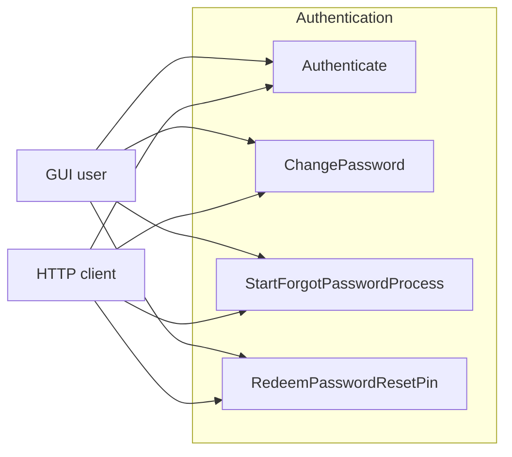

# Лабораторна робота №9

Математичне моделювання SQALE, фінансова капіталізація технічного боргу, FPA та UCP

Об'єкт аудиту — публічний проєкт Jellyfin на SonarQube Cloud. Сирий виклик лежить у [evidence/report.json](evidence/report.json). Фінансовий скрипт — [economics.py](economics.py). Підмодуль для FPA/UCP — контракт автентифікації `MediaBrowser.Controller.Authentication`, п'ять типів.

## Картка об'єкта

Jellyfin — медіасервер, який збирає фільми, серіали і музику і віддає їх клієнтським програмам. Репозиторій: [jellyfin/jellyfin](https://github.com/jellyfin/jellyfin). Хмарний ключ проєкту `jellyfin_jellyfin`, ключ організації `jellyfin`. Сторінка аналізу: [sonarcloud.io/project/overview?id=jellyfin_jellyfin](https://sonarcloud.io/project/overview?id=jellyfin_jellyfin). Зріз аналізу на сервері: 2026-10-25. Мова стеку — C#. Проєкт відібраний із публічного пошуку `ncloc >= 50000 and languages = cs`: `ncloc` 173818 і `sqale_rating` 1.0 (A), тож шестимісячний NPV має вийти в плюс без зміни ставки.

## Протокол хмарного виклику

Запит без токена, рівно три ключі метрик. Текст виклику — [evidence/api-request.txt](evidence/api-request.txt):

```text
GET https://sonarcloud.io/api/measures/component?component=jellyfin_jellyfin&metricKeys=sqale_index,ncloc,sqale_rating
```

Сире тіло відповіді, один рядок, як його віддав сервер:

```json
{"component":{"id":"AXqrMPhllG1PxIkOFIS0","key":"jellyfin_jellyfin","name":"jellyfin","qualifier":"TRK","measures":[{"metric":"ncloc","value":"173818"},{"metric":"sqale_index","value":"13086","bestValue":false},{"metric":"sqale_rating","value":"1.0","bestValue":true}]}}
```

Три ключі з масиву `measures`:

| metric | value |
|---|---|
| `ncloc` | `173818` |
| `sqale_index` | `13086` |
| `sqale_rating` | `1.0` |

`sqale_index` — хвилини ремонту. `sqale_rating` приходить числом: 1 = A, 2 = B, 3 = C, 4 = D, 5 = E. Тут 1.0, тобто A.

## Паспорт технічного боргу (SQALE)

`sqale_index` 13086 хвилин.

- Людино-години = 13086 / 60 = 218.1
- Людино-дні = 218.1 / 8 = 27.2625
- Час написання з нуля = 173818 × 30 / 60 = 86909 людино-годин
- TDD% = 100 × 13086 / (173818 × 30) = 1308600 / 5214540 = 0.25095%

| Масштаб (ncloc) | Борг, людино-години / людино-дні | Розрахунковий TDD | Хмарний рейтинг |
|---|---:|---:|---|
| 173818 | 218.1 / 27.2625 | 0.25095% | A (`1.0`) |

Шкала аналізатора, з якою порівнюється літера: A ≤ 5%, B ≤ 10%, C ≤ 20%, D ≤ 50%, далі E. У бланку лабораторної ті самі смуги записані як A ≤ 5%, B 6–10%, C 11–20%: краї округлені, проміжків між літерами в розрахунку сервера немає. 0.25095% лежить у A і збігається з `sqale_rating` 1.0.

## Декларація фінансового скрипта

Повний текст — [economics.py](economics.py). Скрипт читає `sqale_index` і `ncloc` з масиву `measures` (значення там рядки) і три змінні оточення. Якщо змінної немає, процес завершується з кодом 1 і нічого не пише. Ставка в коді не зашита.

```python
"""Financial quality ledger from a SonarQube Cloud measures file.

Reads sqale_index and ncloc from the measures array. Rates come only from
the environment: HOURLY_RATE, OVERLOAD_COEFF, DISCOUNT_RATE.
"""

import argparse
import json
import os
import sys
from decimal import Decimal, ROUND_HALF_UP
from pathlib import Path


MONTHS = 6
CENTS = Decimal("0.01")
FACTOR = Decimal("0.000001")


def fail(message: str) -> None:
    print(message, file=sys.stderr)
    sys.exit(1)


def require_decimal(name: str) -> Decimal:
    raw = os.environ.get(name)
    if raw is None or raw.strip() == "":
        fail(f"Missing environment variable {name}")
    try:
        return Decimal(raw.strip())
    except Exception:
        fail(f"Environment variable {name} is not a decimal: {raw}")


def money(value: Decimal) -> str:
    return f"{value.quantize(CENTS, rounding=ROUND_HALF_UP)}"


def factor(value: Decimal) -> str:
    return f"{value.quantize(FACTOR, rounding=ROUND_HALF_UP)}"


def measure(measures: list, key: str) -> Decimal:
    for item in measures:
        if item.get("metric") == key:
            raw = item.get("value")
            if raw is None or str(raw).strip() == "":
                fail(f"Metric {key} has no value")
            try:
                return Decimal(str(raw))
            except Exception:
                fail(f"Metric {key} is not a decimal: {raw}")
    fail(f"Metric {key} is missing from the measures array")


def load_report(path: Path) -> tuple[str, Decimal, Decimal]:
    try:
        payload = json.loads(path.read_text(encoding="utf-8"))
    except FileNotFoundError:
        fail(f"Input file not found: {path}")
    except json.JSONDecodeError as error:
        fail(f"Input file is not JSON: {error}")

    component = payload.get("component")
    if not isinstance(component, dict):
        fail("JSON has no component object")
    key = component.get("key")
    if not key:
        fail("JSON component has no key")
    measures = component.get("measures")
    if not isinstance(measures, list):
        fail("JSON component has no measures array")

    return str(key), measure(measures, "sqale_index"), measure(measures, "ncloc")


def build_ledger(
    project_key: str,
    sqale_index: Decimal,
    ncloc: Decimal,
    hourly_rate: Decimal,
    overload: Decimal,
    discount_rate: Decimal,
) -> tuple[str, str, int | None]:
    principal = (sqale_index / Decimal(60)) * hourly_rate * overload
    cost_of_delay = (ncloc / Decimal(100)) * hourly_rate * overload

    rows: list[tuple[int, Decimal, Decimal, Decimal]] = []
    cumulative = -principal
    payback: int | None = None
    for month in range(1, MONTHS + 1):
        discount = (Decimal(1) + discount_rate) ** (-month)
        profit = cost_of_delay * discount
        cumulative += profit
        if payback is None and cumulative > 0:
            payback = month
        rows.append((month, discount, profit, cumulative))

    if payback is None:
        verdict = (
            "Точка виходу в нуль (Payback Period) на дистанції 6 місяців не настає."
        )
        gate = "FAIL"
        warning = (
            "Архітектурне попередження: борг занадто великий, "
            "щоб інвестиція вийшла в плюс за 6 місяців."
        )
    else:
        verdict = (
            f"Точка виходу в нуль (Payback Period) настає на місяці {payback}."
        )
        gate = "PASS"
        warning = ""

    lines = [
        "# SOFTWARE ECONOMICS & FINANCIAL QUALITY LEDGER",
        "",
        "## 1. Вхідні параметри аудиту (System Baseline)",
        "",
        f"- Назва аналізованого проєкту (Key): {project_key}",
        f"- Масштаб системи (NCLOC): {ncloc}",
        f"- Початковий технічний борг (SQALE Index): {sqale_index} хвилин",
        "",
        "## 2. Капіталізація інвестиційних маркерів",
        "",
        f"- Погодинна ставка (HOURLY_RATE): {hourly_rate} $",
        f"- Коефіцієнт накладних витрат (OVERLOAD_COEFF): {overload}",
        f"- Місячний коефіцієнт дисконтування (DISCOUNT_RATE): {discount_rate}",
        f"- Тіло боргу (вартість рефакторингу): {money(principal)} $",
        f"- Щомісячні збитки від бездіяльності (Cost of Delay): {money(cost_of_delay)} $",
        "",
        "## 3. Динаміка окупності інвестицій у часі (6 ітерацій розробки)",
        "",
        "| Місяць | Коефіцієнт дисконтування | Щомісячний прибуток, $ | Кумулятивний NPV, $ |",
        "|---:|---:|---:|---:|",
    ]
    for month, discount, profit, cumulative_npv in rows:
        lines.append(
            f"| {month} | {factor(discount)} | {money(profit)} | {money(cumulative_npv)} |"
        )
    lines.extend(
        [
            "",
            "## 4. Фінальний інженерно-економічний вердикт",
            "",
            verdict,
            "",
            "## 5. СТАТУС ВОРІТ ЯКОСТІ (Quality Gate)",
            "",
            gate,
        ]
    )
    if warning:
        lines.extend(["", warning])
    lines.append("")
    return "\n".join(lines), gate, payback


def main() -> None:
    parser = argparse.ArgumentParser(description="Build a financial quality ledger from report.json")
    parser.add_argument("--input", required=True, help="SonarQube Cloud measures JSON")
    parser.add_argument("--output", required=True, help="Markdown ledger path")
    args = parser.parse_args()

    hourly_rate = require_decimal("HOURLY_RATE")
    overload = require_decimal("OVERLOAD_COEFF")
    discount_rate = require_decimal("DISCOUNT_RATE")

    input_path = Path(args.input)
    output_path = Path(args.output)
    project_key, sqale_index, ncloc = load_report(input_path)
    ledger, gate, payback = build_ledger(
        project_key,
        sqale_index,
        ncloc,
        hourly_rate,
        overload,
        discount_rate,
    )
    output_path.parent.mkdir(parents=True, exist_ok=True)
    output_path.write_text(ledger, encoding="utf-8")
    print(f"Wrote {output_path.as_posix()}")
    print(f"Quality gate: {gate}")
    if payback is None:
        print("Payback: none within 6 months")
    else:
        print(f"Payback month: {payback}")


if __name__ == "__main__":
    main()
```

Прогін із кореня репозиторію. Журнал консолі — [evidence/console-run.txt](evidence/console-run.txt): без змінних оточення код виходу 1 (`Missing environment variable HOURLY_RATE`), з `HOURLY_RATE=42`, `OVERLOAD_COEFF=1.3`, `DISCOUNT_RATE=0.01` код виходу 0 і рядок `Wrote lab9/FINANCIAL_LEDGER.md`.

Формули прогону:

- Тіло = (13086 / 60) × 42 × 1.3 = 11908.26 $
- Cost of Delay = (173818 / 100) × 42 × 1.3 = 94904.628 $, у таблиці 94904.63 $
- Місяць t: коефіцієнт = 1 / 1.01^t, прибуток = Cost of Delay × коефіцієнт, NPV = −тіло + сума прибутків від 1 до t
- Місяць 1: −11908.26 + 94904.628 / 1.01 = 82056.718…, до цента 82056.72. Це перший додатний рядок, тож окупність на місяці 1.

## Згенерований леджер

Файл [FINANCIAL_LEDGER.md](FINANCIAL_LEDGER.md):

| Місяць | Коефіцієнт дисконтування | Щомісячний прибуток, $ | Кумулятивний NPV, $ |
|---:|---:|---:|---:|
| 1 | 0.990099 | 93964.98 | 82056.72 |
| 2 | 0.980296 | 93034.63 | 175091.35 |
| 3 | 0.970590 | 92113.50 | 267204.85 |
| 4 | 0.960980 | 91201.48 | 358406.33 |
| 5 | 0.951466 | 90298.50 | 448704.83 |
| 6 | 0.942045 | 89404.45 | 538109.28 |

Ворота якості: **PASS**. Окупність на місяці 1.

## Висновок щодо Software Economics

На 173818 рядках щомісячна вартість бездіяльності 94904.63 $ більша за разове тіло боргу 11908.26 $ уже після першого дисконтування. TDD 0.25095% означає, що хвилин ремонту мало проти оцінки SQALE «30 хвилин на рядок». Cost of Delay росте від `ncloc`, тіло — від `sqale_index`. Тому великий код із літерою A окупається на місяці 1. Сума шести коефіцієнтів 1/1.01^t дорівнює приблизно 5.7955. Поріг, де NPV за 6 місяців ще додатний: `sqale_index / (ncloc × 30)` нижче приблизно 11.6%. Вище цього відношення ворота були б FAIL. Ставка 42 і накладні 1.3 цей поріг не зсувають: вони множать і тіло, і щомісячний збиток.

## Специфікація підмодуля

Межа підрахунку — п'ять типів у [MediaBrowser.Controller/Authentication](https://github.com/jellyfin/jellyfin/tree/master/MediaBrowser.Controller/Authentication). У тій самій папці лишились поза межею `AuthenticationException`, `IRequiresResolvedUser` і `IHasNewUserPolicy`: виняток не є операцією, а два інтерфейси дублюють вхід `Authenticate` або віддають політику нового користувача.

Сигнатури всередині межі:

- `IAuthenticationProvider.Name` → `string`
- `IAuthenticationProvider.IsEnabled` → `bool`
- `IAuthenticationProvider.Authenticate(string username, string password)` → `Task<ProviderAuthenticationResult>`
- `IAuthenticationProvider.ChangePassword(User user, string newPassword)` → `Task`
- `ProviderAuthenticationResult.Username` → `string`
- `ProviderAuthenticationResult.DisplayName` → `string?`
- `AuthenticationResult.User` → `UserDto`
- `AuthenticationResult.SessionInfo` → `SessionInfoDto`
- `AuthenticationResult.AccessToken` → `string`
- `AuthenticationResult.ServerId` → `string`
- `IPasswordResetProvider.Name` → `string`
- `IPasswordResetProvider.IsEnabled` → `bool`
- `IPasswordResetProvider.StartForgotPasswordProcess(User? user, string enteredUsername, bool isInNetwork)` → `Task<ForgotPasswordResult>`
- `IPasswordResetProvider.RedeemPasswordResetPin(string pin)` → `Task<PinRedeemResult>`
- `PasswordPinCreationResult.PinFile` → `string`
- `PasswordPinCreationResult.ExpirationDate` → `DateTime`

Типи за межею папки, які стоять у цих сигнатурах:

- `User` (`Jellyfin.Database.Implementations.Entities.User`): для цієї межі рахуються `Id`, `Username`, `Password`. Решта колонок сутності (мови субтитрів, батьківський рейтинг, розклади) належить іншим модулям.
- `ForgotPasswordResult`: `Action`, `PinFile`, `PinExpirationDate`. `PinFile` і дата — той самий логічний файл, що `PasswordPinCreationResult`.
- `PinRedeemResult`: `Success`, `UsersReset`.

`AuthenticationResult` лежить у п'ятірці, але жоден із чотирьох методів його не повертає. Це транспортний запис логіну (`User`, `SessionInfo`, `AccessToken`, `ServerId`), не окремий елементарний процес і не файл, який ці методи читають. Тому в FPA окремого рядка для нього немає. Геттери `Name` і `IsEnabled` теж не процеси: вони не перетинають межу як операція користувача.

Актори: `GUI user` (людина в клієнті Jellyfin), `HTTP client` (стороння програма по HTTP).

Прецеденти: `Authenticate`, `ChangePassword`, `StartForgotPasswordProcess`, `RedeemPasswordResetPin`.



Той самий набір у [diagrams/module-usecases.drawio](diagrams/module-usecases.drawio).

## FPA (IFPUG)

Ваги нескореговані: ILF 7/10/15, EIF 5/7/10, EI 3/4/6, EO 4/5/7, EQ 3/4/6 (простий/середній/складний). Для ILF складність іде від DET і RET. Для транзакцій — від DET, які перетинають межу, і FTR. Матриця EO: при FTR 2–3 і DET 6–19 вага середня, 5. Матриця EI/EQ: при FTR 0–1 і DET 1–15 вага проста, 3; при FTR 2 і DET 1–4 теж проста, 3.

EIF немає. `UserDto` — проекція вже порахованого ILF `User`. `SessionInfoDto` стоїть на `AuthenticationResult`, але жоден із чотирьох методів цей запис не читає.

| Елемент | Категорія | DET | RET або FTR | Складність | FP |
|---|---|---:|---|---|---:|
| `User` (`Id`, `Username`, `Password`) | ILF | 3 | RET 1 | Простий | 7 |
| `PasswordPinCreationResult` (`PinFile`, `ExpirationDate`) | ILF | 2 | RET 1 | Простий | 7 |
| `IAuthenticationProvider.ChangePassword` | EI | 3 | FTR 1 (`User`) | Простий | 3 |
| `IAuthenticationProvider.Authenticate` | EQ | 3 | FTR 1 (`User`) | Простий | 3 |
| `IPasswordResetProvider.StartForgotPasswordProcess` | EO | 6 | FTR 2 (`User`, pin) | Середній | 5 |
| `IPasswordResetProvider.RedeemPasswordResetPin` | EI | 3 | FTR 2 (`User`, pin) | Простий | 3 |
| Разом | | | | | 28 |

DET транзакцій:

- `ChangePassword`: `User.Id`, `User.Username`, `newPassword`. Пише `User.Password`. Основний намір — змінити ILF, це EI.
- `Authenticate`: `username`, `password`, `DisplayName`. Вихідний `Username` — той самий DET, що вхідний `username`. Контракт запису не показує, це EQ.
- `StartForgotPasswordProcess`: `User.Id`, `enteredUsername`, `isInNetwork`, `ForgotPasswordResult.Action`, `PinFile`, `PinExpirationDate`. Намір — видати дію, файл піна і строк. Це EO, pin-файл при цьому ж підтримується.
- `RedeemPasswordResetPin`: `pin`, `PinRedeemResult.Success`, `PinRedeemResult.UsersReset`. Новий пароль межу не перетинає. Намір — змінити облікові записи за піном, це EI.

Той самий підрахунок: [evidence/fpa.csv](evidence/fpa.csv). 7 + 7 + 3 + 3 + 5 + 3 = 28.

## UCP (Карнер)

Кроки прецеденту — окремі входи і виходи сигнатури. Однаковий DET на вході і виході для UCP все одно два кроки, бо це дві дії в сигнатурі. Простий ≤ 3 кроків = 5, середній 4–7 = 10, складний > 7 = 15. TCF = 1.0, ECF = 1.0.

| Учасник | Підстава | Вага |
|---|---|---:|
| `GUI user` | людина через GUI | 3 |
| `HTTP client` | протокол HTTP | 2 |
| UAW | | 5 |

| Прецедент | Кроки | Вага |
|---|---|---:|
| `Authenticate` | `username`, `password`, повернути `Username`, повернути `DisplayName` (4) | 10 |
| `ChangePassword` | `User`, `newPassword`, запис `Password` (3) | 5 |
| `StartForgotPasswordProcess` | `User`, `enteredUsername`, `isInNetwork`, `Action`, `PinFile`, `PinExpirationDate` (6) | 10 |
| `RedeemPasswordResetPin` | `pin`, `Success`, `UsersReset` (3) | 5 |
| UUCW | | 30 |

UUCP = 5 + 30 = 35. UCP = 35 × 1.0 × 1.0 = 35. Таблиця — [evidence/ucp.csv](evidence/ucp.csv).

## Зворотне калібрування

Журнал — [evidence/git-module.txt](evidence/git-module.txt). `git log --performance` у git немає, тому взято `git log --no-merges` по шляху `MediaBrowser.Controller/Authentication` через GitHub commits API. Комітів без merge 23, авторів 13, дати від 2018-12-27 до 2025-11-03. Правило годин зафіксоване до підрахунку UCP: 2 людино-години на один такий коміт. 23 × 2 = 46 людино-годин.

PF = 46 / 35 = 46/35 ≈ 1.31 людино-години на одну точку UCP.

Для запиту на зміни оцінка до коду: години ≈ PF × UCP зміни. Один середній прецедент на 10 точок за тих самих коефіцієнтів 1.0 коштує 10 × 46/35 ≈ 13.14 години. Промислова орієнтовна норма Карнера близька до 20 год/UCP. Тут індекс нижчий, бо в 23 комітах є правки попереджень, BOM і форматування, а правило дає їм ті самі 2 години, що й зміні контракту. Множник після відомого UCP не підкручувався. Якщо компанія захоче іншу ціну години коміту, вона міняє опубліковане правило і перераховує PF, а не підганяє історію під бажаний бюджет.

## Лог валідації

Розрахунки і скрипт зібрані в цій сесії. Перед захистом два висновки вище треба переписати своїми реченнями, не чіпаючи числа. Що саме проговорити і які команди демо — у [MUST_READ_REVIEW_CHANGE.md](MUST_READ_REVIEW_CHANGE.md).
